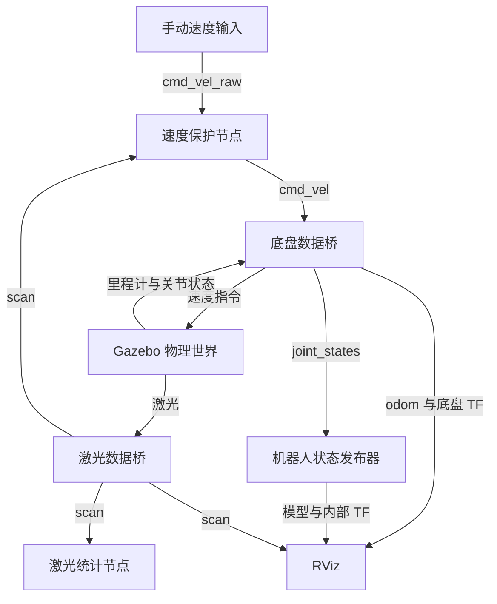

# ROS 2 第四周完整自学手册：Gazebo Harmonic、激光雷达与速度保护

> 接续第三周：你已经能写差速运动学、发布 odom/TF、显示 URDF，并让理想小车驶向目标点。  
> 本周环境：Ubuntu 24.04、Bash、ROS 2 Jazzy、Gazebo Harmonic、C++17；继续使用你的 Ubuntu 虚拟机和 VSCode。  
> 学习安排：7 天，约 25～30 小时；第 5 天代码较多，可以拆成两个半天。  
> 最终成果：一个带物理碰撞和 360° 激光的差速小车仿真工程；能通过 ROS 控制，在障碍物附近减速、停车，并录制、回放和排查故障。  
> 内容核对日期：2026-09-23。

这是第四周的完整教材，延续前面三周的形式。正文给出所有需要新增的文件、完整源码、编译命令、操作步骤、例题、练习答案与验收表。**完成本周不需要另找教程、下载第三方机器人模型，或从第三周复制未列出的代码。** 安装软件依赖需要联网；场景全部使用本文定义的简单几何体，没有 Fuel 模型下载依赖。末尾官方链接用于核对和扩展。

本周新建 `~/ros2_week4_ws`，包名为 `gazebo_robot_lab`。第三周工程保留；本周运行时结束第三周的仿真和控制节点，避免它们继续发布同名话题或 TF。

验证范围：文中的纯 C++ 测距分析、指令检查和速度决策程序已经实际编译，并通过 **33 项检查**；文件结构、XML/YAML、Python launch 和 shell 命令做了静态检查，相关接口对照官方 Jazzy/Harmonic 文档与源码核对。编写环境没有 ROS 2、Gazebo 和图形桌面，**没有在这里实际启动物理仿真或编译 ROS 节点**。本文给出的画面、话题和物理运动结果属于你在本机需要完成的验收，不是已经替你运行的结果。

## 目录

- [学习方式与本周结构](#start)
- [第 1 天：Gazebo、SDF 与物理小车](#day1)
- [第 2 天：ROS 与 Gazebo 桥接、仿真时间](#day2)
- [第 3 天：里程计、TF、URDF 与 RViz](#day3)
- [第 4 天：读懂 LaserScan，编写激光分析节点](#day4)
- [第 5 天：减速、遇障停车与超时保护](#day5)
- [第 6 天：一键启动、参数实验与控制系统边界](#day6)
- [第 7 天：录制回放、故障实验与综合验收](#day7)
- [本周自测题及答案](#exam)
- [排错手册](#troubleshooting)
- [文件索引、命令速查与第五周安排](#finish)
- [官方核对来源](#sources)

<a id="start"></a>

## 学习方式与本周结构

### 每天学什么、做什么、交什么

| 日期 | 重点知识 | 当天实践成果 | 建议用时 |
|---|---|---|---|
| 第 1 天 | world/model/link/joint、惯性、碰撞、系统插件 | 能独立打开的物理小车场景 | 210～240 分钟 |
| 第 2 天 | 两套通信系统、类型映射、方向、`/clock` | 六条数据桥和 ROS 速度控制 | 180～210 分钟 |
| 第 3 天 | TF 发布责任、模型一致性、轮式里程计 | RViz 同步显示机器人和激光 | 180～210 分钟 |
| 第 4 天 | 激光角度、距离、异常值、QoS | C++ 激光统计与前方距离输出 | 240 分钟 |
| 第 5 天 | 输入检查、超时、限幅、迟滞、状态机 | 激光速度保护节点及纯 C++ 测试 | 300～360 分钟 |
| 第 6 天 | launch 组织、参数、退出行为、控制器边界 | 一条命令启动全部系统 | 180～210 分钟 |
| 第 7 天 | 仿真时间录包、独立回放、系统验收 | bag、实验报告、完整工程提交 | 210～270 分钟 |

每天先花 10～15 分钟复述上一次实验的数据流。保存文件后再执行命令，看到预期结果后再继续下一小节。遇到报错，用文末排错表定位到具体一层。

本周内容都在本文中学习：概念看对应日的“知识”；第一次操作照着“实践”；不看答案先做“练习”；最后用“验收”判断是否过关。读代码时至少回答三件事：输入是什么、哪个条件改变输出、异常时发生什么。

### 为什么还沿用 Jazzy，而不是升级环境

Jazzy 与 Harmonic 是官方支持的配对。本周按这个组合写，继续使用已有 Ubuntu 24.04 环境。[S1] `gz sim` 是这里使用的 Gazebo 命令；网上出现的 `gazebo`、`gzserver`、`gazebo_ros_pkgs` 或 `libgazebo_ros_diff_drive.so` 常属于 Gazebo Classic 教程，不能直接套入本工程。

第三周的节点直接对理想轮速积分；本周把轮子放进物理仿真，由轮子关节状态计算里程计。你会开始看到接触、摩擦、传感器渲染和计算速度带来的影响。使用物理引擎不等于已经精确模拟真实电机、驱动器、编码器误差或真实激光噪声。

### 最终数据流



我们会先分别启动各部分，理解职责，再在第 6 天汇总为 launch。初期实验直接控制 `/cmd_vel`；第 5 天开始，普通指令统一发往 `/cmd_vel_raw`，保护节点成为 `/cmd_vel` 的唯一发布源。

| ROS 话题 | ROS 消息类型 | 用途 |
|---|---|---|
| `/clock` | `rosgraph_msgs/msg/Clock` | Gazebo 提供仿真时间 |
| `/cmd_vel_raw` | `geometry_msgs/msg/Twist` | 操作者希望机器人执行的速度 |
| `/cmd_vel` | `geometry_msgs/msg/Twist` | 保护节点允许下发的速度 |
| `/odom` | `nav_msgs/msg/Odometry` | 轮子运动估计出的平面位姿和速度 |
| `/joint_states` | `sensor_msgs/msg/JointState` | 两个驱动轮的关节状态 |
| `/tf`、`/tf_static` | `tf2_msgs/msg/TFMessage` | 动态、静态坐标变换 |
| `/robot_description` | `std_msgs/msg/String` | RViz 使用的 URDF 描述 |
| `/scan` | `sensor_msgs/msg/LaserScan` | 一周激光距离测量 |
| `/front_distance` | `std_msgs/msg/Float32` | 统计节点给出的前方 ±30° 最近距离 |
| `/guard_status` | `std_msgs/msg/String` | 保护节点状态和输出，便于学习与排查 |

`/front_distance` 和 `/guard_status` 是教学观察接口。前者没有时间戳与坐标信息，所以保护节点直接订阅完整 `/scan`，不会把一个可能已经过时的浮点数当成完整传感器输入。

### 终端与文件约定

| 终端 | 第 1～5 天用途 |
|---|---|
| BUILD | 保存文件后构建 |
| A | Gazebo |
| B | 底盘数据桥 |
| C | 激光数据桥 |
| D | RViz/机器人状态发布器，或临时观测工具 |
| E | 第 4 天统计节点、第 5 天保护节点 |
| F | 速度输入、echo、故障测试 |

并非每天都需要全部终端。第 6 天之后多数长期进程交给一个 launch，通常只保留 A、B、C 三个终端即可。

- 标明“文件”的代码块保存到给定路径；`bash` 块在终端执行。
- “完整替换”是覆盖该文件全部内容，不要把两个版本拼接。
- 构建终端只加载本周 `setup_build.bash`；运行终端加载 `setup_run.bash`。
- `Ctrl+C` 指按键，不是输入字符。一天结束后停止当天进程，再开始次日实验。
- 所有运行终端使用相同 `ROS_DOMAIN_ID` 与 `GZ_PARTITION`。前者用于 ROS DDS 分组，后者用于 Gazebo Transport 分组，两者互不替代。
- 本周只有一辆车；不要同时运行两份本工程的 world 或 launch。

### 本周模型的固定约定

| 项目 | 数值或名称 |
|---|---|
| 世界名、模型名 | `week4`、`week4_bot` |
| 驱动轮半径、轮距 | 0.05 m、0.30 m |
| 车体外观 | 长 0.24 m，宽 0.20 m，高 0.10 m |
| 驱动轮关节 | `left_wheel_joint`、`right_wheel_joint` |
| 平面底盘参考系 | `base_link`，原点在轮轴中心的地面投影 |
| 激光坐标系 | `laser_link`，相对底盘 `(0, 0, 0.20)` m，无旋转 |
| 扫描范围 | −π～π，共 361 个采样；距离 0.05～8.0 m |
| 雷达更新频率 | 10 Hz，按仿真时间计 |
| 里程计目标发布频率 | 50 Hz，按仿真时间计 |

第三周的示例传感器在车头；本周为了简化全向距离与车体尺寸的关系，把激光扫描原点放在底盘正上方。不要把第三周的 `sensor_link` 静态变换额外启动到本工程中。

<a id="day1"></a>

## 第 1 天：Gazebo、SDF 与物理小车

### 今天的目标与时间分配

今天结束时，你应能解释世界和机器人怎样描述、哪些部件参与碰撞，并独立启动本文场景。

| 时间 | 任务 |
|---|---|
| 35 分钟 | 理解 Gazebo 与 RViz、SDF 与 URDF 的职责 |
| 30～45 分钟 | 安装依赖、检查图形环境 |
| 90 分钟 | 创建包、阅读并保存完整世界文件 |
| 40 分钟 | 构建、启动、查看 Gazebo 话题 |
| 15～30 分钟 | 例题、练习与验收 |

### 1.1 先把四个概念分开

**Gazebo 是仿真器。** 它推进物理时间，计算关节运动与碰撞，并按模型生成传感器测量。

**RViz 是 ROS 数据可视化工具。** 它根据 ROS 话题与 TF 画图。仅仅在 RViz 添加 RobotModel，不会得到重力、轮子接触或激光测量。

**URDF 主要描述机器人结构。** 第三周已经用它定义连杆和关节。本周继续把 URDF 交给 `robot_state_publisher`，用于内部 TF 与 RViz 模型显示。

**SDF 可以描述整个仿真世界。** 包括地面、灯光、机器人、传感器、物理属性和 Gazebo 系统。本周将它直接交给 Gazebo。我们分别提供 SDF 和 URDF，方便你辨认物理描述与 ROS 显示描述；尺寸和关节名必须一致。

| SDF 元素 | 可以怎样理解 | 本周例子 |
|---|---|---|
| `world` | 整个物理实验场 | `week4` |
| `model` | 一组有关联的实体 | 小车、墙、箱子 |
| `link` | 一个刚体 | 底盘、左轮、右轮 |
| `joint` | 刚体之间的运动约束 | 轮子绕轴旋转、雷达固定在底盘 |
| `visual` | 渲染时看见的形状 | 蓝色车体、红色墙面 |
| `collision` | 物理接触使用的形状 | 车轮圆柱、地面箱体 |
| `inertial` | 质量、质心、转动惯量 | 车体质量 2 kg |
| `sensor` | 从仿真中产生测量 | `gpu_lidar` |
| `plugin` | 给模型或世界增加功能 | 物理系统、差速驱动、传感器系统 |

`visual` 和 `collision` 是不同用途。物体只有 visual 可能看得见却挡不住机器人；只有 collision 可能挡得住机器人却在画面中不可见。本周障碍物同时给出两者，并采用相同几何体，使激光渲染和物理接触描述一致。

### 1.2 惯性与轮子方向：理解到能检查即可

均匀长方体质量为 \(m\)，三个方向尺寸为 \(a,b,c\)，质心处惯量为：

\[
I_{xx}=\frac{m(b^2+c^2)}{12},\quad
I_{yy}=\frac{m(a^2+c^2)}{12},\quad
I_{zz}=\frac{m(a^2+b^2)}{12}.
\]

例如 `m=2 kg，a=0.24 m，b=0.20 m，c=0.10 m`，得到约 `0.008333、0.011267、0.016267 kg·m²`。零质量、全零惯量或极不合理的惯量都可能破坏仿真。

本车把底盘质心设置在 x=−0.03 m，表示后部较重的简化质量分布，让质心落在两个驱动轮与后支撑球构成的支撑区域内；惯量采用上述箱体量级的近似值。这是教学模型，不是精确机械参数辨识结果。

坐标仍然采用 x 向前、y 向左、z 向上。两个轮子都绕 `+y` 轴旋转。SDF 中圆柱的默认轴沿 z，所以把车轮几何体绕 x 转 90°，让圆柱轴沿 y；关节轴和可视几何朝向是不同设置，不能只改其中一个后凭画面猜符号。

后支撑球是一个低摩擦的固定球形接触近似，并没有真实万向脚轮的转向机构。它支撑车体，允许平面运动。

### 1.3 安装本周依赖

在 Ubuntu 打开一个新的 BUILD 终端。你已经完成前几周的 ROS 安装，因此 ROS 软件源应当可用。

```bash
source /opt/ros/jazzy/setup.bash
sudo apt update
sudo apt install ros-jazzy-ros-gz ros-jazzy-robot-state-publisher \
  ros-jazzy-rviz2 ros-jazzy-tf2-tools ros-jazzy-rosbag2 \
  ros-jazzy-rosbag2-storage-mcap python3-colcon-common-extensions \
  python3-rosdep build-essential cmake mesa-utils liburdfdom-tools
```

这里让 `ros-jazzy-ros-gz` 安装与 Jazzy 配对的 Gazebo 依赖。[S1] 不需要额外安装另一套非默认 Gazebo，也不用从源码编译仿真器。

检查命令：

```bash
source /opt/ros/jazzy/setup.bash
ros2 pkg prefix ros_gz_bridge
ros2 pkg prefix ros_gz_sim
gz sim --versions
glxinfo -B
```

前两项应返回安装路径；Harmonic 对应 Gazebo Sim 8.x；`glxinfo -B` 显示渲染器与 OpenGL 信息。不要把 Gazebo Transport、Msgs、Sim 各库不同的主版本号误认为安装混乱。

**虚拟机检查。** 确保虚拟机具有可用的 3D 图形加速；具体可分配的内存和 CPU 按宿主机余量调整。Ogre2 对图形能力有要求，出错时按以下顺序尝试，每次先关闭原进程：[S8]

1. 在 Ubuntu 桌面会话的终端运行，不要先在没有显示服务的 SSH 会话里测试 GUI。
2. 遇到 Qt/Wayland 窗口错误，给启动命令加 `QT_QPA_PLATFORM=xcb`。
3. 遇到虚拟显卡 OpenGL 问题，可以临时加 `LIBGL_ALWAYS_SOFTWARE=1`；软件渲染会更慢。
4. 具体命令在 1.7 给出。先不要改系统全局配置，也不要以“窗口打开”替代后面 `/scan` 有实际数据的检查。

### 1.4 建立工作空间与环境脚本

```bash
mkdir -p ~/ros2_week4_ws/src/gazebo_robot_lab/{worlds,urdf,config,rviz,launch,src,test,include/gazebo_robot_lab}
mkdir -p ~/ros2_week4_ws/notes ~/ros2_week4_ws/bags
cd ~/ros2_week4_ws
```

文件：`~/ros2_week4_ws/setup_build.bash`

```bash
source /opt/ros/jazzy/setup.bash
export ROS_DOMAIN_ID=42
unset ROS_LOCALHOST_ONLY ROS_STATIC_PEERS
export ROS_AUTOMATIC_DISCOVERY_RANGE=LOCALHOST
export GZ_PARTITION=ros2_week4_lab
```

文件：`~/ros2_week4_ws/setup_run.bash`

```bash
source ~/ros2_week4_ws/setup_build.bash
source ~/ros2_week4_ws/install/local_setup.bash
```

`GZ_PARTITION` 是本周选的 Gazebo 通信分组名，不是 ROS 参数。Gazebo、桥和 `gz topic` 所在终端都需要同一值。使用脚本加载环境可以减少“一个终端看得见，另一个看不见”的问题。

新终端中不要同时 source 前三周的工作空间。本周安装产物尚未生成前，先使用 `setup_build.bash`；第一次构建成功后才使用 `setup_run.bash`。

### 1.5 完整世界文件

文件：`~/ros2_week4_ws/src/gazebo_robot_lab/worlds/lab.sdf`

```xml
<?xml version="1.0"?>
<sdf version="1.9">
  <world name="week4">
    <gravity>0 0 -9.81</gravity>
    <physics name="physics" type="ignored">
      <max_step_size>0.001</max_step_size>
      <real_time_factor>1.0</real_time_factor>
    </physics>
    <plugin filename="gz-sim-physics-system" name="gz::sim::systems::Physics"/>
    <plugin filename="gz-sim-user-commands-system" name="gz::sim::systems::UserCommands"/>
    <plugin filename="gz-sim-scene-broadcaster-system" name="gz::sim::systems::SceneBroadcaster"/>
    <plugin filename="gz-sim-sensors-system" name="gz::sim::systems::Sensors">
      <render_engine>ogre2</render_engine>
    </plugin>
    <scene><ambient>0.6 0.6 0.6 1</ambient><background>0.8 0.85 0.9 1</background></scene>
    <light name="sun" type="directional">
      <pose>0 0 8 0 0 0</pose><cast_shadows>false</cast_shadows>
      <diffuse>0.8 0.8 0.8 1</diffuse><specular>0.2 0.2 0.2 1</specular>
      <direction>-0.5 0.1 -0.9</direction>
      <attenuation><range>1000</range><constant>0.9</constant>
        <linear>0.01</linear><quadratic>0.001</quadratic></attenuation>
    </light>
    <model name="ground">
      <static>true</static><pose>0 0 -0.05 0 0 0</pose>
      <link name="link">
        <collision name="ground_collision">
          <pose>0 0 0 0 0 0</pose><geometry><box><size>10 10 0.1</size></box></geometry>
        </collision>
        <visual name="ground_visual">
          <pose>0 0 0 0 0 0</pose><geometry><box><size>10 10 0.1</size></box></geometry>
          <material><ambient>0.75 0.75 0.75 1</ambient><diffuse>0.75 0.75 0.75 1</diffuse></material>
        </visual>
      </link>
    </model>
    <model name="front_wall">
      <static>true</static><pose>2 0 0.3 0 0 0</pose>
      <link name="link">
        <collision name="front_wall_collision">
          <pose>0 0 0 0 0 0</pose><geometry><box><size>0.2 2.0 0.6</size></box></geometry>
        </collision>
        <visual name="front_wall_visual">
          <pose>0 0 0 0 0 0</pose><geometry><box><size>0.2 2.0 0.6</size></box></geometry>
          <material><ambient>0.85 0.3 0.15 1</ambient><diffuse>0.85 0.3 0.15 1</diffuse></material>
        </visual>
      </link>
    </model>
    <model name="left_box">
      <static>true</static><pose>0 2 0.3 0 0 0</pose>
      <link name="link">
        <collision name="left_box_collision">
          <pose>0 0 0 0 0 0</pose><geometry><box><size>0.5 0.5 0.6</size></box></geometry>
        </collision>
        <visual name="left_box_visual">
          <pose>0 0 0 0 0 0</pose><geometry><box><size>0.5 0.5 0.6</size></box></geometry>
          <material><ambient>0.2 0.65 0.3 1</ambient><diffuse>0.2 0.65 0.3 1</diffuse></material>
        </visual>
      </link>
    </model>
    <model name="right_box">
      <static>true</static><pose>0 -2 0.3 0 0 0</pose>
      <link name="link">
        <collision name="right_box_collision">
          <pose>0 0 0 0 0 0</pose><geometry><box><size>0.5 0.5 0.6</size></box></geometry>
        </collision>
        <visual name="right_box_visual">
          <pose>0 0 0 0 0 0</pose><geometry><box><size>0.5 0.5 0.6</size></box></geometry>
          <material><ambient>0.2 0.65 0.3 1</ambient><diffuse>0.2 0.65 0.3 1</diffuse></material>
        </visual>
      </link>
    </model>
    <model name="back_box">
      <static>true</static><pose>-2 0 0.3 0 0 0</pose>
      <link name="link">
        <collision name="back_box_collision">
          <pose>0 0 0 0 0 0</pose><geometry><box><size>0.5 0.5 0.6</size></box></geometry>
        </collision>
        <visual name="back_box_visual">
          <pose>0 0 0 0 0 0</pose><geometry><box><size>0.5 0.5 0.6</size></box></geometry>
          <material><ambient>0.2 0.65 0.3 1</ambient><diffuse>0.2 0.65 0.3 1</diffuse></material>
        </visual>
      </link>
    </model>
    <model name="week4_bot" canonical_link="base_link">
      <pose>0 0 0.005 0 0 0</pose>
      <self_collide>false</self_collide>
      <link name="base_link">
        <inertial>
          <pose>-0.03 0 0.1 0 0 0</pose><mass>2.0</mass>
          <inertia><ixx>0.008333333</ixx><iyy>0.011266667</iyy><izz>0.016266667</izz>
            <ixy>0</ixy><ixz>0</ixz><iyz>0</iyz></inertia>
        </inertial>
        <collision name="body_collision">
          <pose>0 0 0.1 0 0 0</pose><geometry><box><size>0.24 0.20 0.10</size></box></geometry>
        </collision>
        <visual name="body_visual">
          <pose>0 0 0.1 0 0 0</pose><geometry><box><size>0.24 0.20 0.10</size></box></geometry>
          <material><ambient>0.1 0.35 0.9 1</ambient><diffuse>0.1 0.35 0.9 1</diffuse></material>
        </visual>
      </link>
      <link name="left_wheel">
        <pose>0 0.15 0.05 0 0 0</pose>
        <inertial>
          <pose>0 0 0 0 0 0</pose><mass>0.2</mass>
          <inertia><ixx>0.00014</ixx><iyy>0.00025</iyy><izz>0.00014</izz>
            <ixy>0</ixy><ixz>0</ixz><iyz>0</iyz></inertia>
        </inertial>
        <collision name="left_collision">
          <pose>0 0 0 1.57079632679 0 0</pose><geometry><cylinder><radius>0.05</radius><length>0.03</length></cylinder></geometry>
          <surface><friction><ode><mu>1.0</mu><mu2>1.0</mu2></ode></friction></surface>
        </collision>
        <visual name="left_visual">
          <pose>0 0 0 1.57079632679 0 0</pose><geometry><cylinder><radius>0.05</radius><length>0.03</length></cylinder></geometry>
          <material><ambient>0.12 0.12 0.12 1</ambient><diffuse>0.12 0.12 0.12 1</diffuse></material>
        </visual>
      </link>
      <joint name="left_wheel_joint" type="revolute">
        <parent>base_link</parent><child>left_wheel</child>
        <axis><xyz>0 1 0</xyz>
          <limit><lower>-1e16</lower><upper>1e16</upper><effort>5</effort><velocity>20</velocity></limit>
        </axis>
      </joint>
      <link name="right_wheel">
        <pose>0 -0.15 0.05 0 0 0</pose>
        <inertial>
          <pose>0 0 0 0 0 0</pose><mass>0.2</mass>
          <inertia><ixx>0.00014</ixx><iyy>0.00025</iyy><izz>0.00014</izz>
            <ixy>0</ixy><ixz>0</ixz><iyz>0</iyz></inertia>
        </inertial>
        <collision name="right_collision">
          <pose>0 0 0 1.57079632679 0 0</pose><geometry><cylinder><radius>0.05</radius><length>0.03</length></cylinder></geometry>
          <surface><friction><ode><mu>1.0</mu><mu2>1.0</mu2></ode></friction></surface>
        </collision>
        <visual name="right_visual">
          <pose>0 0 0 1.57079632679 0 0</pose><geometry><cylinder><radius>0.05</radius><length>0.03</length></cylinder></geometry>
          <material><ambient>0.12 0.12 0.12 1</ambient><diffuse>0.12 0.12 0.12 1</diffuse></material>
        </visual>
      </link>
      <joint name="right_wheel_joint" type="revolute">
        <parent>base_link</parent><child>right_wheel</child>
        <axis><xyz>0 1 0</xyz>
          <limit><lower>-1e16</lower><upper>1e16</upper><effort>5</effort><velocity>20</velocity></limit>
        </axis>
      </joint>
      <link name="caster_link">
        <pose>-0.09 0 0.025 0 0 0</pose>
        <inertial>
          <pose>0 0 0 0 0 0</pose><mass>0.05</mass>
          <inertia><ixx>1.25e-05</ixx><iyy>1.25e-05</iyy><izz>1.25e-05</izz>
            <ixy>0</ixy><ixz>0</ixz><iyz>0</iyz></inertia>
        </inertial>
        <collision name="caster_collision">
          <pose>0 0 0 0 0 0</pose><geometry><sphere><radius>0.025</radius></sphere></geometry>
          <surface><friction><ode><mu>0</mu><mu2>0</mu2></ode></friction></surface>
        </collision>
        <visual name="caster_visual">
          <pose>0 0 0 0 0 0</pose><geometry><sphere><radius>0.025</radius></sphere></geometry>
          <material><ambient>0.5 0.5 0.5 1</ambient><diffuse>0.5 0.5 0.5 1</diffuse></material>
        </visual>
      </link>
      <joint name="caster_joint" type="fixed"><parent>base_link</parent><child>caster_link</child></joint>
      <link name="laser_link">
        <pose>0 0 0.20 0 0 0</pose>
        <inertial>
          <pose>0 0 -0.03 0 0 0</pose><mass>0.1</mass>
          <inertia><ixx>2.9e-05</ixx><iyy>2.9e-05</iyy><izz>3.125e-05</izz>
            <ixy>0</ixy><ixz>0</ixz><iyz>0</iyz></inertia>
        </inertial>
        <collision name="laser_body_collision">
          <pose>0 0 -0.03 0 0 0</pose><geometry><cylinder><radius>0.025</radius><length>0.04</length></cylinder></geometry>
        </collision>
        <visual name="laser_body_visual">
          <pose>0 0 -0.03 0 0 0</pose><geometry><cylinder><radius>0.025</radius><length>0.04</length></cylinder></geometry>
          <material><ambient>0.2 0.9 0.6 1</ambient><diffuse>0.2 0.9 0.6 1</diffuse></material>
        </visual>
        <sensor name="lidar" type="gpu_lidar">
          <pose>0 0 0 0 0 0</pose>
          <topic>/week4/scan</topic>
          <update_rate>10</update_rate><always_on>true</always_on><visualize>false</visualize>
          <lidar>
            <scan>
              <horizontal><samples>361</samples><resolution>1</resolution>
                <min_angle>-3.141592653589793</min_angle><max_angle>3.141592653589793</max_angle>
              </horizontal>
              <vertical><samples>1</samples><resolution>1</resolution><min_angle>0</min_angle><max_angle>0</max_angle></vertical>
            </scan>
            <range><min>0.05</min><max>8.0</max><resolution>0.01</resolution></range>
          </lidar>
        </sensor>
      </link>
      <joint name="laser_joint" type="fixed"><parent>base_link</parent><child>laser_link</child></joint>
      <plugin filename="gz-sim-diff-drive-system" name="gz::sim::systems::DiffDrive">
        <left_joint>left_wheel_joint</left_joint><right_joint>right_wheel_joint</right_joint>
        <wheel_separation>0.30</wheel_separation><wheel_radius>0.05</wheel_radius>
        <topic>/week4/cmd_vel</topic><odom_topic>/week4/odom</odom_topic><tf_topic>/week4/tf</tf_topic>
        <frame_id>odom</frame_id><child_frame_id>base_link</child_frame_id>
        <odom_publish_frequency>50</odom_publish_frequency>
        <min_linear_velocity>-0.4</min_linear_velocity><max_linear_velocity>0.4</max_linear_velocity>
        <min_angular_velocity>-1.0</min_angular_velocity><max_angular_velocity>1.0</max_angular_velocity>
      </plugin>
      <plugin filename="gz-sim-joint-state-publisher-system" name="gz::sim::systems::JointStatePublisher">
        <topic>/week4/joint_states</topic><update_rate>50</update_rate>
        <joint_name>left_wheel_joint</joint_name><joint_name>right_wheel_joint</joint_name>
      </plugin>
    </model>
  </world>
</sdf>
```

文件虽然长，但按照 world → 静态环境 → 机器人连杆关节 → 传感器 → 控制插件阅读就可以。

重点核对下面几处：

- 地面的中心在 z=−0.05 m、厚 0.1 m，因此上表面是 z=0。
- 小车初始模型位置 z=0.005 m，让车轮和支撑球略高于地面，启动后在重力作用下接触地面。
- 车轮半径 0.05 m、轮心高度 0.05 m，与地面几何相容。
- 前方墙中心 x=2 m、厚 0.2 m，所以朝向机器人的墙面在 x=1.9 m。
- 雷达扫描平面在底盘上方 0.20 m；雷达外壳 visual 在扫描原点下方，避免把扫描原点放在自身可见外壳内部。
- `frame_id=odom` 与 `child_frame_id=base_link` 是显式设置，避免插件默认的模型前缀与 ROS 侧模型不一致。[S3]
- 里程计来自驱动轮关节位置的积分，不是直接读取世界中的真实位置。[S3]

世界级的四个系统分别负责物理、用户命令、场景显示数据和传感器。模型级的 `DiffDrive` 把线/角速度变为轮速，并发布轮式里程计；`JointStatePublisher` 发布关节状态。[S3][S4]

激光相关数值会在第 4 天详细解释。今天先保留原样。

### 1.6 构建资源包

文件：`~/ros2_week4_ws/src/gazebo_robot_lab/CMakeLists.txt`，第 1 天完整版本。

```cmake
cmake_minimum_required(VERSION 3.8)
project(gazebo_robot_lab)
find_package(ament_cmake REQUIRED)
install(DIRECTORY worlds urdf config rviz launch DESTINATION share/${PROJECT_NAME})
ament_package()
```

文件：`~/ros2_week4_ws/src/gazebo_robot_lab/package.xml`，第 1 天完整版本。

```xml
<?xml version="1.0"?>
<package format="3">
  <name>gazebo_robot_lab</name><version>0.1.0</version>
  <description>Week 4 Gazebo and laser learning project</description>
  <maintainer email="learner@example.com">learner</maintainer>
  <license>Apache-2.0</license>
  <buildtool_depend>ament_cmake</buildtool_depend>
  <exec_depend>ament_index_python</exec_depend>
  <exec_depend>launch</exec_depend>
  <exec_depend>launch_ros</exec_depend>
  <exec_depend>ros_gz_bridge</exec_depend>
  <exec_depend>ros_gz_sim</exec_depend>
  <exec_depend>robot_state_publisher</exec_depend>
  <exec_depend>rviz2</exec_depend>
  <export><build_type>ament_cmake</build_type></export>
</package>
```

今天的包只有资源，没有 C++ 可执行程序。`install(DIRECTORY ...)` 把世界、模型、配置、launch 安装到 ROS 包的共享目录；之后程序通过包名找资源，不依赖你当前在哪个目录。

BUILD 终端：

```bash
source ~/ros2_week4_ws/setup_build.bash
cd ~/ros2_week4_ws
rosdep install --from-paths src --ignore-src -r -y --rosdistro jazzy
colcon build --symlink-install --packages-select gazebo_robot_lab
```

若提示 rosdep 尚未初始化，先执行一次 `sudo rosdep init`，再执行 `rosdep update` 后重试。已经初始化就不重复 init。如果构建失败，先解决本包第一条错误，暂时不要进入 Gazebo 排错。

### 1.7 启动、观察、关闭

终端 A：

```bash
source ~/ros2_week4_ws/setup_run.bash
gz sim -r -v 3 ~/ros2_week4_ws/src/gazebo_robot_lab/worlds/lab.sdf
```

`-r` 表示启动后运行仿真，`-v 3` 指日志级别。预期看到地面、小车、前方墙和周围三个箱子。小车应静止，没有持续弹跳或穿透地面。

同一命令的两种图形兼容尝试，**逐个尝试，不要同时启动多份**：

```bash
QT_QPA_PLATFORM=xcb gz sim -r -v 3 ~/ros2_week4_ws/src/gazebo_robot_lab/worlds/lab.sdf
```

```bash
QT_QPA_PLATFORM=xcb LIBGL_ALWAYS_SOFTWARE=1 gz sim -r -v 3 ~/ros2_week4_ws/src/gazebo_robot_lab/worlds/lab.sdf
```

另开终端 C：

```bash
source ~/ros2_week4_ws/setup_run.bash
gz topic -l
gz topic -i -t /week4/odom
gz topic -i -t /week4/scan
gz topic -e -t /week4/odom
```

最后一个命令持续打印，用 `Ctrl+C` 停止观察，不影响 Gazebo。应看到 `/week4/odom`、`/week4/tf`、`/week4/joint_states`、`/week4/scan` 和时钟相关话题。

再检查激光确实有消息：

```bash
gz topic -e -t /week4/scan
```

会打印较长的消息，看到角度和 ranges 后即可 `Ctrl+C`。**话题名存在只说明通信端点存在，持续收到数据才说明传感器正在工作。** 还没有启动 ROS 桥时，`ros2 topic list` 中没有这些 ROS 话题是正常的。

结束今天实验时，在 A 用 `Ctrl+C` 关闭 Gazebo。第 2 天重新启动，得到同样的初始位置。

### 1.8 例题与练习

**例题：前方中央激光距离应该是多少？**

初始底盘 x≈0，激光在底盘正上方，前墙近侧 x=2−0.2/2=1.9 m。因此朝正前方的射线预期约为 1.9 m。实际值可能有很小的数值差异；这不是车体前沿到墙的距离，车体前沿还比激光原点靠前 0.12 m。

**练习 A：** 把墙的 visual 删除，保留 collision，会发生什么？

**答案：** 物理上仍可能撞到墙，但画面看不见它；GPU 激光由渲染几何生成，不能再假定扫描仍与碰撞一致。实验后恢复完整文件。

**练习 B：** 把轮距写成 0.15 m，但两个轮心实际仍相距 0.30 m，有什么问题？

**答案：** 差速换算和里程计使用了错误几何参数，特别是转弯角速度和角度会不一致。参数中的轮距是左右轮中心距离，不是单侧轮心到车体中心距离。

**练习 C：** 为什么没有提供电机 PID 参数？

**答案：** 本周使用 Gazebo 原生差速系统给关节速度目标，没有建模你原 C++ 项目中的电机惯性与轮速 PID。不能把“轮子按速度运动”解释成“真实驱动闭环已经调好”。

### 第 1 天验收

- [ ] 说清 Gazebo 与 RViz 的不同职责。
- [ ] 包能构建，Gazebo 场景不需要额外模型下载。
- [ ] 小车正确落地，前方有红色墙，轮子没有明显穿地。
- [ ] Gazebo 侧 odom 与 scan 均持续有数据。
- [ ] 能解释轮距、轮轴方向、雷达高度和前墙 1.9 m 的来源。

<a id="day2"></a>

## 第 2 天：ROS 与 Gazebo 桥接、仿真时间

### 今天的目标与时间分配

今天连接两套通信系统，建立稳定的话题映射，并通过 ROS 控制小车。

| 时间 | 任务 |
|---|---|
| 35 分钟 | 理解话题桥、方向和消息类型 |
| 45 分钟 | 保存配置、运行两个桥接进程 |
| 40 分钟 | 速度脉冲与停车实验 |
| 40～55 分钟 | `/clock`、暂停与时间尺度实验 |
| 20～35 分钟 | 练习、记录与验收 |

### 2.1 两个系统同名话题也不会自动相通

`gz topic` 观察 Gazebo Transport，`ros2 topic` 观察 ROS 通信图。名字相同不代表二者使用相同通信协议，也不意味着消息结构可以直接互换。

`ros_gz_bridge` 根据受支持的类型转换在两侧建立订阅和发布。每条映射至少回答：ROS 话题叫什么、Gazebo 话题叫什么、两边类型是什么、数据朝哪个方向走。[S2]

| ROS 话题 | Gazebo 话题 | 类型映射 | 方向 |
|---|---|---|---|
| `/clock` | `/world/week4/clock` | Clock ↔ `gz.msgs.Clock` | Gazebo → ROS |
| `/cmd_vel` | `/week4/cmd_vel` | Twist ↔ `gz.msgs.Twist` | ROS → Gazebo |
| `/odom` | `/week4/odom` | Odometry ↔ `gz.msgs.Odometry` | Gazebo → ROS |
| `/tf` | `/week4/tf` | TFMessage ↔ `gz.msgs.Pose_V` | Gazebo → ROS |
| `/joint_states` | `/week4/joint_states` | JointState ↔ `gz.msgs.Model` | Gazebo → ROS |
| `/scan` | `/week4/scan` | LaserScan ↔ `gz.msgs.LaserScan` | Gazebo → ROS |

完整 ROS 类型名在下面 YAML 中给出。Gazebo 侧关节消息用 `Model`、底盘 TF 用 `Pose_V`，不是根据 ROS 名字猜一个同名 Gazebo 类型。

### 2.2 创建两份桥接配置

文件：`~/ros2_week4_ws/src/gazebo_robot_lab/config/bridge.yaml`

```yaml
- ros_topic_name: /clock
  gz_topic_name: /world/week4/clock
  ros_type_name: rosgraph_msgs/msg/Clock
  gz_type_name: gz.msgs.Clock
  direction: GZ_TO_ROS
  lazy: false
  qos_profile: CLOCK
- ros_topic_name: /cmd_vel
  gz_topic_name: /week4/cmd_vel
  ros_type_name: geometry_msgs/msg/Twist
  gz_type_name: gz.msgs.Twist
  direction: ROS_TO_GZ
  lazy: false
- ros_topic_name: /odom
  gz_topic_name: /week4/odom
  ros_type_name: nav_msgs/msg/Odometry
  gz_type_name: gz.msgs.Odometry
  direction: GZ_TO_ROS
  lazy: false
- ros_topic_name: /tf
  gz_topic_name: /week4/tf
  ros_type_name: tf2_msgs/msg/TFMessage
  gz_type_name: gz.msgs.Pose_V
  direction: GZ_TO_ROS
  lazy: false
- ros_topic_name: /joint_states
  gz_topic_name: /week4/joint_states
  ros_type_name: sensor_msgs/msg/JointState
  gz_type_name: gz.msgs.Model
  direction: GZ_TO_ROS
  lazy: false
```

文件：`~/ros2_week4_ws/src/gazebo_robot_lab/config/laser_bridge.yaml`

```yaml
- ros_topic_name: /scan
  gz_topic_name: /week4/scan
  ros_type_name: sensor_msgs/msg/LaserScan
  gz_type_name: gz.msgs.LaserScan
  direction: GZ_TO_ROS
  qos_profile: SENSOR_DATA
  frame_id: laser_link
  lazy: false
```

配置解释：

- YAML 顶层是一个列表；每个 `-` 开始一条映射。
- `GZ_TO_ROS` 与 `ROS_TO_GZ` 指数据方向。这里只建立需要的单向桥。
- `/clock` 使用世界限定话题，避免依赖 Gazebo 是否同时发布全局 `/clock`；ROS 侧仍统一叫 `/clock`。[S2]
- `qos_profile: CLOCK` 选择时钟适用的 QoS；`SENSOR_DATA` 适合激光订阅链。
- `lazy: false` 让桥主动建立通信，方便初学时观测。
- 激光的 `frame_id: laser_link` 覆盖 ROS 消息头中的 frame 名称。这个设置只改标签，**不会变换坐标数据**；之所以合法，是因为 SDF 中实际扫描原点、方向与 URDF 中 `laser_link` 相同。

底盘与激光分成两个进程，是为了在第 5 天单独切断激光输入时仍保留发送零速度的通路。

重新构建资源：

```bash
source ~/ros2_week4_ws/setup_build.bash
cd ~/ros2_week4_ws
colcon build --symlink-install --packages-select gazebo_robot_lab
```

### 2.3 分别启动并检查

终端 A，重新启动初始场景：

```bash
source ~/ros2_week4_ws/setup_run.bash
gz sim -r -v 3 ~/ros2_week4_ws/src/gazebo_robot_lab/worlds/lab.sdf
```

终端 B，底盘桥：

```bash
source ~/ros2_week4_ws/setup_run.bash
ros2 run ros_gz_bridge parameter_bridge --ros-args \
  -r __node:=base_bridge \
  -p config_file:=$HOME/ros2_week4_ws/src/gazebo_robot_lab/config/bridge.yaml
```

终端 C，激光桥：

```bash
source ~/ros2_week4_ws/setup_run.bash
ros2 run ros_gz_bridge parameter_bridge --ros-args \
  -r __node:=laser_bridge \
  -p config_file:=$HOME/ros2_week4_ws/src/gazebo_robot_lab/config/laser_bridge.yaml
```

终端 D：

```bash
source ~/ros2_week4_ws/setup_run.bash
ros2 topic list -t
ros2 topic echo /clock --once
ros2 topic echo /odom --once
ros2 topic echo /scan --once --field header --qos-reliability best_effort
ros2 topic info /scan --verbose
```

预期 `/odom` 的 `header.frame_id` 是 `odom`，`child_frame_id` 是 `base_link`；`/scan` 的 `header.frame_id` 是 `laser_link`；时钟和传感器时间戳的秒数通常接近从启动开始的仿真秒数，而不是 Unix 时间。

激光话题若有发布者却收不到数据，先看 QoS。Best Effort 发布者不能满足要求 Reliable 的订阅者；观察工具显式使用 Best Effort，可以接受本工程的数据。[S7]

### 2.4 做一个有限次数的前进实验

**今天还没有速度保护节点。原生 Gazebo DiffDrive 会保持最近收到的速度；停止发布不等于停止运动。** 源码中没有本教程第 5 天那样的指令失效判断。[S3] 下面第一条发有限次速度，第二条主动发零。把两条按顺序执行，确认零速度已发出。

终端 D：

```bash
ros2 topic pub --rate 10 --times 10 /cmd_vel geometry_msgs/msg/Twist \
  '{linear: {x: 0.10}, angular: {z: 0.0}}'
ros2 topic pub --rate 10 --times 3 /cmd_vel geometry_msgs/msg/Twist \
  '{linear: {x: 0.0}, angular: {z: 0.0}}'
```

预期小车向前移动一小段再停下，`/odom` 的 x 增加。DDS 发现、新建发布者和命令间隔会引入额外保持时间，所以不要把这次位移当作精确的“0.10 m”测量。

再做轻微原地左转：

```bash
ros2 topic pub --rate 10 --times 10 /cmd_vel geometry_msgs/msg/Twist \
  '{linear: {x: 0.0}, angular: {z: 0.30}}'
ros2 topic pub --rate 10 --times 3 /cmd_vel geometry_msgs/msg/Twist \
  '{linear: {x: 0.0}, angular: {z: 0.0}}'
```

俯视应逆时针转动。用 `ros2 topic echo /joint_states --once` 查看轮子速度：正向原地转动通常左轮负、右轮正。名字数组顺序不固定，必须按 `name` 对应 `velocity`，不要假定第一个永远是左轮。

若误发持续速度，先结束所有非零速度发布，再执行：

```bash
ros2 topic pub --rate 10 --times 5 /cmd_vel geometry_msgs/msg/Twist \
  '{linear: {x: 0.0}, angular: {z: 0.0}}'
```

如果桥已经断开，ROS 零速度无法到达 Gazebo。此时暂停或关闭 A 中的 Gazebo；不要看到 ROS 终端打印“publishing”就认定底盘已收到。

### 2.5 三种时间，分别用在什么地方

| 时间 | 含义 | 本周使用位置 |
|---|---|---|
| 系统时间 | 电脑当前时间，可能受校时影响 | 日志、普通文件时间等 |
| 稳定时钟 `steady_clock` | 单调经过的现实时间，不随系统校时回拨 | 指令/激光接收超时、保护节点调度 |
| ROS 时间 | `use_sim_time=false` 时使用系统时间，设为 true 后使用 `/clock` | 仿真传感器、TF、RViz、录包时间 |

`use_sim_time` 是**每个节点自己的参数**。给 RViz 设了 true，不会自动改变其他节点。后面 launch 会给需要理解仿真时间的节点分别设置。[S6]

底盘桥和激光桥主要搬运消息，保留仿真消息中已有的时间戳；它们不需要把传感器时间改成自己的系统时间。本文不会启用将消息头强制换成墙上时间的桥接选项。

`Twist` 没有 Header，因此今天的命令行发布者按现实时间发送也可用于这套练习。第 5 天的保护节点明确以接收时刻判断命令是否过期，不假定 Twist 中藏着发送时间。

### 2.6 暂停实验：仿真时间不一定跟现实同步

先发零速度，确认车停下。终端 D 执行：

```bash
ros2 topic echo /clock
```

在 Gazebo 窗口按暂停按钮。仿真时钟停止推进，物理状态停止变化；恢复运行后继续推进。暂停时可能停止发新时钟消息，也可能看到相同时间，关键是时间数值不再增加。

如果想用终端控制暂停，先 `Ctrl+C` 结束 echo，再执行：

```bash
gz service -s /world/week4/control --reqtype gz.msgs.WorldControl \
  --reptype gz.msgs.Boolean --timeout 3000 --req 'pause: true'
```

恢复：

```bash
gz service -s /world/week4/control --reqtype gz.msgs.WorldControl \
  --reptype gz.msgs.Boolean --timeout 3000 --req 'pause: false'
```

这里单位为毫秒的 `--timeout` 是等待服务响应的超时，不是命令让世界暂停多久。

实时因子可以理解成：

\[
\text{RTF}=\frac{\text{经过的仿真时间}}{\text{经过的现实时间}}.
\]

虚拟机较慢时，例如 5 秒现实时间只推进 2 秒仿真时间，RTF≈0.4。配置为 10 Hz 仿真频率的激光，按现实时间观察可能只有约 4 Hz。不能仅凭 `ros2 topic hz` 显示低于 10 就认为配置失效。

本周保护节点会用现实稳定时钟做接收超时，所以暂停仿真足够久也会输出零速度。这是有意的实验策略，第 5 天会验证。

### 2.7 例题、练习与答案

**例题：** `/scan` 中时间戳是 12 秒，而 RViz 的 ROS 时间约为 17 亿秒，应该先查什么？

**解答：** 查 RViz 的 `use_sim_time` 和 `/clock` 桥。前者像仿真启动后的时间，后者像系统 Unix 时间，这通常是时间源不一致。先统一时间，不能用扩大 TF 缓存来掩盖问题。

**练习 A：** `/clock` 为什么不设双向桥？

**答案：** 实时仿真由 Gazebo 提供唯一时钟源。将 ROS 的时钟反向再传回 Gazebo，可能引入额外发布者或反馈关系。单向桥清楚表达时钟权属。

**练习 B：** Gazebo 有 `/week4/scan`，ROS 没有 `/scan`。给出排查顺序。

**答案：** 先确认 C 中激光桥进程存活，再检查 YAML 路径、方向和类型，核对 `GZ_PARTITION` 与 `ROS_DOMAIN_ID`，看桥的报错，然后看 QoS。无需先修改激光角度或惯性。

**练习 C：** 一条消息把 frame 标签改成 `base_link`，就完成了从激光到机器人底盘的变换吗？

**答案：** 没有。改标签不改变点坐标。本周激光原点比底盘高 0.20 m，仍需要 `base_link → laser_link` 的 TF。标签必须如实描述数据表达在哪个坐标系。

### 第 2 天验收

- [ ] 能用 Gazebo 和 ROS 两套命令检查同一条数据链。
- [ ] 六条桥接映射方向和消息类型正确。
- [ ] 有限次数前进、转弯及主动零速度停车都完成。
- [ ] 知道 Gazebo DiffDrive 不会因为命令行退出而自动停车。
- [ ] 能解释 `use_sim_time`、暂停、RTF 与实际观测频率。

<a id="day3"></a>

## 第 3 天：里程计、TF、URDF 与 RViz

### 今天的目标与时间分配

今天把上一周的 TF/URDF 知识接入真实的仿真数据源，检查模型、时间与坐标是否一致。

| 时间 | 任务 |
|---|---|
| 30 分钟 | 划分 TF 发布责任、理解轮式里程计 |
| 55 分钟 | 保存 URDF、RViz 配置与显示 launch |
| 50 分钟 | 运行模型、激光显示与坐标查询 |
| 25～40 分钟 | 短程运动与一致性检查 |
| 20～35 分钟 | 练习与验收 |

### 3.1 同一条 TF 边只能有一个发布责任方

本周 TF 关系如下：

| 父坐标系 | 子坐标系 | 变换来源 | 类型 |
|---|---|---|---|
| `odom` | `base_link` | Gazebo DiffDrive，经底盘桥转入 ROS | 动态 |
| `base_link` | `left_wheel` | robot_state_publisher + 左轮 JointState | 动态 |
| `base_link` | `right_wheel` | robot_state_publisher + 右轮 JointState | 动态 |
| `base_link` | `laser_link` | robot_state_publisher + URDF 固定关节 | 静态 |
| `base_link` | `caster_link` | robot_state_publisher + URDF 固定关节 | 静态 |

`/tf` 上出现两个发布者可以是正常的，因为底盘桥与 `robot_state_publisher` 负责不同的边。需要避免的是两者或旧节点重复发布同一条 `odom → base_link`。

本周不用第三周的 `diff_drive_node`，也不额外启动 `joint_state_publisher` 生成假轮角。轮角来自 Gazebo 的实际关节状态。

没有 `map` frame 是正常的。我们还没有建立地图或全局定位系统；RViz 的 Fixed Frame 应为 `odom`。Gazebo 内部 `world` 也不会因为存在一个世界就自动变成 ROS TF 中的坐标系。

### 3.2 轮式里程计仍然是一种估计

Gazebo 的差速系统读取左右轮关节位置，使用轮半径和轮距更新平面里程计。[S3] 它与第三周的差速公式相通，但轮子现在处于物理世界中。

- 推车、碰撞、车轮滑动可能使世界中的真实运动与轮式里程计不一致。
- 两个轮子转了，不代表机器人在地面上移动了对应距离。
- 我们桥接的是 `gz.msgs.Odometry`，没有在这里标定协方差。消息中的零协方差不能被解释成“测量没有不确定性”。
- 里程计只表达平面 x、y、yaw。Gazebo 中很小的竖直沉降或俯仰不在该平面 TF 中完整表现。

这周先确认符号、尺度、时间与连接正确。第五周进入建图后，仍然需要轮式里程计和激光信息配合；有里程计不等于已经有全局定位。

### 3.3 完整 URDF

文件：`~/ros2_week4_ws/src/gazebo_robot_lab/urdf/robot.urdf`

```xml
<?xml version="1.0"?>
<robot name="week4_bot">
  <material name="blue"><color rgba="0.1 0.35 0.9 1"/></material>
  <material name="dark"><color rgba="0.12 0.12 0.12 1"/></material>
  <material name="green"><color rgba="0.2 0.9 0.6 1"/></material>
  <material name="orange"><color rgba="1 0.5 0.0 1"/></material>
  <link name="base_link">
    <visual><origin xyz="0 0 0.1"/><geometry><box size="0.24 0.20 0.10"/></geometry><material name="blue"/></visual>
  </link>
  <link name="left_wheel">
    <visual><origin rpy="1.57079632679 0 0"/>
      <geometry><cylinder radius="0.05" length="0.03"/></geometry><material name="dark"/>
    </visual>
    <visual><geometry><box size="0.09 0.031 0.008"/></geometry><material name="orange"/></visual>
  </link>
  <joint name="left_wheel_joint" type="continuous">
    <parent link="base_link"/><child link="left_wheel"/>
    <origin xyz="0 0.15 0.05"/><axis xyz="0 1 0"/>
    <limit effort="5" velocity="20"/>
  </joint>
  <link name="right_wheel">
    <visual><origin rpy="1.57079632679 0 0"/>
      <geometry><cylinder radius="0.05" length="0.03"/></geometry><material name="dark"/>
    </visual>
    <visual><geometry><box size="0.09 0.031 0.008"/></geometry><material name="orange"/></visual>
  </link>
  <joint name="right_wheel_joint" type="continuous">
    <parent link="base_link"/><child link="right_wheel"/>
    <origin xyz="0 -0.15 0.05"/><axis xyz="0 1 0"/>
    <limit effort="5" velocity="20"/>
  </joint>
  <link name="caster_link">
    <visual><geometry><sphere radius="0.025"/></geometry><material name="dark"/></visual>
  </link>
  <joint name="caster_joint" type="fixed">
    <parent link="base_link"/><child link="caster_link"/><origin xyz="-0.09 0 0.025"/>
  </joint>
  <link name="laser_link">
    <visual><origin xyz="0 0 -0.03"/><geometry><cylinder radius="0.025" length="0.04"/></geometry><material name="green"/></visual>
  </link>
  <joint name="laser_joint" type="fixed">
    <parent link="base_link"/><child link="laser_link"/><origin xyz="0 0 0.20"/>
  </joint>
</robot>
```

这个 URDF 只用于 ROS 侧模型和 TF。物理碰撞、质量与激光仿真已经在 SDF 中定义，因此这里保留显示所需的结构。它不是拿去单独生成物理模型的完整替代文件。

橙色横条帮助观察轮子旋转。它只是显示标记，不参与本周的物理接触。URDF 与 SDF 中的关节名、轮心位置、轮轴、雷达原点需要保持一致。

### 3.4 完整 RViz 配置

文件：`~/ros2_week4_ws/src/gazebo_robot_lab/rviz/robot.rviz`

```yaml
Panels:
  - Class: rviz_common/Displays
    Name: Displays
Visualization Manager:
  Class: ""
  Global Options:
    Background Color: 48; 48; 48
    Fixed Frame: odom
    Frame Rate: 30
  Displays:
    - Class: rviz_default_plugins/Grid
      Name: Grid
      Value: true
      Cell Size: 0.5
      Plane Cell Count: 30
    - Class: rviz_default_plugins/RobotModel
      Name: RobotModel
      Value: true
      Visual Enabled: true
      Collision Enabled: false
      Description Source: Topic
      Description Topic:
        Value: /robot_description
        Reliability Policy: Reliable
        Durability Policy: Transient Local
        History Policy: Keep Last
        Depth: 1
    - Class: rviz_default_plugins/TF
      Name: TF
      Value: true
      Show Names: true
      Show Axes: true
      Show Arrows: false
      Marker Scale: 0.2
    - Class: rviz_default_plugins/LaserScan
      Name: LaserScan
      Value: true
      Topic:
        Value: /scan
        Reliability Policy: Best Effort
        Durability Policy: Volatile
        History Policy: Keep Last
        Depth: 5
      Style: Points
      Size (Pixels): 4
      Decay Time: 0
      Color Transformer: FlatColor
      Color: 255; 255; 0
  Views:
    Current:
      Class: rviz_default_plugins/Orbit
      Distance: 6
      Focal Point: {X: 0.7, Y: 0, Z: 0.1}
      Pitch: 0.8
      Yaw: 0.8
Window Geometry:
  Width: 1100
  Height: 800
```

这里显示 Grid、RobotModel、TF 和 LaserScan。RobotModel 从 `/robot_description` 取模型，使用 Transient Local 接收已发布的描述；LaserScan 使用 Best Effort 接收传感器数据。不同话题的 QoS 可以不同。

RViz 只显示有限范围内的命中点；没有回波的方向不一定画出一条 8 m 长射线。雷达采样 361 个方向，不意味着画面必须出现 361 个可见点。

### 3.5 完整显示 launch

文件：`~/ros2_week4_ws/src/gazebo_robot_lab/launch/view.launch.py`

```python
from pathlib import Path
from ament_index_python.packages import get_package_share_directory
from launch import LaunchDescription
from launch_ros.actions import Node
from launch_ros.parameter_descriptions import ParameterValue


def generate_launch_description():
    share = Path(get_package_share_directory('gazebo_robot_lab'))
    description = (share / 'urdf' / 'robot.urdf').read_text(encoding='utf-8')
    return LaunchDescription([
        Node(
            package='robot_state_publisher', executable='robot_state_publisher',
            name='robot_state_publisher', output='screen',
            parameters=[{'use_sim_time': True, 'publish_frequency': 50.0,
                         'robot_description': ParameterValue(description, value_type=str)}]),
        Node(
            package='rviz2', executable='rviz2', name='rviz2', output='screen',
            arguments=['-d', str(share / 'rviz' / 'robot.rviz')],
            parameters=[{'use_sim_time': True}]),
    ])
```

`ParameterValue(..., value_type=str)` 明确说明 URDF 内容是一段字符串，避免把 XML 当作另一种参数值解析。`robot_state_publisher` 负责内部变换，固定关节进入 `/tf_static`，活动关节根据 `/joint_states` 更新。[S9]

BUILD 终端重新构建：

```bash
source ~/ros2_week4_ws/setup_build.bash
cd ~/ros2_week4_ws
colcon build --symlink-install --packages-select gazebo_robot_lab
check_urdf src/gazebo_robot_lab/urdf/robot.urdf
```

`check_urdf` 应能列出连杆树，没有未知父子连杆错误。

### 3.6 运行与四项检查

按第 2 天 2.3 的命令启动 A：Gazebo、B：底盘桥、C：激光桥。新终端 D：

```bash
source ~/ros2_week4_ws/setup_run.bash
ros2 launch gazebo_robot_lab view.launch.py
```

新终端 E：

```bash
source ~/ros2_week4_ws/setup_run.bash
ros2 param get /robot_state_publisher use_sim_time
ros2 param get /rviz2 use_sim_time
ros2 run tf2_ros tf2_echo base_link laser_link --ros-args -p use_sim_time:=true
```

两个参数应为 true。最后一条持续显示底盘到雷达的变换，预期平移 `(0, 0, 0.20)`，旋转为零。`Ctrl+C` 后再查询：

```bash
ros2 run tf2_ros tf2_echo odom base_link --ros-args -p use_sim_time:=true
```

初始 x、y、yaw 应接近 0。让底盘按第 2 天的短程命令移动，再主动发零；此变换会随轮式里程计改变。

依次完成下面四项：

1. **模型正确。** 机器人车体、轮子和雷达相对位置合理，RobotModel 状态无持续错误。
2. **时间正确。** use_sim_time 为 true，TF 与激光不持续报时间外推错误。
3. **激光正确。** 黄色点落在墙面和箱子表面附近，初始正前方约 1.9 m。
4. **移动一致。** 在 `odom` 为固定系时，小车前进，雷达点所表示的静止墙大致留在相同位置，而不是跟车一起平移。

如果初期出现一两条等待 TF 的提示，等各进程完成启动再观察；如果持续出现，按文末排错表核查。

### 3.7 用一个点验证坐标链

在初始朝向下，雷达中央射线命中墙面的点在 `laser_link` 中约为 `(1.9, 0, 0)`。通过固定变换变到底盘系：

\[
p_{base}=(1.9,0,0.20).
\]

若底盘里程计为 `(x=0.30, y=0, yaw=0)`，同一面墙的中央距离约变成 1.60 m，则：

\[
p_{odom}=(0.30,0,0)+(1.60,0,0.20)=(1.90,0,0.20).
\]

雷达相对车近了，墙在 odom 中仍近似不动。这正是 RViz 用 TF 解释传感器数据的意义。存在滑动或误差时不会完全一致，因此要把它作为一致性检查，不当作外部精密测量。

### 3.8 练习与答案

**练习 A：** 车体显示正常，但轮子没有旋转，先查什么？

**答案：** 查看 `/joint_states` 是否持续更新、`name` 是否与 URDF 关节名完全一致、`position` 是否变化，再检查 TF。不要先改 `/odom` 的值；底盘位姿和轮子内部旋转来自两条不同数据链。

**练习 B：** 激光点比障碍物整体高或低 0.1 m，可能是什么原因？

**答案：** SDF 扫描原点与 URDF 的 `laser_joint` 高度不一致，或 frame 标签写错。不能只在 RViz 修改颜色或大小来修正坐标问题。

**练习 C：** 同一时刻启动第三周的仿真节点，会造成什么？

**答案：** 它可能重复发布 `/odom`、`/joint_states` 和同一条底盘 TF，导致数据交错。应停止旧进程，明确每条 TF 边和状态话题的来源。

**练习 D：** 机器人静止不动但轮子一直转，odom 还在增加，能据此证明 Gazebo 图形卡住了吗？

**答案：** 不能。可能是轮子被障碍物挡住或打滑，odom 仍按轮转角积分。需要结合 Gazebo 接触状态、世界位置和传感器变化判断。

### 第 3 天验收

- [ ] 能逐条指出 TF 边的发布方。
- [ ] RViz 的固定坐标系为 odom，模型和激光状态正常。
- [ ] laser_link 相对底盘的位置是 `(0,0,0.20)`。
- [ ] 前进后静止墙在 odom 中位置大致不变。
- [ ] 不把轮式里程计、世界真实位姿和零协方差混为一谈。

<a id="day4"></a>

## 第 4 天：读懂 LaserScan，编写激光分析节点

### 今天的目标与时间分配

今天不只“看到雷达”，而是能够解释一个 ranges 元素对应哪个方向、哪些数值能用，并用 C++ 做稳定的统计。

| 时间 | 任务 |
|---|---|
| 45 分钟 | LaserScan 字段、角度和时间 |
| 35 分钟 | 极坐标例题、异常值处理策略 |
| 90 分钟 | 保存数学核心、节点和构建文件 |
| 40 分钟 | 运行、对照初始世界测距 |
| 30 分钟 | 练习与验收 |

### 4.1 LaserScan 的字段逐项解释

| 字段 | 含义 | 本周应怎样读 |
|---|---|---|
| `header.stamp` | 扫描首条射线的采集时间约定 | 仿真 ROS 时间；检查是否持续推进 |
| `header.frame_id` | 距离与角度所在坐标系 | `laser_link` |
| `angle_min` | 第 0 条射线的角度 | −π rad |
| `angle_max` | 最后一条射线的角度 | +π rad |
| `angle_increment` | 相邻射线角度差 | 约 π/180 rad，即 1° |
| `time_increment` | 相邻射线采集时间差 | 此 Gazebo 桥接消息中为 0 |
| `scan_time` | 相邻扫描间隔字段 | 此桥接转换中为 0，不能用它求频率 |
| `range_min`、`range_max` | 可用距离范围 | 0.05～8.0 m |
| `ranges` | 每条射线的距离数组，单位 m | 与角度索引一一对应 |
| `intensities` | 回波强度 | 可能为空；本周不使用 |

角度绕 +z 轴按逆时针为正，0 rad 指向 +x。[S5] 本周朝前是 0°，左是 +90°，右是 −90°，后方是 ±180°。

**时间字段的版本细节。** Jazzy 的 `ros_gz_bridge` 在这项 Gazebo LaserScan 转换中，把 `time_increment` 和 `scan_time` 设为 0。[S5] 这不代表雷达停了，也不意味着更新频率无限大。要结合相邻消息时间戳、SDF 的 `update_rate` 和现实接收频率判断。不要照抄 `frequency = 1 / scan_time`。

### 4.2 从数组索引得到方向与坐标

第 i 条射线角度为：

\[
\theta_i=\text{angle_min}+i\cdot\text{angle_increment}.
\]

如果该距离 \(r_i\) 有效，激光坐标系中的点为：

\[
x_i=r_i\cos\theta_i,\qquad y_i=r_i\sin\theta_i,\qquad z_i=0.
\]

本周 361 条射线包含 −180° 和 +180° 两端，端点方向重合，这是有意的采样设置。**第 180 项朝前，不是第 0 项朝前。** 处理其他雷达时必须按消息元数据计算，不能把 180 写死在通用程序里。

**例题 1：** i=210，距离 2 m。角度为 −180°+210°=30°，所以点坐标约 `(1.732, 1.0, 0)` m，在前方偏左。

**例题 2：** 某扫描 `angle_min=-90°`、角度间隔 0.5°，正前方索引是多少？

\[
i=(0-(-90))/0.5=180.
\]

索引相同只是巧合，不能据此认为所有扫描都以 180 为中心。还要检查结果是否在数组长度范围内、0° 是否恰好落在采样点上。

### 4.3 有效、无回波、无效：三种状态

本文采用的规则针对当前干净、无遮挡的仿真配置：

| 数值 | 本文处理 | 理由 |
|---|---|---|
| 有限值且在 `[range_min, range_max]` 内 | 有效命中，参与最小值统计 | 它表达一个可用距离 |
| `+inf` | 记作量程内无回波，不参与有限最小值 | 本仿真中允许当作该方向没有量程内命中 |
| `NaN` | 无效 | 不能据此判断有无障碍物 |
| `-inf` | 无效并禁止运动 | 不能当作远处没有物体；也可能表达过近等异常语义 |
| 小于最小量程、超过最大量程的有限数 | 无效 | 与消息声明的可用测量范围不符 |
| 空数组、角度不连续、元数据不合理 | 整帧不合格 | 不知道这些距离覆盖什么方向 |

`+inf` 的使用前提是传感器确实按“无回波”语义输出它。换真实雷达或别的驱动时必须重新确认协议；不能把任何设备的所有异常数都改成最大距离。

初始化最小值时用正无穷，不能用 0。距离通常大于 0，以 0 开始取 min 会得到永远为 0 的错误结果。

我们同时计算：

- `min_front`：前方 ±30° 范围内的最近有效距离，用于观察。
- `min_all`：整个 360° 的最近有效距离，第 5 天用于保守的全向停车决策。

前方小扇区不能覆盖后退、转弯或车身侧面，因此不能直接把 `min_front > 阈值` 等同于“整车周围安全”。本周不实现复杂的扫掠轮廓碰撞预测，改用全向最近距离并留出车体余量。

### 4.4 完整纯 C++ 测距分析

文件：`~/ros2_week4_ws/src/gazebo_robot_lab/include/gazebo_robot_lab/scan_math.hpp`

```cpp
#pragma once
#include <algorithm>
#include <cmath>
#include <cstddef>
#include <limits>
#include <vector>

namespace gazebo_robot_lab {
constexpr double pi = 3.14159265358979323846;

struct ScanSpec {
  double angle_min;
  double angle_max;
  double angle_increment;
  double range_min;
  double range_max;
};

struct ScanStats {
  bool metadata_ok{false};
  bool full_circle{false};
  bool complete{false};
  std::size_t total{0};
  std::size_t finite_hits{0};
  std::size_t no_return{0};
  std::size_t invalid{0};
  std::size_t front_samples{0};
  double range_max{0.0};
  double min_all{std::numeric_limits<double>::infinity()};
  double min_front{std::numeric_limits<double>::infinity()};
};

inline ScanStats summarize_scan(const ScanSpec &s,
                               const std::vector<float> &ranges) {
  ScanStats out;
  out.total = ranges.size();
  const bool finite_metadata =
      std::isfinite(s.angle_min) && std::isfinite(s.angle_max) &&
      std::isfinite(s.angle_increment) && std::isfinite(s.range_min) &&
      std::isfinite(s.range_max);
  if (!finite_metadata || ranges.size() < 2 || ranges.size() > 10000 ||
      s.angle_increment <= 0.0 || s.angle_increment > 0.1 ||
      s.angle_min >= s.angle_max || s.range_min <= 0.0 ||
      s.range_max <= s.range_min) {
    return out;
  }
  const double last_angle = s.angle_min +
      static_cast<double>(ranges.size() - 1) * s.angle_increment;
  if (std::abs(last_angle - s.angle_max) > 0.002) {
    return out;
  }
  out.metadata_ok = true;
  out.range_max = s.range_max;
  const double span = s.angle_max - s.angle_min;
  out.full_circle = span >= 2.0 * pi - 0.05 && span <= 2.0 * pi + 0.05;

  for (std::size_t i = 0; i < ranges.size(); ++i) {
    const double angle = s.angle_min + static_cast<double>(i) * s.angle_increment;
    const double wrapped = std::atan2(std::sin(angle), std::cos(angle));
    const bool front = std::abs(wrapped) <= pi / 6.0 + 1e-6;
    if (front) {
      ++out.front_samples;
    }
    const double r = ranges[i];
    // In this Gazebo exercise +inf means no return within range_max.
    if (std::isinf(r) && r > 0.0) {
      ++out.no_return;
      continue;
    }
    if (!std::isfinite(r) || r < s.range_min || r > s.range_max) {
      ++out.invalid;
      continue;
    }
    ++out.finite_hits;
    out.min_all = std::min(out.min_all, r);
    if (front) {
      out.min_front = std::min(out.min_front, r);
    }
  }
  // Strict validity is intentional for a clean, 360-degree simulated lidar.
  out.complete = out.full_circle && out.invalid == 0 && out.front_samples > 0;
  return out;
}
}  // namespace gazebo_robot_lab
```

代码分为三个阶段：检查扫描元数据；逐束计算方向并分类数值；汇总为 `ScanStats`。

重点阅读：

1. 用数组长度推算最后一束角度，与 `angle_max` 比较，允许很小的浮点误差。
2. `atan2(sin(angle),cos(angle))` 把角度归一化，前方扇区按真实角度选取。
3. 元数据允许不同的角度起点，但完整保护要求覆盖近似一周。
4. `complete` 要求全向覆盖且没有无效束。这是为了让本周干净仿真的异常容易暴露，不是所有真实雷达都适用的容错标准。
5. `finite_hits + no_return + invalid` 应等于 total，前提是元数据通过检查。

此文件不包含 ROS 头文件，所以可用普通 C++ 编译器测试。把可独立验证的算法与 ROS 消息适配分开，可以减少调试时必须同时启动的组件。

### 4.5 完整 ROS 统计节点

文件：`~/ros2_week4_ws/src/gazebo_robot_lab/src/scan_monitor.cpp`

```cpp
#include "gazebo_robot_lab/scan_math.hpp"
#include <rclcpp/rclcpp.hpp>
#include <sensor_msgs/msg/laser_scan.hpp>
#include <std_msgs/msg/float32.hpp>
#include <limits>
#include <memory>

class ScanMonitor : public rclcpp::Node {
 public:
  ScanMonitor() : Node("scan_monitor") {
    distance_pub_ = create_publisher<std_msgs::msg::Float32>("/front_distance", 10);
    scan_sub_ = create_subscription<sensor_msgs::msg::LaserScan>(
      "/scan", rclcpp::SensorDataQoS(),
      [this](sensor_msgs::msg::LaserScan::ConstSharedPtr msg) {
        gazebo_robot_lab::ScanSpec spec{msg->angle_min, msg->angle_max,
          msg->angle_increment, msg->range_min, msg->range_max};
        const auto s = gazebo_robot_lab::summarize_scan(spec, msg->ranges);
        const bool usable = s.complete && msg->header.frame_id == "laser_link";
        std_msgs::msg::Float32 distance;
        distance.data = usable ? static_cast<float>(s.min_front) :
          std::numeric_limits<float>::quiet_NaN();
        distance_pub_->publish(distance);
        RCLCPP_INFO_THROTTLE(get_logger(), log_clock_, 1000,
          "frame=%s beams=%zu front_beams=%zu hits=%zu no_return=%zu invalid=%zu "
          "complete=%s front=%.3f all=%.3f stamp=%d.%09u",
          msg->header.frame_id.c_str(), s.total, s.front_samples,
          s.finite_hits, s.no_return, s.invalid, usable ? "true" : "false",
          s.min_front, s.min_all, msg->header.stamp.sec, msg->header.stamp.nanosec);
      });
  }
 private:
  rclcpp::Clock log_clock_{RCL_STEADY_TIME};
  rclcpp::Publisher<std_msgs::msg::Float32>::SharedPtr distance_pub_;
  rclcpp::Subscription<sensor_msgs::msg::LaserScan>::SharedPtr scan_sub_;
};

int main(int argc, char **argv) {
  rclcpp::init(argc, argv);
  rclcpp::spin(std::make_shared<ScanMonitor>());
  rclcpp::shutdown();
  return 0;
}
```

节点订阅 `/scan`，把 ROS 消息的元数据传给纯 C++ 函数，再发布 `/front_distance`。

- 一帧合格且 frame 正确：输出前方最近有限距离；前方都无回波时输出 `+inf`。
- 一帧不合格：输出 NaN。
- 完全收不到新扫描：不发布新统计值。CLI 以前显示过一个数字并不表示它仍然新鲜。
- 日志每现实 1 秒最多一次，避免每帧刷屏。这里用单调时钟做日志节流，仿真暂停不妨碍观察调试消息。

### 4.6 更新完整构建文件

完整替换 `~/ros2_week4_ws/src/gazebo_robot_lab/CMakeLists.txt`：

```cmake
cmake_minimum_required(VERSION 3.8)
project(gazebo_robot_lab)
find_package(ament_cmake REQUIRED)
find_package(rclcpp REQUIRED)
find_package(rcl_interfaces REQUIRED)
find_package(geometry_msgs REQUIRED)
find_package(sensor_msgs REQUIRED)
find_package(std_msgs REQUIRED)
set(CMAKE_CXX_STANDARD 17)
set(CMAKE_CXX_STANDARD_REQUIRED ON)
set(CMAKE_CXX_EXTENSIONS OFF)
function(configure_program target)
  target_include_directories(${target} PRIVATE ${CMAKE_CURRENT_SOURCE_DIR}/include)
  target_compile_options(${target} PRIVATE -Wall -Wextra -Wpedantic)
  install(TARGETS ${target} DESTINATION lib/${PROJECT_NAME})
endfunction()
add_executable(scan_monitor src/scan_monitor.cpp)
configure_program(scan_monitor)
ament_target_dependencies(scan_monitor rclcpp rcl_interfaces geometry_msgs sensor_msgs std_msgs)
install(DIRECTORY worlds urdf config rviz launch DESTINATION share/${PROJECT_NAME})
ament_package()
```

完整替换 `~/ros2_week4_ws/src/gazebo_robot_lab/package.xml`：

```xml
<?xml version="1.0"?>
<package format="3">
  <name>gazebo_robot_lab</name><version>0.1.0</version>
  <description>Week 4 Gazebo and laser learning project</description>
  <maintainer email="learner@example.com">learner</maintainer>
  <license>Apache-2.0</license>
  <buildtool_depend>ament_cmake</buildtool_depend>
  <depend>rclcpp</depend>
  <depend>rcl_interfaces</depend>
  <depend>geometry_msgs</depend>
  <depend>sensor_msgs</depend>
  <depend>std_msgs</depend>
  <exec_depend>ament_index_python</exec_depend>
  <exec_depend>launch</exec_depend>
  <exec_depend>launch_ros</exec_depend>
  <exec_depend>ros_gz_bridge</exec_depend>
  <exec_depend>ros_gz_sim</exec_depend>
  <exec_depend>robot_state_publisher</exec_depend>
  <exec_depend>rviz2</exec_depend>
  <export><build_type>ament_cmake</build_type></export>
</package>
```

`configure_program` 是本手册定义的 CMake 函数：添加本包 include 目录、编译警告和可执行文件安装规则。它不是 ROS 内置命令。

```bash
source ~/ros2_week4_ws/setup_build.bash
cd ~/ros2_week4_ws
rosdep install --from-paths src --ignore-src -r -y --rosdistro jazzy
colcon build --symlink-install --packages-select gazebo_robot_lab
```

### 4.7 运行并用几何事实检查结果

按第 2 天启动 A/B/C，可以按第 3 天启动 D 的显示 launch。新终端 E：

```bash
source ~/ros2_week4_ws/setup_run.bash
ros2 run gazebo_robot_lab scan_monitor --ros-args -p use_sim_time:=true
```

小车处于初始位置时，预期日志近似为：

```text
frame=laser_link beams=361 front_beams=61 ... complete=true front=1.900 all=1.750 ...
```

`hits` 与 `no_return` 数量受射线命中边界影响，不要求固定值。前方墙面约 1.9 m；左右/后方箱子的近侧约 1.75 m，所以全向最小值可以小于前方最小值。这不是统计程序的错误。

终端 F：

```bash
source ~/ros2_week4_ws/setup_run.bash
ros2 topic echo /front_distance
```

`Ctrl+C` 后再看频率：

```bash
ros2 topic hz /scan
```

该频率主要体现当前工具接收消息的速度，会受虚拟机负载和 RTF 影响。再检查桥接时间字段：

```bash
ros2 topic echo /scan --once --field scan_time --qos-reliability best_effort
ros2 topic echo /scan --once --field time_increment --qos-reliability best_effort
```

预期两者为 0。若你本机未来的软件版本改变了转换行为，以实际接口为准，并记录差异；不要为了符合示例手动覆盖真实消息字段。

进行一次很短的前进并发零，观察前方距离下降；然后结束所有进程，明天重新打开初始世界。

### 4.8 练习与参考答案

**练习 A：** 前方范围内有 `1.2、+inf、0.8、NaN、2.0`，有限有效最小值是多少？本周保护是否允许据此继续走？

**答案：** 最小有限有效值是 0.8 m；但存在 NaN，整帧不满足本周严格完整性要求，保护节点应输出零。统计到一个数与证明其余方向可用是两件事。

**练习 B：** 用 `ranges[0]` 判断前方障碍物，本世界会读到哪个方向？

**答案：** −π，即后方。应按 `angle_min + i * angle_increment` 选取方向。

**练习 C：** `range_max=8`、所有数据都是 `+inf`，`min_all` 应设为 0、8 还是无穷？

**答案：** 本实现保留为正无穷，表达“没有有限命中”。它不代表传感器看到了无限远；只能按配置理解为量程内没有回波。有效性判断独立进行。

**练习 D：** 把前方半角从 30° 改为 45°，361 束一度间隔的数据会选出多少束？

**答案：** 若两端都包含，共 91 束。改代码中的 `pi / 6.0` 为 `pi / 4.0`，重新构建并观察。做完恢复 30°，第 5 天测试按 61 束编写。

**练习 E：** 为什么不先对整帧求平均距离再决定停车？

**答案：** 大量远处数据会掩盖一个近处障碍物。平均距离适合某些统计目标，但不能直接替代最近障碍距离。

### 第 4 天验收

- [ ] 能从索引算方向，从距离和角度算平面坐标。
- [ ] 能解释有限命中、无回波与无效数据的区别。
- [ ] 初始 beams=361、前方扇区约 61 束，距离与世界几何一致。
- [ ] 能说明为什么 scan_time=0 不等于没有数据。
- [ ] 能指出前方距离接口缺少哪些完整传感器信息。

<a id="day5"></a>

## 第 5 天：减速、遇障停车与超时保护

### 今天的目标与时间分配

今天把感知和动作连起来，得到一个能说明每次输出原因的速度保护节点。它的任务是检查、限制和停止速度；不会寻找绕过障碍物的路径。

| 时间 | 任务 |
|---|---|
| 45 分钟 | 设计决策规则、距离余量与迟滞 |
| 60 分钟 | 阅读并保存纯 C++ 决策核心和测试 |
| 75～90 分钟 | 阅读并保存 ROS 适配节点、配置与构建文件 |
| 35 分钟 | 编译、执行纯 C++ 检查 |
| 60～90 分钟 | 接近障碍物、命令断流、激光断流实验 |
| 25～40 分钟 | 暂停实验、练习与验收 |

### 5.1 先写规则，再写代码

输入有两个：`/cmd_vel_raw` 的期望速度，和 `/scan` 的环境观测。输出是 `/cmd_vel`。

本周每 50 ms 用现实稳定时钟触发一次决策，正常情况下输出 20 Hz 的命令，包括持续的零速度。核心规则按优先级依次检查：

| 条件 | 输出 | 状态示例 |
|---|---|---|
| 尚无仿真时钟 | 零 | `WAIT_CLOCK` |
| 仿真时间回退 | 持续零，要求重启本次实验 | `TIME_REWIND_RESTART` |
| 没收到合格命令，或最新命令无效 | 零 | `WAIT_COMMAND` |
| 命令接收超过 0.5 秒 | 零 | `COMMAND_TIMEOUT` |
| 没收到激光 | 零 | `WAIT_SCAN` |
| 激光接收超过 1.0 秒 | 零 | `SCAN_TIMEOUT` |
| 激光 frame、时间或扫描内容不合格 | 零 | `INVALID_SCAN` |
| 任意方向最近距离 ≤0.60 m | 零，进入障碍停车状态 | `OBSTACLE_STOP` |
| 已停车且距离尚未恢复到 ≥0.75 m | 继续零 | `OBSTACLE_STOP` |
| 距离在停车距离与 1.10 m 之间 | 按比例缩小速度 | `SLOW` |
| 数据新鲜、环境距离充足 | 输出限幅后的命令 | `CLEAR` |

如果命令和激光同时过期，代码先报告 `COMMAND_TIMEOUT`；这不表示激光一定正常。状态文本表示当前最先触发的阻断条件。

速度在输入时限制为：线速度绝对值 ≤0.25 m/s，角速度绝对值 ≤0.6 rad/s。反向速度与旋转同样使用全向距离保护。收到 NaN、无穷速度或非平面分量时，清除旧的有效命令，不保留上一次非零运动。

### 5.2 为什么停车距离大于机器人尺寸

雷达在底盘中心上方，测到的是“从雷达原点到表面的距离”，不是车体边缘的净间隙。

本车轮子最外侧约在 y=±0.165 m。用外接矩形粗略包络，半径上界约：

\[
R=\sqrt{0.12^2+0.165^2}\approx0.204\ \text{m}.
\]

教学分析中可以取 0.21 m。停车阈值还要考虑观测和执行延迟、制动行程及余量。一个用于思考的估算式是：

\[
d_{stop}>R+v\tau+\frac{v^2}{2a}+m.
\]

例如假设 `v=0.25 m/s`、总反应时间 `τ=1.05 s`、有效制动减速度 `a=0.5 m/s²`、余量 `m=0.05 m`，右侧约为 `0.585 m`，因此本周默认选 0.60 m。

**这里的 τ 和 a 是分析例题的假设，不是对你的虚拟机延迟或真实电机制动力的实测保证。** 本节点也没有辨识真实制动能力。它用于当前低速、单平面、已知几何的仿真实验；扫描平面以下的矮障碍物、细小物体、动态障碍物和真实硬件还需要其他设计与验证。

### 5.3 迟滞与减速规则

迟滞使用两个阈值：距离 ≤0.60 m 时停车；已经停车后，只有距离 ≥0.75 m 才放行。

这样在 0.60 m 附近的小幅噪声不会让输出快速开关。例如距离依次为 `0.58 → 0.68 → 0.74 → 0.76 m`，前面三次都保持停车，最后一次才恢复允许移动。

减速区的比例为：

\[
s=\operatorname{clamp}\left(\frac{d-0.60}{1.10-0.60},\ 0.25,\ 1.0\right).
\]

然后同时缩小 `v` 和 `ω`。例如 `d=0.85 m`，`s=0.5`，原指令 `(0.25,0.4)` 变成 `(0.125,0.2)`，在速度非零时保留原来的曲率关系。

最低比例 0.25 是本实验的选择，使小车能够进入明确的停车阈值，而不是速度越来越小、一直渐近接近阈值。越过停车条件后比例不再使用，直接输出零。它不是在障碍物内继续保持 25% 速度。

### 5.4 完整纯 C++ 决策核心

文件：`~/ros2_week4_ws/src/gazebo_robot_lab/include/gazebo_robot_lab/guard_core.hpp`

```cpp
#pragma once
#include "gazebo_robot_lab/scan_math.hpp"
#include <algorithm>
#include <cmath>
#include <stdexcept>

namespace gazebo_robot_lab {
struct GuardSettings {
  double max_linear{0.25};
  double max_angular{0.6};
  double stop_distance{0.60};
  double release_distance{0.75};
  double slow_distance{1.10};
  double command_timeout{0.5};
  double scan_timeout{1.0};
};

struct Decision {
  double v{0.0};
  double w{0.0};
  const char *reason{"WAIT_COMMAND"};
};

class GuardCore {
 public:
  explicit GuardCore(GuardSettings s = {}) : settings_(s) {
    const double values[]{s.max_linear, s.max_angular, s.stop_distance,
      s.release_distance, s.slow_distance, s.command_timeout, s.scan_timeout};
    for (double v : values) {
      if (!std::isfinite(v) || v <= 0.0) {
        throw std::invalid_argument("All guard settings must be finite and positive");
      }
    }
    if (s.max_linear > 0.4 || s.max_angular > 1.0 ||
        s.stop_distance < 0.3 || s.stop_distance >= s.release_distance ||
        s.release_distance >= s.slow_distance || s.slow_distance >= 8.0 ||
        s.command_timeout > 2.0 || s.scan_timeout > 3.0) {
      throw std::invalid_argument("Guard settings are outside this lab's limits");
    }
  }

  void command(double v, double w, double wall_now, bool planar = true) {
    have_command_ = planar && std::isfinite(v) && std::isfinite(w) &&
                    std::isfinite(wall_now);
    if (!have_command_) {
      return;
    }
    v_ = std::clamp(v, -settings_.max_linear, settings_.max_linear);
    w_ = std::clamp(w, -settings_.max_angular, settings_.max_angular);
    command_time_ = wall_now;
  }

  void scan(const ScanStats &stats, double wall_now, bool frame_and_time_ok) {
    stats_ = stats;
    have_scan_ = std::isfinite(wall_now);
    scan_ok_ = stats.complete && frame_and_time_ok &&
               stats.range_max >= settings_.slow_distance;
    scan_time_ = wall_now;
  }

  Decision step(double wall_now) {
    if (!std::isfinite(wall_now)) return {0.0, 0.0, "WALL_TIME_ERROR"};
    if (!have_command_) return {0.0, 0.0, "WAIT_COMMAND"};
    const double command_age = wall_now - command_time_;
    if (command_age < 0.0) return {0.0, 0.0, "WALL_TIME_ERROR"};
    if (command_age > settings_.command_timeout) return {0.0, 0.0, "COMMAND_TIMEOUT"};
    if (!have_scan_) return {0.0, 0.0, "WAIT_SCAN"};
    const double scan_age = wall_now - scan_time_;
    if (scan_age < 0.0) return {0.0, 0.0, "WALL_TIME_ERROR"};
    if (scan_age > settings_.scan_timeout) return {0.0, 0.0, "SCAN_TIMEOUT"};
    if (!scan_ok_) return {0.0, 0.0, "INVALID_SCAN"};

    if (stats_.min_all <= settings_.stop_distance) {
      blocked_ = true;
    } else if (blocked_ && stats_.min_all >= settings_.release_distance) {
      blocked_ = false;
    }
    if (blocked_) return {0.0, 0.0, "OBSTACLE_STOP"};

    double scale = 1.0;
    if (std::isfinite(stats_.min_all) && stats_.min_all < settings_.slow_distance) {
      scale = std::clamp(
        (stats_.min_all - settings_.stop_distance) /
        (settings_.slow_distance - settings_.stop_distance), 0.25, 1.0);
    }
    // Scale both velocities equally, preserving the requested curvature.
    return {v_ * scale, w_ * scale, scale < 1.0 ? "SLOW" : "CLEAR"};
  }

 private:
  GuardSettings settings_;
  ScanStats stats_;
  bool have_command_{false};
  bool have_scan_{false};
  bool scan_ok_{false};
  bool blocked_{false};
  double v_{0.0}, w_{0.0};
  double command_time_{0.0}, scan_time_{0.0};
};
}  // namespace gazebo_robot_lab
```

这一层不依赖 ROS。`command()` 接收并检查命令，`scan()` 记录最新观测，`step()` 给出当前决策。测试时直接传入明确的时间数字，就能精确验证超时边界，而不必让测试真的等待一秒。

`blocked_` 是迟滞所需的记忆状态。如果只对当前距离做一个无状态比较，就无法表达“已经停车后要等更远才恢复”。

### 5.5 完整 ROS 适配节点

文件：`~/ros2_week4_ws/src/gazebo_robot_lab/src/velocity_guard.cpp`

```cpp
#include "gazebo_robot_lab/guard_core.hpp"
#include <geometry_msgs/msg/twist.hpp>
#include <rcl_interfaces/msg/parameter_descriptor.hpp>
#include <rclcpp/rclcpp.hpp>
#include <sensor_msgs/msg/laser_scan.hpp>
#include <std_msgs/msg/string.hpp>
#include <chrono>
#include <cmath>
#include <exception>
#include <iostream>
#include <memory>
#include <sstream>
#include <stdexcept>
#include <string>

double steady_seconds() {
  return std::chrono::duration<double>(
    std::chrono::steady_clock::now().time_since_epoch()).count();
}

class VelocityGuard : public rclcpp::Node {
 public:
  VelocityGuard() : Node("velocity_guard") {
    if (!get_parameter("use_sim_time").as_bool()) {
      throw std::invalid_argument("This lab requires use_sim_time:=true");
    }
    gazebo_robot_lab::GuardSettings s;
    s.max_linear = read_only("max_linear_mps", 0.25);
    s.max_angular = read_only("max_angular_rps", 0.6);
    s.stop_distance = read_only("stop_distance_m", 0.60);
    s.release_distance = read_only("release_distance_m", 0.75);
    s.slow_distance = read_only("slow_distance_m", 1.10);
    s.command_timeout = read_only("command_timeout_s", 0.5);
    s.scan_timeout = read_only("scan_timeout_s", 1.0);
    max_scan_age_ = read_only("max_scan_age_s", 0.5);
    if (!std::isfinite(max_scan_age_) || max_scan_age_ <= 0.0 || max_scan_age_ > 2.0) {
      throw std::invalid_argument("max_scan_age_s must be in (0, 2]");
    }
    core_ = std::make_unique<gazebo_robot_lab::GuardCore>(s);
    command_pub_ = create_publisher<geometry_msgs::msg::Twist>("/cmd_vel", 10);
    status_pub_ = create_publisher<std_msgs::msg::String>("/guard_status", 10);
    command_sub_ = create_subscription<geometry_msgs::msg::Twist>(
      "/cmd_vel_raw", rclcpp::QoS(1).reliable(),
      [this](geometry_msgs::msg::Twist::ConstSharedPtr msg) {
        const double unused[]{msg->linear.y, msg->linear.z, msg->angular.x, msg->angular.y};
        bool planar = true;
        for (double x : unused) {
          planar = planar && std::isfinite(x) && std::abs(x) < 1e-9;
        }
        core_->command(msg->linear.x, msg->angular.z, steady_seconds(), planar);
      });
    scan_sub_ = create_subscription<sensor_msgs::msg::LaserScan>(
      "/scan", rclcpp::SensorDataQoS(),
      [this](sensor_msgs::msg::LaserScan::ConstSharedPtr msg) {
        gazebo_robot_lab::ScanSpec spec{msg->angle_min, msg->angle_max,
          msg->angle_increment, msg->range_min, msg->range_max};
        last_stats_ = gazebo_robot_lab::summarize_scan(spec, msg->ranges);
        const double stamp = static_cast<double>(msg->header.stamp.sec) +
          1e-9 * static_cast<double>(msg->header.stamp.nanosec);
        const double ros_now = now().seconds();
        const double age = ros_now - stamp;
        const bool stamp_ok = ros_now > 0.0 && stamp > 0.0 &&
          stamp > last_scan_stamp_ && age >= -0.10 && age <= max_scan_age_;
        const bool usable = msg->header.frame_id == "laser_link" && stamp_ok;
        if (stamp_ok) {
          last_scan_stamp_ = stamp;
        }
        core_->scan(last_stats_, steady_seconds(), usable);
        if (!usable || !last_stats_.complete) {
          RCLCPP_WARN_THROTTLE(get_logger(), log_clock_, 2000,
            "Rejected scan: frame=%s stamp=%.3f ros_now=%.3f complete=%s",
            msg->header.frame_id.c_str(), stamp, ros_now,
            last_stats_.complete ? "true" : "false");
        }
      });
    timer_ = create_wall_timer(std::chrono::milliseconds(50), [this]() { tick(); });
  }

 private:
  double read_only(const std::string &name, double value) {
    rcl_interfaces::msg::ParameterDescriptor descriptor;
    descriptor.read_only = true;
    return declare_parameter<double>(name, value, descriptor);
  }

  void tick() {
    const double ros_now = now().seconds();
    if (last_ros_now_ > 0.0 && ros_now + 1e-6 < last_ros_now_) {
      time_rewound_ = true;
    }
    last_ros_now_ = ros_now;
    auto d = core_->step(steady_seconds());
    if (time_rewound_) {
      d = {0.0, 0.0, "TIME_REWIND_RESTART"};
    } else if (ros_now <= 0.0) {
      d = {0.0, 0.0, "WAIT_CLOCK"};
    } else if (!get_parameter("use_sim_time").as_bool()) {
      d = {0.0, 0.0, "WRONG_TIME_MODE"};
    }
    geometry_msgs::msg::Twist out;
    out.linear.x = d.v;
    out.angular.z = d.w;
    command_pub_->publish(out);
    std::ostringstream text;
    text << d.reason << " nearest=" << last_stats_.min_all
         << " front=" << last_stats_.min_front
         << " output_v=" << d.v << " output_w=" << d.w;
    std_msgs::msg::String status;
    status.data = text.str();
    status_pub_->publish(status);
    if (last_reason_ != d.reason) {
      RCLCPP_INFO(get_logger(), "%s", status.data.c_str());
      last_reason_ = d.reason;
    }
  }

  std::unique_ptr<gazebo_robot_lab::GuardCore> core_;
  gazebo_robot_lab::ScanStats last_stats_;
  rclcpp::Clock log_clock_{RCL_STEADY_TIME};
  double max_scan_age_{0.5};
  double last_scan_stamp_{0.0};
  double last_ros_now_{0.0};
  bool time_rewound_{false};
  std::string last_reason_;
  rclcpp::Publisher<geometry_msgs::msg::Twist>::SharedPtr command_pub_;
  rclcpp::Publisher<std_msgs::msg::String>::SharedPtr status_pub_;
  rclcpp::Subscription<geometry_msgs::msg::Twist>::SharedPtr command_sub_;
  rclcpp::Subscription<sensor_msgs::msg::LaserScan>::SharedPtr scan_sub_;
  rclcpp::TimerBase::SharedPtr timer_;
};

int main(int argc, char **argv) {
  rclcpp::init(argc, argv);
  try {
    rclcpp::spin(std::make_shared<VelocityGuard>());
  } catch (const std::exception &e) {
    std::cerr << "velocity_guard: " << e.what() << '\n';
    rclcpp::shutdown();
    return 1;
  }
  rclcpp::shutdown();
  return 0;
}
```

这份代码可以按四条线阅读：

1. **参数线。** 构造时读取只读参数，检查范围和阈值关系；`use_sim_time` 必须为 true。
2. **命令线。** 收到 raw 命令，检查 x/z 以外的平面无关分量，再交给核心；记录稳定时钟接收时刻。
3. **传感器线。** 检查扫描元数据、frame 和时间戳；完整扫描必须比上一次接受的扫描新，且与当前 ROS 仿真时间相容；最大量程还要覆盖整个减速区，不能用看不到足够远的“全无回波”扫描放行。
4. **输出线。** wall timer 每 50 ms 计算一次并发布；状态变化时记录原因，同时持续发布 `/guard_status`。

采用单线程 `rclcpp::spin`，回调顺序执行，所以这里没有给核心状态加互斥锁。未来换成多线程执行器并放到可并发回调组时，需要重新分析共享状态访问。

#### 为什么接收超时与消息时间都要检查

单看“刚收到一条消息”，不能确认内容刚采集。网络积压、重复发布旧消息或时间源不一致，都可能造成刚收到但数据旧。

本节点同时使用：

- **接收时限：** 稳定时钟距上次收到扫描是否超过 1 秒。仿真暂停时此时间仍会增加。
- **采集时间检查：** 扫描 stamp 相对当前仿真 ROS 时间不能过旧；这里允许最多 0.10 秒的小幅未来偏差，容纳时钟与扫描跨话题到达的先后差异。
- **进度检查：** 新接受的 stamp 必须大于上一次接受的 stamp，重复旧帧不能不断刷新有效运动。

发生仿真时间回退时，节点保持零直到重启。本文每次重做实验都关闭并重新启动整套系统，不使用 Gazebo 的世界 Reset 按钮强行复用原来的 TF 和保护状态。

### 5.6 参数文件与完整测试

文件：`~/ros2_week4_ws/src/gazebo_robot_lab/config/guard.yaml`

```yaml
velocity_guard:
  ros__parameters:
    use_sim_time: true
    max_linear_mps: 0.25
    max_angular_rps: 0.6
    stop_distance_m: 0.60
    release_distance_m: 0.75
    slow_distance_m: 1.10
    command_timeout_s: 0.5
    scan_timeout_s: 1.0
    max_scan_age_s: 0.5
```

文件：`~/ros2_week4_ws/src/gazebo_robot_lab/test/test_core.cpp`

```cpp
#include "gazebo_robot_lab/guard_core.hpp"
#include <cmath>
#include <cstdlib>
#include <iostream>
#include <limits>
#include <string>
#include <vector>

using namespace gazebo_robot_lab;
int checks = 0;
void check(bool ok, const std::string &name) {
  ++checks;
  if (!ok) {
    std::cerr << "FAIL: " << name << '\n';
    std::exit(1);
  }
}
bool near(double a, double b) { return std::abs(a - b) < 1e-6; }
bool reason(const Decision &d, const char *expected) {
  return std::string(d.reason) == expected;
}
const ScanSpec full{-pi, pi, pi / 180.0, 0.05, 8.0};
ScanStats uniform(float distance) {
  return summarize_scan(full, std::vector<float>(361, distance));
}

int main() {
  const float inf = std::numeric_limits<float>::infinity();
  const float nan = std::numeric_limits<float>::quiet_NaN();
  auto ranges = std::vector<float>(361, inf);
  ranges[180] = 0.8F;
  ranges[270] = 0.4F;
  auto stats = summarize_scan(full, ranges);
  check(stats.complete, "valid 360-degree scan");
  check(stats.front_samples == 61, "front sector contains 61 rays");
  check(near(stats.min_front, 0.8), "front minimum excludes left obstacle");
  check(near(stats.min_all, 0.4), "all-around minimum includes left obstacle");
  check(stats.finite_hits == 2 && stats.no_return == 359, "return counts");
  check(uniform(inf).complete && std::isinf(uniform(inf).min_all), "all +inf is clear in this simulator");
  ranges[10] = nan;
  check(!summarize_scan(full, ranges).complete, "NaN prevents motion");
  ranges[10] = -inf;
  check(!summarize_scan(full, ranges).complete, "negative infinity prevents motion");
  ranges[10] = 0.01F;
  check(!summarize_scan(full, ranges).complete, "too-short finite range is invalid");
  ranges[10] = 9.0F;
  check(!summarize_scan(full, ranges).complete, "out-of-range finite return is invalid");
  auto partial = full;
  partial.angle_min = -pi / 2.0;
  partial.angle_max = pi / 2.0;
  check(!summarize_scan(partial, std::vector<float>(181, 2.0F)).complete, "180-degree scan rejected by all-around guard");
  auto broken = full;
  broken.angle_increment = 0.0;
  check(!summarize_scan(broken, ranges).metadata_ok, "zero angle increment");
  check(!summarize_scan(full, {}).metadata_ok, "empty scan");
  check(!summarize_scan(full, std::vector<float>(360, inf)).metadata_ok, "array length and last angle mismatch");

  GuardCore guard;
  check(reason(guard.step(0.0), "WAIT_COMMAND"), "startup zero");
  guard.command(0.25, 0.6, 0.0);
  check(reason(guard.step(0.0), "WAIT_SCAN"), "no scan zero");
  guard.scan(uniform(2.0F), 0.0, true);
  auto d = guard.step(0.0);
  check(reason(d, "CLEAR") && near(d.v, 0.25), "fresh clear scan moves");
  check(reason(guard.step(0.51), "COMMAND_TIMEOUT"), "command expires");
  guard.command(0.25, 0.0, 1.1);
  check(reason(guard.step(1.1), "SCAN_TIMEOUT"), "scan expires independently");
  guard.scan(uniform(2.0F), 1.1, false);
  check(reason(guard.step(1.1), "INVALID_SCAN"), "frame or timestamp invalid");
  auto short_range = full;
  short_range.range_max = 0.5;
  guard.scan(summarize_scan(short_range, std::vector<float>(361, inf)), 1.1, true);
  check(reason(guard.step(1.1), "INVALID_SCAN"), "scan range must cover slowdown zone");
  guard.scan(uniform(0.85F), 1.1, true);
  d = guard.step(1.1);
  check(reason(d, "SLOW") && near(d.v, 0.125), "linear slowdown at 0.85m");
  guard.scan(uniform(0.61F), 1.1, true);
  check(near(guard.step(1.1).v, 0.0625), "minimum slowdown scale");
  guard.scan(uniform(0.59F), 1.1, true);
  check(reason(guard.step(1.1), "OBSTACLE_STOP"), "close obstacle stops");
  guard.scan(uniform(0.70F), 1.1, true);
  check(reason(guard.step(1.1), "OBSTACLE_STOP"), "hysteresis stays stopped");
  guard.scan(uniform(0.80F), 1.1, true);
  check(reason(guard.step(1.1), "SLOW"), "release beyond threshold");
  guard.scan(uniform(inf), 1.1, true);
  guard.command(10.0, -10.0, 1.1);
  d = guard.step(1.1);
  check(near(d.v, 0.25) && near(d.w, -0.6), "clamp both command components");
  guard.command(nan, 0.0, 1.1);
  check(reason(guard.step(1.1), "WAIT_COMMAND"), "invalid command clears previous motion");
  guard.command(0.2, 0.0, 1.1, false);
  check(reason(guard.step(1.1), "WAIT_COMMAND"), "non-planar command rejected");
  guard.command(0.2, 0.0, 1.1);
  check(reason(guard.step(1.0), "WALL_TIME_ERROR"), "backward wall time zero");
  bool threw = false;
  try {
    GuardSettings bad;
    bad.release_distance = bad.stop_distance;
    GuardCore invalid(bad);
  } catch (const std::invalid_argument &) { threw = true; }
  check(threw, "invalid configuration rejected");

  GuardCore approach;
  double distance = 1.9;
  bool stopped = false;
  for (int tick = 0; tick < 400; ++tick) {
    const double t = tick * 0.05;
    approach.command(0.25, 0.0, t);
    if (tick % 2 == 0) {
      approach.scan(uniform(static_cast<float>(distance)), t, true);
    }
    const auto command = approach.step(t);
    distance -= command.v * 0.05;
    stopped = stopped || reason(command, "OBSTACLE_STOP");
  }
  check(stopped, "discrete approach reaches obstacle stop");
  check(distance >= 0.58 && distance <= 0.60, "clearance after ideal discrete stop");
  std::cout << "Ideal approach final clearance: " << distance << " m\n";
  std::cout << "PASS: " << checks << " checks\n";
}
```

最后一个测试以 20 Hz 决策、10 Hz 扫描模拟逐步接近前墙；它只验证纯逻辑和理想离散运动，不替代 Gazebo 接触与传输链验证。

### 5.7 最终构建文件与测试命令

完整替换 `~/ros2_week4_ws/src/gazebo_robot_lab/CMakeLists.txt`，这是本周最终版本：

```cmake
cmake_minimum_required(VERSION 3.8)
project(gazebo_robot_lab)
find_package(ament_cmake REQUIRED)
find_package(rclcpp REQUIRED)
find_package(rcl_interfaces REQUIRED)
find_package(geometry_msgs REQUIRED)
find_package(sensor_msgs REQUIRED)
find_package(std_msgs REQUIRED)
set(CMAKE_CXX_STANDARD 17)
set(CMAKE_CXX_STANDARD_REQUIRED ON)
set(CMAKE_CXX_EXTENSIONS OFF)
function(configure_program target)
  target_include_directories(${target} PRIVATE ${CMAKE_CURRENT_SOURCE_DIR}/include)
  target_compile_options(${target} PRIVATE -Wall -Wextra -Wpedantic)
  install(TARGETS ${target} DESTINATION lib/${PROJECT_NAME})
endfunction()
add_executable(scan_monitor src/scan_monitor.cpp)
configure_program(scan_monitor)
ament_target_dependencies(scan_monitor rclcpp rcl_interfaces geometry_msgs sensor_msgs std_msgs)
add_executable(velocity_guard src/velocity_guard.cpp)
configure_program(velocity_guard)
ament_target_dependencies(velocity_guard rclcpp rcl_interfaces geometry_msgs sensor_msgs std_msgs)
add_executable(test_core test/test_core.cpp)
configure_program(test_core)
install(DIRECTORY worlds urdf config rviz launch DESTINATION share/${PROJECT_NAME})
ament_package()
```

完整替换 `~/ros2_week4_ws/src/gazebo_robot_lab/package.xml`，这是本周最终版本：

```xml
<?xml version="1.0"?>
<package format="3">
  <name>gazebo_robot_lab</name><version>0.1.0</version>
  <description>Week 4 Gazebo and laser learning project</description>
  <maintainer email="learner@example.com">learner</maintainer>
  <license>Apache-2.0</license>
  <buildtool_depend>ament_cmake</buildtool_depend>
  <depend>rclcpp</depend>
  <depend>rcl_interfaces</depend>
  <depend>geometry_msgs</depend>
  <depend>sensor_msgs</depend>
  <depend>std_msgs</depend>
  <exec_depend>ament_index_python</exec_depend>
  <exec_depend>launch</exec_depend>
  <exec_depend>launch_ros</exec_depend>
  <exec_depend>ros_gz_bridge</exec_depend>
  <exec_depend>ros_gz_sim</exec_depend>
  <exec_depend>robot_state_publisher</exec_depend>
  <exec_depend>rviz2</exec_depend>
  <export><build_type>ament_cmake</build_type></export>
</package>
```

BUILD：

```bash
source ~/ros2_week4_ws/setup_build.bash
cd ~/ros2_week4_ws
colcon build --symlink-install --packages-select gazebo_robot_lab
```

新的运行终端：

```bash
source ~/ros2_week4_ws/setup_run.bash
ros2 run gazebo_robot_lab test_core
```

预期：

```text
Ideal approach final clearance: 0.593913 m
PASS: 33 checks
```

这是普通可执行测试程序，不会启动 ROS 节点，也没有注册到 `colcon test`。运行上面的命令才执行这 33 项检查。出现 `FAIL` 时先解决核心逻辑问题，不要用修改 Gazebo 摩擦参数来掩盖算法错误。

纯测试也可以绕过 ROS 构建，直接使用普通编译器：

```bash
cd ~/ros2_week4_ws
mkdir -p core_test_build
g++ -std=c++17 -Wall -Wextra -Wpedantic -Werror \
  -I src/gazebo_robot_lab/include \
  src/gazebo_robot_lab/test/test_core.cpp -o core_test_build/test_core
./core_test_build/test_core
```

### 5.8 实验一：逐步接近墙并停车

结束旧进程，重新启动初始世界。A/B/C 仍使用第 2 天的三个命令：Gazebo、底盘桥、激光桥。

终端 D 启动保护节点：

```bash
source ~/ros2_week4_ws/setup_run.bash
ros2 run gazebo_robot_lab velocity_guard --ros-args \
  --params-file ~/ros2_week4_ws/src/gazebo_robot_lab/config/guard.yaml
```

终端 F 观察：

```bash
source ~/ros2_week4_ws/setup_run.bash
ros2 topic info /cmd_vel --verbose
ros2 topic echo /guard_status
```

`/cmd_vel` 应只有一个发布者：`velocity_guard`。初始没有 raw 命令，状态通常是 `WAIT_COMMAND`。

终端 E 发期望速度，**这里是 `/cmd_vel_raw`**：

```bash
source ~/ros2_week4_ws/setup_run.bash
ros2 topic pub --rate 10 /cmd_vel_raw geometry_msgs/msg/Twist \
  '{linear: {x: 0.25}, angular: {z: 0.0}}'
```

正常情况下状态大致经历 `CLEAR → SLOW → OBSTACLE_STOP`。小车朝墙前进、逐步减速，最近激光距离约 0.60 m 时停住；里程计 x 大致约 1.3 m。物理、采样和传输会带来几个厘米左右的差异，纯测试的 `0.593913` 不是 Gazebo 必须精确复现的值。

原始指令仍为正，最终 `/cmd_vel` 应为零。F 中 `Ctrl+C` 结束状态观察，再查看：

```bash
ros2 topic echo /cmd_vel --once
ros2 topic echo /odom --once
```

在 E 停止发布。保护节点继续运行并输出零。

如果先显示 `INVALID_SCAN` 或 `SCAN_TIMEOUT`，先解决传感器链，不要把阈值改成 0 或绕过保护来“让车先动起来”。

### 5.9 实验二：命令断流后停车

重新启动初始世界和 A/B/C/D。以较小速度运行：

```bash
ros2 topic pub --rate 10 /cmd_vel_raw geometry_msgs/msg/Twist \
  '{linear: {x: 0.10}, angular: {z: 0.0}}'
```

前进约 1 秒后，在这个发布终端按 `Ctrl+C`。保护节点 D 保持运行。预期经过约 0.5 秒，再加一次 50 ms 决策周期及通信/执行延迟，最终命令变为零，状态出现 `COMMAND_TIMEOUT`。

这次停止是保护节点持续发送零速度的结果，而不是原生插件突然具备了命令超时功能。观察保护输出与 Gazebo 实際停止两个证据，不能只观察发布终端退出。

### 5.10 实验三：激光断流后停车

重新开始初始实验，A/B/C/D 正常，E 持续发 0.10 m/s 的 raw 指令。车刚开始运动时，在 **C 激光桥终端** 按 `Ctrl+C`，保留 B 底盘桥和 D 保护节点。

预期：

- `/cmd_vel_raw` 仍不断更新。
- `/scan` 没有新消息。
- 约 1 秒后保护节点报告 `SCAN_TIMEOUT`，持续输出零。
- B 仍在，所以零速度能够到达 Gazebo，小车停下。

观察后先在 E 停止 raw 发布，再重新执行 2.3 中 C 的激光桥命令。看到扫描恢复并确认没有意外运动后，再主动发布新的 raw 指令。

**为什么不能把 B 也一起停掉来测试？** B 承担速度通路，关闭后保护节点发出的零速度也无法下发。那是执行链路中断问题，和“感知输入过期但执行链路仍通”的本实验不同。第 6 天的完整 launch 会在底盘桥或保护进程退出时关闭 Gazebo，避免进程退出后仿真继续保持旧命令；它仍不是硬件驱动器内部 watchdog 的替代品。

### 5.11 实验四：仿真暂停时仍检查接收超时

用初始场景、正常桥和保护节点开始。在 E 持续发 0.10 m/s raw 指令，F 执行：

```bash
gz service -s /world/week4/control --reqtype gz.msgs.WorldControl \
  --reptype gz.msgs.Boolean --timeout 3000 --req 'pause: true'
```

Gazebo 物理运动立即暂停。raw 发布者仍按现实时间发消息，而新扫描停止推进。保护节点的 wall timer 仍运行，过期后输出零，通常状态为 `SCAN_TIMEOUT`；若某组件重复发相同 stamp 的扫描，也可能先看到 `INVALID_SCAN`。

恢复前，在 E 停止 raw 发布，等待至少 1 秒，再执行：

```bash
gz service -s /world/week4/control --reqtype gz.msgs.WorldControl \
  --reptype gz.msgs.Boolean --timeout 3000 --req 'pause: false'
```

预期不会因为旧 raw 指令而继续前进。若保留持续的 raw 发布并恢复扫描，条件重新满足后系统可能恢复运动；暂停本身不是一个永久锁存的人工急停按钮。

### 5.12 练习与参考答案

**练习 A：** 距离 `0.58 → 0.70 → 0.80 m`，raw 指令和扫描都新鲜，状态如何变化？

**答案：** `OBSTACLE_STOP → OBSTACLE_STOP → SLOW`。0.70 大于停车阈值，但还没达到恢复阈值 0.75。

**练习 B：** 距离 0.85 m，输入线速度 0.8 m/s、角速度 1.0 rad/s，最终输出是多少？

**答案：** 先限幅为 `(0.25,0.6)`，再乘 0.5，得到 `(0.125,0.3)`。不能直接拿 0.8 乘减速比例。

**练习 C：** 消息每 100 ms 都到达，但 stamp 一直不变，能否继续运动？

**答案：** 不能。本节点要求接受的扫描时间戳严格推进；重复旧帧会被判为不合格。

**练习 D：** 已经在前墙前停车，为什么发后退指令也不走？

**答案：** 本周是保守的全向停止策略，障碍锁存期间所有速度都为零。它没有区分“后退会远离障碍”或进行路径判断。可以移开障碍物或重新开始实验；未来通过足迹碰撞判断和规划控制获得更灵活行为。

**练习 E：** 有人绕过保护节点，直接往 `/cmd_vel` 发布非零命令，会怎样？

**答案：** 两个发布者的命令可能交替到达，保护不再可靠。话题命名本身不是权限控制。本周通过保持唯一发布源来维持系统结构。

**练习 F：** 虚拟机过慢导致每现实 1.2 秒才收到一帧激光，为什么会反复停车？

**答案：** 它超过了 1.0 秒现实接收超时。先关闭不必要的图形窗口、改善渲染负载和 RTF；调整超时会增加故障后的运动距离，需要重新评估，不能只为了消除停车而无限放宽。

### 第 5 天验收

- [ ] 33 项纯 C++ 检查全部通过。
- [ ] 理解输入限幅、减速、停止与迟滞之间的顺序。
- [ ] 正常接近墙时，raw 非零而最终命令能够变零。
- [ ] 命令断流、激光断流、暂停三个实验都完成并记录。
- [ ] 知道保护节点依赖执行通路，不能保证自身进程卡死或底盘桥中断后的停车。
- [ ] 知道这个节点没有实现绕障、导航或真实设备急停认证。

<a id="day6"></a>

## 第 6 天：一键启动、参数实验与控制系统边界

### 今天的目标与时间分配

今天把已经单独验证的组件组合起来，完成重复启动与配置实验，并明确后续 ros2_control 应接在哪里。

| 时间 | 任务 |
|---|---|
| 45 分钟 | 阅读完整 launch，理解进程退出行为 |
| 35 分钟 | 一键启动与无 GUI 运行 |
| 45～60 分钟 | 调参、迟滞仿真实验 |
| 35 分钟 | 区分原生差速系统与 ros2_control |
| 20～35 分钟 | 练习与验收 |

### 6.1 完整启动文件

文件：`~/ros2_week4_ws/src/gazebo_robot_lab/launch/sim.launch.py`

```python
from pathlib import Path
from ament_index_python.packages import get_package_share_directory
from launch import LaunchDescription
from launch.actions import DeclareLaunchArgument, EmitEvent, ExecuteProcess, OpaqueFunction
from launch.conditions import IfCondition
from launch.events import Shutdown
from launch.substitutions import LaunchConfiguration
from launch_ros.actions import Node
from launch_ros.parameter_descriptions import ParameterValue


def start_system(context):
    share = Path(get_package_share_directory('gazebo_robot_lab'))
    gui = IfCondition(LaunchConfiguration('gui')).evaluate(context)
    headless = IfCondition(LaunchConfiguration('headless')).evaluate(context)
    if gui and headless:
        raise ValueError('Use headless:=true together with gui:=false')
    args = ['gz', 'sim', '-r', '-v', '3']
    if not gui:
        args.append('-s')
    if headless:
        args.append('--headless-rendering')
    args.append(str(share / 'worlds' / 'lab.sdf'))
    description = (share / 'urdf' / 'robot.urdf').read_text(encoding='utf-8')
    return [
        ExecuteProcess(cmd=args, output='screen',
                       on_exit=[EmitEvent(event=Shutdown(reason='Gazebo exited'))]),
        Node(package='ros_gz_bridge', executable='parameter_bridge',
             name='base_bridge', output='screen',
             parameters=[{'config_file': str(share / 'config' / 'bridge.yaml')}],
             on_exit=[EmitEvent(event=Shutdown(reason='Base bridge exited'))]),
        Node(package='ros_gz_bridge', executable='parameter_bridge',
             name='laser_bridge', output='screen',
             parameters=[{'config_file': str(share / 'config' / 'laser_bridge.yaml')}]),
        Node(package='robot_state_publisher', executable='robot_state_publisher',
             name='robot_state_publisher', output='screen',
             parameters=[{'use_sim_time': True, 'publish_frequency': 50.0,
                          'robot_description': ParameterValue(description, value_type=str)}]),
        Node(package='gazebo_robot_lab', executable='scan_monitor',
             name='scan_monitor', output='screen', parameters=[{'use_sim_time': True}]),
        Node(package='gazebo_robot_lab', executable='velocity_guard',
             name='velocity_guard', output='screen',
             parameters=[str(share / 'config' / 'guard.yaml')],
             on_exit=[EmitEvent(event=Shutdown(reason='Velocity guard exited'))]),
        Node(package='rviz2', executable='rviz2', name='rviz2', output='screen',
             arguments=['-d', str(share / 'rviz' / 'robot.rviz')],
             parameters=[{'use_sim_time': True}],
             condition=IfCondition(LaunchConfiguration('rviz'))),
    ]


def generate_launch_description():
    return LaunchDescription([
        DeclareLaunchArgument('gui', default_value='true'),
        DeclareLaunchArgument('rviz', default_value='true'),
        DeclareLaunchArgument('headless', default_value='false'),
        OpaqueFunction(function=start_system),
    ])
```

这里的 CMakeLists 与 package.xml 仍用第 5 天最终版，无需再次替换。

这份 launch 做了几件具体的事：

- 从包的共享目录找到世界、模型和参数，避免依赖启动时的当前路径。
- 通过 `ExecuteProcess` 启动外部命令 `gz sim`；Gazebo 本身不是用 `ros2 run` 启动的普通 ROS 节点。
- 通过 `Node` 启动两份桥、模型发布器、两个 C++ 节点和 RViz。
- 给使用仿真时间的节点分别设置 `use_sim_time=true`。
- 底盘桥、保护节点或 Gazebo 进程退出时，触发整个 launch 关闭。
- 激光桥退出时保留其他进程，让保护节点通过扫描超时输出零。

我们没有用固定等待 5 秒的方式假定传感器一定准备好了。桥能等待 Gazebo 话题出现，保护节点在缺少时钟、扫描或命令时持续输出零；收到合格输入后才放行。这样的启动过程能适应一定程度的启动快慢差异。

`on_exit` 处理的是进程退出，不会检测一个仍存活但已经卡住的保护进程。驱动链内部超时、硬件急停和更完整的进程监督是以后接真实底盘时要补的能力。

这里从 `launch.events` 导入的是 `Shutdown` 事件，通过 `EmitEvent` 动作发出，不能把事件对象直接当作动作放进列表。Jazzy 也提供 `launch.actions.Shutdown` 封装；本文采用显式发事件的形式，方便区分动作和事件。

### 6.2 构建与统一启动

先在手动启动的 A/B/C/D/E 各终端按 `Ctrl+C`，结束旧进程。BUILD：

```bash
source ~/ros2_week4_ws/setup_build.bash
cd ~/ros2_week4_ws
colcon build --symlink-install --packages-select gazebo_robot_lab
```

新终端 A：

```bash
source ~/ros2_week4_ws/setup_run.bash
ros2 launch gazebo_robot_lab sim.launch.py
```

新终端 B：

```bash
source ~/ros2_week4_ws/setup_run.bash
ros2 node list
ros2 topic info /cmd_vel --verbose
ros2 topic echo /guard_status --once
```

应能找到 `base_bridge`、`laser_bridge`、`robot_state_publisher`、`scan_monitor`、`velocity_guard`、`rviz2`。Gazebo 自身不一定以普通 ROS 节点名出现，这是正常的。RViz/TF 工具也可能有额外内部节点。

再发本周标准前进指令，观察完整停车过程：

```bash
ros2 topic pub --rate 10 /cmd_vel_raw geometry_msgs/msg/Twist \
  '{linear: {x: 0.25}, angular: {z: 0.0}}'
```

运行成功后，在发布终端按 `Ctrl+C`，确认输出停车，再在 A 按 `Ctrl+C` 关闭整套系统。

### 6.3 降低图形开销的三个模式

关闭 RViz，保留 Gazebo 窗口：

```bash
ros2 launch gazebo_robot_lab sim.launch.py rviz:=false
```

关闭 Gazebo 窗口，保留 RViz：

```bash
ros2 launch gazebo_robot_lab sim.launch.py gui:=false
```

完全不打开两个可视化窗口，并请求 Ogre2 使用无窗口 EGL 渲染：[S8]

```bash
ros2 launch gazebo_robot_lab sim.launch.py gui:=false rviz:=false headless:=true
```

`gui:=false` 只是不启动 Gazebo 客户端窗口。GPU 激光仍需要渲染上下文；`headless:=true` 也不意味着激光不需要图形能力，它使用另一条渲染路径，驱动仍需支持。headless 与 gui=true 不兼容，启动文件会明确报错。

虚拟机图形兼容尝试也可以施加到整个 launch：

```bash
QT_QPA_PLATFORM=xcb LIBGL_ALWAYS_SOFTWARE=1 \
  ros2 launch gazebo_robot_lab sim.launch.py gui:=false
```

只有在当前普通模式出现相应问题时再使用。验收仍然以 `/scan` 持续有数据、RTF 足以支持保护节点工作为准。

### 6.4 参数实验：一次只改一个原因

先停止整套系统。在 `config/guard.yaml` 中，把 `max_linear_mps: 0.25` 改成 `0.15`，其他参数保持原值。重新构建资源并启动：

```bash
source ~/ros2_week4_ws/setup_build.bash
cd ~/ros2_week4_ws
colcon build --symlink-install --packages-select gazebo_robot_lab
```

新运行终端启动完整 launch，另一个运行终端检查：

```bash
source ~/ros2_week4_ws/setup_run.bash
ros2 param get /velocity_guard max_linear_mps
```

即使 raw 仍请求 0.25 m/s，远离障碍时实际 `/cmd_vel.linear.x` 也不应超过 0.15。接近障碍后还会在此基础上减速。

本教程的这些参数是只读的，运行中执行下面命令应被拒绝：

```bash
ros2 param set /velocity_guard stop_distance_m 0.80
```

原因是停车、恢复、减速阈值具有联合约束。我们选择在启动时一次性验证配置，避免初学阶段引入“只更新一部分参数后暂时不合法”的动态调参复杂度。修改 YAML 后重新启动即可完成配置实验。

完成后将 `max_linear_mps` 恢复 0.25，重新构建。后面的验收与参考数字使用默认参数。

### 6.5 在 Gazebo 中验证迟滞

这个实验使用完整 launch 和默认参数，不修改代码。

1. 从初始世界启动，让 raw 以 10 Hz 持续请求 0.25 m/s，等待车在前墙前进入 `OBSTACLE_STOP`。
2. 保留 raw 发布，另外一个终端持续查看 `/guard_status`。
3. 再开一个已经加载 `setup_run.bash` 的终端，把前墙向前移动 0.10 m：

```bash
gz service -s /world/week4/set_pose --reqtype gz.msgs.Pose \
  --reptype gz.msgs.Boolean --timeout 3000 \
  --req 'name: "front_wall", position: {x: 2.10, y: 0.0, z: 0.3}, orientation: {w: 1.0}'
```

这调用的是 Gazebo UserCommands 提供的实体位姿服务。[S12] 墙的近侧从 1.9 m 变成 2.0 m，最近距离通常从约 0.60 m 增至约 0.70 m；它大于停止阈值，却仍小于 0.75 m 的恢复阈值，车应继续停住。

再把墙中心设为 2.30 m：

```bash
gz service -s /world/week4/set_pose --reqtype gz.msgs.Pose \
  --reptype gz.msgs.Boolean --timeout 3000 \
  --req 'name: "front_wall", position: {x: 2.30, y: 0.0, z: 0.3}, orientation: {w: 1.0}'
```

距离恢复到约 0.90 m 后，应先出现 `SLOW`，小车继续前进，接近新墙面后再次停止。这时运动恢复是因为 raw 命令一直新鲜、扫描距离满足条件；不是节点自动创造了新的前进目标。

结束 raw 发布，再结束 launch。下次启动读取原始 SDF，墙仍位于 x=2.0 m；上述服务改变的是当前运行实例，不会改写磁盘文件。

如果移动 0.10 m 后因测量/停车误差已经达到恢复阈值，应以实际 `nearest` 为准，不能仅凭墙的指令位置判断测试是否符合条件。可重新启动实验，先记录停止时距离，再选择使它保持低于 0.75 m 的移动量。

### 6.6 ros2_control 应该接在哪一层

本周选择原生 Gazebo `DiffDrive`，目的是先把世界、桥、时间、TF 和激光连通。它直接通过 Gazebo 系统操作仿真关节。

`ros2_control` 提供另一种组织方式：控制器通过统一的关节命令/状态接口工作，仿真或硬件实现读写接口，controller_manager 管理控制器生命周期和更新。之后换真实底盘时，这种边界更有价值。[S10]

| 对比项 | 本周原生 Gazebo 路线 | 之后的 ros2_control 路线 |
|---|---|---|
| 速度接收者 | Gazebo DiffDrive 系统 | ROS `diff_drive_controller` |
| Jazzy 输入类型 | 本文桥接的 `Twist` | 控制器的 `TwistStamped` |
| 控制器管理 | Gazebo 加载系统插件 | controller_manager 管理控制器 |
| 底层输出 | Gazebo 关节速度命令 | 关节 velocity command interface |
| 状态输入 | Gazebo 关节状态 | 硬件/仿真 state interfaces |
| 仿真对接 | 本文 SDF 插件 | 例如 `gz_ros2_control` 实现的仿真接口 |
| 里程计/底盘 TF | 原生系统产生，经桥发布 | 可由 diff_drive_controller 发布 |

后续迁移的正确步骤是：先停用原生 DiffDrive，再定义 ros2_control 关节接口与控制器参数，启动 joint_state_broadcaster 和 diff_drive_controller，检查时间、话题类型、状态与 TF 责任，最后接上上层速度来源。**不能让两套控制器同时写同一对轮子，也不能让两套 odom TF 同时广播。**

Jazzy 的该控制器接受 `TwistStamped`。[S10] 转接时不仅要改话题名，还要给速度正确的时间戳，并重新核对超时策略。本文没有给出一份只改名字就声称完成迁移的配置，因为那会掩盖实际接口差异。

这周需要掌握的是接口边界与迁移顺序，不要求安装第二套控制栈。第五周先用已经验证的底盘与激光学习建图；等接硬件或专门研究控制框架时，再完整迁移 ros2_control。

### 6.7 把你的 C++ 项目放回整套系统

| 你已有的能力 | 现在可以放在哪一层 |
|---|---|
| 差速运动学 | 车体速度与左右轮速度换算，核对控制器配置 |
| 编码器与里程计 | 在硬件反馈或仿真关节状态上估计局部运动 |
| 电机模型、轮速 PID | 低层驱动闭环；应与高层避障、到点控制区分 |
| CMake、测试、模块划分 | 把纯算法与 ROS 消息适配分离，独立验证 |
| 第三周目标点控制 | 未来作为一个上层速度来源，输出接到受控输入链 |

第三周的到点算法只适合其空旷平面假设，不能因为加了这个停车节点就宣称已经具有绕障到点能力。本周先保持命令源简单，能够清楚归因；下一阶段再添加定位、规划和控制之间的协作。

### 6.8 练习与答案

**练习 A：** 为什么关掉 laser_bridge 可以保留 Gazebo，而关掉 base_bridge 要结束整套 launch？

**答案：** 激光断流时底盘指令链仍通，保护节点可发零；底盘桥断开时零速度也无法到达仿真，继续仿真会保持旧命令，所以本 launch 结束整个仿真实例。

**练习 B：** `gui:=false` 后为什么 CPU/GPU 仍可能占用较高？

**答案：** 物理计算和 GPU 激光还在运行，RViz 也可能仍开着。关闭交互窗口没有删除传感器渲染和物理系统。

**练习 C：** 将 max_linear 调小后，为什么没有改变原生插件的 0.4 m/s 上限？

**答案：** 保护层使用更小上限，后端上限仍是第二层约束。执行量会同时受链路上各层限制。修改哪个层，要知道谁实际接收和执行命令。

**练习 D：** 用 ros2_control 后是否可以直接删除所有超时判断？

**答案：** 不可以。控制器命令超时、传感器新鲜度、上层状态有效性和硬件驱动超时解决不同问题，需要分别核对。

### 第 6 天验收

- [ ] 一条 launch 命令启动全部系统，没有重复进程或底盘 TF。
- [ ] 能使用 rviz/gui 参数选择显示模式。
- [ ] 最大速度参数实验和迟滞实验完成，默认参数已恢复。
- [ ] 能解释进程退出处理的作用及局限。
- [ ] 能区分原生 Gazebo DiffDrive、ros2_control 与你的轮速 PID。

<a id="day7"></a>

## 第 7 天：录制回放、故障实验与综合验收

### 今天的目标与时间分配

今天留下可复现的数据和报告，证明你理解了整条系统，而不只是记住启动命令。

| 时间 | 任务 |
|---|---|
| 30 分钟 | 理解仿真时间录制与独立回放 |
| 50 分钟 | 录制完整减速停车过程 |
| 40 分钟 | 只启动 RViz 进行回放 |
| 45～70 分钟 | 复查故障实验、填写证据表 |
| 45～80 分钟 | 自测、报告与 Git 整理 |

### 7.1 录什么，为什么录

| 数据 | 记录原因 |
|---|---|
| `/cmd_vel_raw` | 操作者想让车怎样走 |
| `/cmd_vel` | 保护节点实际允许怎样走 |
| `/guard_status` | 判断每次减速、停车的原因 |
| `/scan`、`/front_distance` | 原始环境观测及辅助统计 |
| `/odom` | 里程计中的运动状态 |
| `/joint_states` | 轮子状态，便于排查模型同步问题 |
| `/tf`、`/tf_static` | 回放时重建坐标关系 |
| `/robot_description` | 回放时重建机器人显示 |

共十个话题。记录它们后，回放显示不需要再启动 Gazebo、桥或 robot_state_publisher。

本次不把 `/clock` 作为记录话题。录制器使用 `--use-sim-time`，从实时 `/clock` 获得 bag 的记录时间；回放时由播放器使用 `--clock 50` 发布回放时钟。[S11] 这样避免同时回放录下的 clock 又让播放器另发一份 clock。

记录器在未收到第一条仿真时钟前会等待，因此必须先确认仿真运行和 `/clock` 桥正常。

### 7.2 QoS 配置

文件：`~/ros2_week4_ws/src/gazebo_robot_lab/config/bag_qos.yaml`

```yaml
/tf_static:
  history: keep_last
  depth: 1
  reliability: reliable
  durability: transient_local
/robot_description:
  history: keep_last
  depth: 1
  reliability: reliable
  durability: transient_local
/scan:
  history: keep_last
  depth: 5
  reliability: best_effort
  durability: volatile
```

`/tf_static` 和 `/robot_description` 通常不持续高频发布。Transient Local 能让后来加入的记录器拿到仍在线发布者保存的最近数据。bag 回放时也用相同配置，让 RViz 获得模型与静态变换。

激光使用 Best Effort，匹配本周桥接发布者。其他话题由 rosbag2 按正常发现规则处理。

重新构建资源：

```bash
source ~/ros2_week4_ws/setup_build.bash
cd ~/ros2_week4_ws
colcon build --symlink-install --packages-select gazebo_robot_lab
```

### 7.3 录制一次完整停车过程

确保所有参数为默认值，之前的 Gazebo 实例已结束。终端 A：

```bash
source ~/ros2_week4_ws/setup_run.bash
ros2 launch gazebo_robot_lab sim.launch.py
```

终端 B：

```bash
source ~/ros2_week4_ws/setup_run.bash
ros2 topic echo /clock --once
ros2 topic echo /scan --once --field header --qos-reliability best_effort
ros2 topic echo /guard_status --once
```

确认时钟、扫描正常，启动录制：

```bash
ros2 bag record --use-sim-time -s mcap \
  -o ~/ros2_week4_ws/bags/week4_stop_01 \
  --qos-profile-overrides-path ~/ros2_week4_ws/src/gazebo_robot_lab/config/bag_qos.yaml \
  --topics /cmd_vel_raw /cmd_vel /guard_status /scan /front_distance \
  /odom /joint_states /tf /tf_static /robot_description
```

等待记录器显示订阅已经建立。终端 C：

```bash
source ~/ros2_week4_ws/setup_run.bash
ros2 topic pub --rate 10 /cmd_vel_raw geometry_msgs/msg/Twist \
  '{linear: {x: 0.25}, angular: {z: 0.0}}'
```

等小车进入 `OBSTACLE_STOP` 后继续录约 3 秒，留下“raw 仍非零、实际输出为零”的片段。然后依次：

1. C 中 `Ctrl+C` 停 raw 发布，等待约 1 秒，留下命令过期片段。
2. B 中 `Ctrl+C` 停录制，等待它正常完成关闭。
3. A 中 `Ctrl+C` 结束整个实时系统。

检查 bag：

```bash
ros2 bag info ~/ros2_week4_ws/bags/week4_stop_01
```

十个话题都应被列出并有消息。`/tf_static` 和模型描述数量少是正常的；缺失时先核对发布者是否在线以及 QoS，不能只看 bag 文件夹创建成功就算录制完成。

重复录制时换成 `week4_stop_02` 等新目录。不要让命令误用已经存在的输出目录，也不必为了重录删除旧数据。

### 7.4 只用 RViz 回放

先确认完整实时 launch、独立 Gazebo、桥和旧控制节点全部已关闭。尤其不要留下会把录下的 `/cmd_vel` 再传给仿真器的底盘桥。

终端 A **只启动 RViz**：

```bash
source ~/ros2_week4_ws/setup_run.bash
rviz2 -d ~/ros2_week4_ws/src/gazebo_robot_lab/rviz/robot.rviz \
  --ros-args -p use_sim_time:=true
```

这里不运行 `view.launch.py`，因为它还会启动一个新的 robot_state_publisher；我们已经在 bag 中记录了内部 TF 和模型描述，不需要另一套发布方。

终端 B：

```bash
source ~/ros2_week4_ws/setup_run.bash
ros2 bag play ~/ros2_week4_ws/bags/week4_stop_01 --clock 50 \
  --qos-profile-overrides-path ~/ros2_week4_ws/src/gazebo_robot_lab/config/bag_qos.yaml
```

预期 RViz 复现机器人接近墙和停车，激光、TF、机器人描述均来自 bag。Gazebo 不应该重新打开。

终端 C 可以观察：

```bash
source ~/ros2_week4_ws/setup_run.bash
ros2 topic echo /guard_status
```

看到的状态是**录下的判断结果**，不是重新运行一次保护算法的结果。若要做算法离线重算，应另建隔离的话题/命名空间，并区分记录输出与新算法输出；本周不把两者混在一起。

正常播放结束后停止 RViz。要慢放，先重新启动 RViz，避免旧 TF 缓存跨时间回退，再使用：

```bash
ros2 bag play ~/ros2_week4_ws/bags/week4_stop_01 --rate 0.5 --clock 50 \
  --qos-profile-overrides-path ~/ros2_week4_ws/src/gazebo_robot_lab/config/bag_qos.yaml
```

`--rate 0.5` 改变回放推进速度，不会把记录下的距离、里程计或速度数值乘 0.5。消息的物理含义仍属于原实验。

### 7.5 综合验收表

回到实时实验前，先关闭回放与 RViz，再启动完整 launch。需要手动断开激光时，使用第 5 天 A/B/C/D 分进程的模式。

| 项目 | 操作 | 必须观察到的证据 |
|---|---|---|
| 场景与模型 | 从初始世界启动 | 小车接地稳定，前方墙和周围箱子存在 |
| 桥接 | 对照 gz topic 与 ros2 topic | 方向、类型和话题名对应 |
| TF | 查询 odom→base_link、base_link→laser_link | 前者随运动变化，后者固定 0.20 m |
| 激光几何 | 初始位置读取统计 | 前方约 1.9 m，全向最近约 1.75 m |
| 算法 | 运行 test_core | 33 项检查通过 |
| 速度上限 | 输入超限速度 | 最终 v、ω 在配置上限内 |
| 遇障停车 | 持续发前进 raw | CLEAR/SLOW/STOP 变化，raw 非零而输出为零 |
| 命令断流 | 停 raw 发布 | COMMAND_TIMEOUT 后持续零 |
| 激光断流 | 单独停激光桥 | raw 新鲜，SCAN_TIMEOUT 后持续零 |
| 仿真暂停 | 保持 raw，再暂停 | 保护 timer 继续运行并输出零 |
| 迟滞 | 停车后分两次移开墙 | 距离未过恢复阈值时保持停车 |
| 录制完整 | bag info | 十个话题存在且有数据 |
| 独立回放 | 只开 RViz 与播放器 | 无 Gazebo 也能复现模型、扫描和状态 |

对“几秒后”的测试，记录你实际观测到的范围，不要把定时器周期当成操作系统的硬实时保证。发生异常时记录状态文本、时钟、话题端点和时间戳，而不只写“车不动”。

### 7.6 实验报告模板

新建 `~/ros2_week4_ws/notes/week4-report.md`，复制以下模板后填写。这里留空的是你的实验结果，不是需要另查的教材内容。

```markdown
# ROS 2 第四周实验报告

## 环境
- Ubuntu / ROS / Gazebo 版本：
- 虚拟机与渲染模式：
- ROS_DOMAIN_ID / GZ_PARTITION：
- 当前代码 Git 提交号：

## 初始几何核对
- 前方距离：
- 全向最近距离：
- 扫描束数、前方扇区束数：
- base_link -> laser_link 变换：
- use_sim_time 与 /clock 检查：

## 核心测试
- test_core 输出：
- 如有修改，改动原因：

## 停车实验
- raw 请求速度：
- 进入减速时最近距离：
- 最终停车时最近距离和 odom.x：
- raw 与实际 cmd_vel 的差异：
- 为什么该距离不是车体前沿净空：

## 故障实验
| 故障 | 注入方式 | 状态变化 | 最终命令 | 观察结论 |
|---|---|---|---|---|
| 命令断流 | | | | |
| 激光断流 | | | | |
| 仿真暂停 | | | | |
| 阈值迟滞 | | | | |

## 记录与回放
- bag 路径：
- 十个话题是否齐全：
- 仅 RViz 回放是否成功：
- 回放时钟由谁发布：

## 我能解释的系统边界
- 原生 DiffDrive 与 ros2_control 的区别：
- odom 与世界真实位姿的区别：
- 本保护节点没有解决的问题：
- 进入建图前仍需修复的问题：
```

### 7.7 Git 整理

若本周工作空间尚未建立 Git 仓库，可以这样整理；如果已经有仓库，就在已有仓库中提交，不必创建嵌套仓库。

```bash
cd ~/ros2_week4_ws
git init
```

新建或合并到根目录 `.gitignore`，保留已有规则：

```gitignore
build/
install/
log/
bags/
core_test_build/
```

检查要提交的内容：

```bash
git status --short
git add src/gazebo_robot_lab setup_build.bash setup_run.bash notes .gitignore
git diff --cached --stat
git commit -m "Complete ROS 2 week 4 Gazebo and lidar lab"
```

bag 体积可能较大，放在单独的实验数据目录保存，报告记录路径即可。提交源码、配置和报告，让另一台已安装相同依赖的 Ubuntu 机器能够构建同样的工程。

### 第 7 天完成标准

- [ ] 实时系统可以从零启动，执行减速停车。
- [ ] 三种输入/时间异常及迟滞实验有记录。
- [ ] 有一个话题完整的 bag，能独立回放。
- [ ] 报告中有实际观测值、问题与解释。
- [ ] 能不看代码说明每个节点的输入、输出与职责。

<a id="exam"></a>

## 本周自测题及答案

先不看答案，用自己的话解释。每题 5 分，共 100 分；达到 80 分且完成第 7 天实践验收，再进入建图阶段。分数只用于自查，不能替代运行证据。

### 题目

1. Gazebo 与 RViz 分别负责什么？为什么只在 RViz 显示模型不会产生激光？
2. SDF 中 visual、collision、inertial 各自影响什么？
3. 本周为什么同时有 SDF 和 URDF？哪些信息必须一致？
4. 轮子半径 0.05 m，直行速度 0.20 m/s，需要多少 rad/s 轮速？
5. 轮距 0.30 m，原地角速度 0.40 rad/s，左右轮速分别是多少？
6. ROS 话题和 Gazebo 话题名字相同，为什么不自动互通？
7. `/clock` 的数据方向是什么？谁是实时仿真阶段的时间权威？
8. `use_sim_time` 是否是整台电脑唯一的全局开关？
9. 本周 `odom → base_link` 与 `base_link → laser_link` 分别由谁产生？
10. 为什么 wheel odom 不等于 world ground truth？
11. `angle_min=-π`，间隔 `π/180`，第 90 项指向哪边？
12. 30° 方向上距离 1.2 m 的点，在激光系的 x、y 约是多少？
13. 所有 ranges 都是 +inf 与所有 ranges 都是 NaN，在本实现中是否相同？
14. 为什么 `/front_distance` 不直接作为保护节点的唯一输入？
15. 为什么仅用仿真 ROS 时间检测“现实中多久没收到扫描”会在暂停时失效？
16. 默认参数下，距离 0.85 m、raw 为 `(v=0.25,ω=-0.4)`，输出是多少？
17. 停车后距离由 0.58 m 恢复到 0.70 m，为什么还不动？
18. 为什么停止激光桥与停止底盘桥不是等价故障？
19. 为什么回放阶段不再启动 Gazebo、bridge 和 robot_state_publisher？
20. 从本周切换到 Jazzy diff_drive_controller 时，仅把话题名改为控制器输入是否足够？

### 参考答案

1. Gazebo 计算世界、碰撞、关节和模拟传感器；RViz 解释已经存在的 ROS 数据。RobotModel 只是显示，不能单独产生测量。
2. visual 决定渲染几何，collision 决定接触几何，inertial 决定质量与转动惯性。本周 GPU 激光与渲染几何相关，障碍物两种几何应一致。
3. SDF 用于物理世界和传感器，URDF 用于 ROS 内部 TF 与显示。连杆/关节名、关节位置与轴、轮尺寸、雷达实际测量原点和方向要对应。
4. `ω_wheel=v/r=0.20/0.05=4 rad/s`，左右相同。
5. `ω_L=−ωL/(2r)=−1.2 rad/s`，`ω_R=+1.2 rad/s`。
6. 两者使用不同通信系统和消息结构，需要受支持的桥接类型转换和明确方向。
7. Gazebo → ROS；实时仿真由 Gazebo 推进时间。回放时改由 rosbag 播放器提供时间。
8. 不是，是每个节点的参数。RViz、状态发布器和自写节点都需要分别设置。
9. 前者是 Gazebo DiffDrive 通过底盘桥；后者是 robot_state_publisher 根据固定关节发布。
10. 轮式估计依赖轮转角和几何，轮子打滑或外力推移会破坏理想滚动假设。
11. `−π+90π/180=−π/2`，右方。
12. `(1.2cos30°,1.2sin30°)≈(1.0392,0.6)` m。
13. 不同。前者在本传感器约定下表示量程内无有限命中，后者表示没有有效观测，保护应停止。
14. 单个浮点数缺少 stamp、frame、覆盖范围和原始异常信息，不能可靠检查扫描完整性与新鲜度。
15. 暂停时 ROS 仿真时间不再推进，按它计算的经过时间也可能停住；稳定时钟仍能度量现实经过时长。
16. 比例为 0.5，输出 `(0.125,−0.2)`。
17. 已进入障碍停车状态，迟滞要求至少恢复到 0.75 m。
18. 激光桥断开时速度通路仍可下发零；底盘桥断开时零命令也传不过去。
19. 已记录模型与 TF，可由 bag 独立显示。再启动实时系统会引入重复 TF、时钟或把历史速度送往仿真器。
20. 不足。需要匹配 TwistStamped、时间戳、控制器管理、关节接口、超时、反馈和 TF 权属，并停用原生差速控制。

答错时按下面的对应关系复习：1～5 回第 1 天；6～8 回第 2 天；9～10 回第 3 天；11～14 回第 4 天；15～18 回第 5 天；20 回第 6 天；19 回第 7 天。

<a id="troubleshooting"></a>

## 排错手册

### 按数据流排查，而不是随机调参数

建议顺序为：**程序是否启动 → Gazebo 原始数据 → 桥接配置 → ROS 类型/QoS → 时间戳 → TF → 算法状态 → 执行输出**。例如 Gazebo 自己没有扫描数据时，先修改 ROS 回调没有帮助。

| 现象 | 优先检查 | 本文中的处理方法 |
|---|---|---|
| `gz sim` 不存在或找不到 Sim 库 | 是否安装 ros-jazzy-ros-gz、是否 source Jazzy | 重做 1.3；检查 `ros2 pkg prefix ros_gz_sim`；用新终端加载环境 |
| Gazebo 窗口黑屏或 Ogre2 报错 | 图形会话、虚拟显卡、OpenGL、Wayland | 1.7 的 xcb 或软件渲染尝试；不要先删激光或改桥 |
| 场景打开但车一直下落 | 地面 collision、初始位置、物理系统 | 对照 1.5；地面顶面为 0，轮心与半径相容 |
| 车抖动、弹飞 | 惯量、初始穿透、车轮轴、支撑几何 | 恢复完整默认 SDF，逐项改动，避免同时改尺寸和控制参数 |
| Gazebo 里有 scan 话题却没有消息 | 是否暂停、Sensors 系统、渲染器 | 先用 gz echo，检查仿真时间和渲染日志 |
| Gazebo 有消息但 ROS 没话题 | 桥进程、YAML 路径、类型、方向、通信分组 | 2.3 的桥命令；核对两套分组环境 |
| ROS 有 scan 发布者却收不到 | QoS | echo 用 best_effort；自写订阅用 SensorDataQoS |
| scan frame 仍带模型前缀 | YAML 是否真正加载、桥版本 | 确认 laser_bridge 的 config_file；核对 `frame_id: laser_link`，更新 Jazzy bridge 包 |
| RViz 模型不出现 | robot_description、Transient Local、TF | 启动 3.5 的 view launch，使用给定 RViz 配置 |
| RViz `No transform` | frame 名称、缺失 TF、RSP 是否运行 | 查 scan.header 与 TF 表；不要额外广播猜测的变换 |
| RViz 持续报 past/future extrapolation | ROS 时间源或 TF 时间戳 | 检查 RViz/RSP use_sim_time 和 /clock；结束多余时钟发布源 |
| 车体跳动、轮角交错 | 重复节点、旧周工程还在运行 | `ros2 node list` 与 topic info；在原终端正常停止旧进程 |
| 车往反方向走 | 左右关节对应、共同 +y 轴、负速度 | 对照 SDF，并按 joint name 读取 velocity |
| `WAIT_CLOCK` | world 时钟桥、是否正在运行 | 检查 `/world/week4/clock` 与 ROS `/clock` |
| `WAIT_COMMAND` | 是否往 raw 输入、命令是否有限且平面 | 发本周标准 raw 指令；检查非零的其他分量 |
| `WAIT_SCAN` | 没有收到任何扫描 | 启动激光桥；先验证 Gazebo 侧扫描 |
| `INVALID_SCAN` | frame、stamp、重复帧、数组/元数据、异常值 | 读节点的 Rejected scan 日志，再检查原始消息 |
| `SCAN_TIMEOUT` 反复出现 | RTF 太低、激光桥/传感器断流 | 降低图形开销，比较仿真时间与现实频率 |
| `OBSTACLE_STOP` 后倒车也不走 | 全向迟滞规则 | 移开障碍或重新启动；这是本周策略的预期行为 |
| `TIME_REWIND_RESTART` | 世界 reset、时钟回退、混入回放 | 停止命令与全部进程，重新启动本次实验 |
| 修改 YAML 后没有变化 | 安装资源、节点是否重启、加载路径 | 重新构建并重新启动，再 `ros2 param get` |
| bag 有 scan 却没有模型/静态 TF | 录制时 QoS、发布者是否在线 | 用 7.2 配置重新录，检查十个话题 |
| 回放比实时快慢不同 | RTF 与播放 rate | 记录时用 sim time，回放 rate 表示记录时间推进倍率 |
| 进程退出后仿真还保持旧速度 | 仍在用手动模式、底盘通信已断 | 暂停/结束 Gazebo；完整 launch 的退出处理见第 6 天 |

### 几组可直接执行的定位命令

先在新终端加载本周环境：

```bash
source ~/ros2_week4_ws/setup_run.bash
```

**检查实际加载配置：**

```bash
ros2 param get /laser_bridge config_file
ros2 param get /base_bridge config_file
ros2 param get /velocity_guard use_sim_time
ros2 param get /velocity_guard scan_timeout_s
```

**检查两侧通信端点：**

```bash
gz topic -i -t /week4/scan
gz topic -i -t /week4/cmd_vel
ros2 topic info /scan --verbose
ros2 topic info /cmd_vel --verbose
```

**检查原始扫描头和结构：**

```bash
ros2 topic echo /scan --once --field header --qos-reliability best_effort
ros2 topic echo /scan --once --field angle_min --qos-reliability best_effort
ros2 topic echo /scan --once --field angle_increment --qos-reliability best_effort
ros2 topic echo /scan --once --field range_max --qos-reliability best_effort
```

这些 `--once` 各取一次消息，不保证来自同一帧。分析同一帧全部字段时执行不带 `--field` 的完整 echo，或使用已经提供的 scan_monitor。

**检查 TF 图：**

```bash
mkdir -p ~/ros2_week4_ws/notes/tf
cd ~/ros2_week4_ws/notes/tf
ros2 run tf2_tools view_frames --ros-args -p use_sim_time:=true
```

工具运行数秒后生成坐标树报告。在实验报告里说明每条边的来源；如果看到无关的 turtle 或第三周节点名称，检查是否还有旧进程。

**桥版本过旧时，更新当前 Jazzy 包：**

```bash
sudo apt update
sudo apt install --only-upgrade ros-jazzy-ros-gz-bridge
```

更新后结束旧桥进程，再用新终端加载环境并启动。不要同时 source 从源码构建的另一个 ros_gz 来“碰运气”。

### 图形仍不能用时，哪些学习可以继续

可以继续完成 LaserScan 字段与坐标例题、纯 C++ 解析和 33 项核心测试、launch/参数阅读及控制系统边界学习。你不需要为了学习这些内容先解决全部显卡问题。

但必须把真实仿真部分标记为未验收：没有实际 `/scan` 数据，就不能声称完成了遇障停车与录包回放。先按本页的 xcb、软件渲染、降低窗口开销逐项排查；若该虚拟机渲染能力始终不足，需要可运行 Ogre2 的 Ubuntu 图形环境后再补这些实验。

不要把传感器类型直接改成 Gazebo Classic 的 `ray` 并假定等价；本周采用的是 Harmonic 的 GPU 激光与对应 Sensors 系统。[S4]

### 关于 VSCode 红线

真正的编译结果以 colcon/g++ 输出为准。需要给 C++ 扩展提供编译数据库时，可以在 BUILD 终端重新构建：

```bash
source ~/ros2_week4_ws/setup_build.bash
cd ~/ros2_week4_ws
colcon build --symlink-install --packages-select gazebo_robot_lab \
  --cmake-args -DCMAKE_EXPORT_COMPILE_COMMANDS=ON
```

在 VSCode 的 C/C++ 扩展配置中，把 Compile Commands 指向当前工作空间的 `build/gazebo_robot_lab/compile_commands.json`。不要沿用第二或第三周包名，也不要为了消除编辑器红线复制系统 ROS 头文件。

<a id="finish"></a>

## 文件索引、命令速查与第五周安排

### 最终文件索引

以下相对路径以 `~/ros2_week4_ws` 为根；同名构建文件只保留最后版本。

| 文件 | 本文完整内容的位置 |
|---|---|
| `setup_build.bash`、`setup_run.bash` | 第 1 天 |
| `src/gazebo_robot_lab/CMakeLists.txt` | 第 5 天最终版 |
| `src/gazebo_robot_lab/package.xml` | 第 5 天最终版 |
| `src/gazebo_robot_lab/worlds/lab.sdf` | 第 1 天 |
| `src/gazebo_robot_lab/config/bridge.yaml` | 第 2 天 |
| `src/gazebo_robot_lab/config/laser_bridge.yaml` | 第 2 天 |
| `src/gazebo_robot_lab/urdf/robot.urdf` | 第 3 天 |
| `src/gazebo_robot_lab/rviz/robot.rviz` | 第 3 天 |
| `src/gazebo_robot_lab/launch/view.launch.py` | 第 3 天 |
| `src/gazebo_robot_lab/include/gazebo_robot_lab/scan_math.hpp` | 第 4 天 |
| `src/gazebo_robot_lab/src/scan_monitor.cpp` | 第 4 天 |
| `src/gazebo_robot_lab/include/gazebo_robot_lab/guard_core.hpp` | 第 5 天 |
| `src/gazebo_robot_lab/src/velocity_guard.cpp` | 第 5 天 |
| `src/gazebo_robot_lab/config/guard.yaml` | 第 5 天 |
| `src/gazebo_robot_lab/test/test_core.cpp` | 第 5 天 |
| `src/gazebo_robot_lab/launch/sim.launch.py` | 第 6 天 |
| `src/gazebo_robot_lab/config/bag_qos.yaml` | 第 7 天 |
| `notes/week4-report.md` | 第 7 天模板，填写你的实测结果 |
| `.gitignore` | 第 7 天 |
| `bags/week4_stop_01/` | 实际录制后产生 |

本周最终包有两个自写 ROS 节点 `scan_monitor`、`velocity_guard`，一个普通 C++ 测试程序 `test_core`。Gazebo、桥、状态发布器、RViz 来自安装依赖，不需要你把它们的源码复制进包里。

### 命令速查

| 目的 | 命令 |
|---|---|
| 加载构建环境 | `source ~/ros2_week4_ws/setup_build.bash` |
| 加载运行环境 | `source ~/ros2_week4_ws/setup_run.bash` |
| 构建 | 根目录执行 `colcon build --symlink-install --packages-select gazebo_robot_lab` |
| 测试核心 | `ros2 run gazebo_robot_lab test_core` |
| 完整启动 | `ros2 launch gazebo_robot_lab sim.launch.py` |
| 不开 RViz | `ros2 launch gazebo_robot_lab sim.launch.py rviz:=false` |
| 不开 Gazebo GUI | `ros2 launch gazebo_robot_lab sim.launch.py gui:=false` |
| 观察保护状态 | `ros2 topic echo /guard_status` |
| 观察最终速度 | `ros2 topic echo /cmd_vel` |
| 观察前方距离 | `ros2 topic echo /front_distance` |
| 查 Gazebo 话题 | `gz topic -l` |
| 查 ROS 话题与类型 | `ros2 topic list -t` |
| 检查录制内容 | `ros2 bag info ~/ros2_week4_ws/bags/week4_stop_01` |

完整系统运行时，先停止其他 raw 指令发布，再主动请求零速度：

```bash
ros2 topic pub --rate 10 --times 5 /cmd_vel_raw geometry_msgs/msg/Twist \
  '{linear: {x: 0.0}, angular: {z: 0.0}}'
```

若保护节点或底盘桥已经失效，这条命令不能替代恢复执行链或关闭仿真；在运行 Gazebo 的终端正常结束本次实例。

### 本周术语表

| 术语 | 在本工程中的含义 |
|---|---|
| SDF | 描述整个世界、模型和传感器的格式 |
| Collision | 参与物理接触的形状 |
| Inertia | 刚体抗拒角加速度的惯性参数 |
| System plugin | 给 Gazebo 世界或模型提供功能的系统组件 |
| Bridge | 两套通信/消息系统之间的转换节点 |
| Gazebo Transport | Gazebo 的通信系统，与 ROS DDS 区分 |
| Sim time | 仿真推进的时间 |
| RTF | 仿真时间推进速度与现实时间的比值 |
| LaserScan | 带角度、距离、范围和时间元数据的一组扫描 |
| Best Effort | 不要求逐条可靠重传的通信策略 |
| Transient Local | 发布者为后来订阅者保存一定历史数据的耐久性策略 |
| Watchdog | 输入或状态超时后采取动作的监测机制 |
| Hysteresis | 进入和退出状态采用不同阈值 |
| Ground truth | 用来对照估计的仿真真实状态 |
| ros2_control | 组织控制器与硬件/仿真关节接口的框架 |

### 第五周应该做什么

下一周可以进入**二维激光建图与地图坐标系**。先通过本周验收，再加入新的系统。

| 顺序 | 学习主题 | 应得到的成果 |
|---|---|---|
| 1 | 地图、定位、建图的区别；占据栅格分辨率、原点和单元值 | 能解释地图消息和坐标含义 |
| 2 | `map → odom → base_link → laser_link` | 知道 SLAM 新增哪条 TF、已有 TF 由谁继续维护 |
| 3 | 接入与 Jazzy 匹配的二维 SLAM 工具 | 让经过验证的 scan 与 odom 进入建图节点 |
| 4 | 低速探索、回环、里程计漂移与地图一致性 | 绘出闭合且可解释的环境地图 |
| 5 | 地图保存、加载、实验记录与质量检查 | 保存可复用地图及建图 bag |
| 6 | 定位与导航的输入准备 | 知道后续 Nav2 需要哪些话题、TF、地图与控制接口 |

本周的全向停车在狭窄位置可能限制探索；下一周需要根据足迹、环境间距和新的控制链设计探索方式，而不是直接删掉全部保护。也不能把第三周到点算法加一个地图话题就称为导航。

往后的学习顺序仍然是：**稳定仿真与传感器 → 建图和地图理解 → 已知地图定位与 Nav2 导航 → ros2_control/真实底盘接口 → 一个端到端机器人项目**。真实硬件接入与导航学习也可以在条件具备后部分并行，但每一阶段都应有独立验收结果。

<a id="sources"></a>

## 官方核对来源

以下是与本文版本相关的官方文档、消息定义和项目源码，用于查证接口。本文课程、例题与参考工程为配合你的进度编写，完成本周不要求再打开这些链接。

- **S1：ROS 与 Gazebo 配对及安装。** [Installing Gazebo with ROS](https://gazebosim.org/docs/harmonic/ros_installation/)。Jazzy 使用 Harmonic，默认安装路径通过 ROS 的 ros_gz 包获取配对依赖。
- **S2：桥接类型与配置。** [ros_gz_bridge Jazzy README](https://github.com/gazebosim/ros_gz/blob/jazzy/ros_gz_bridge/README.md)，[YAML 配置解析实现](https://github.com/gazebosim/ros_gz/blob/jazzy/ros_gz_bridge/src/bridge_config.cpp)。用于核对方向、QoS、frame_id 和时钟桥。
- **S3：原生差速系统。** [Gazebo Sim 8 DiffDrive API](https://gazebosim.org/api/sim/8/classgz_1_1sim_1_1systems_1_1DiffDrive.html)，[DiffDrive 源码](https://github.com/gazebosim/gz-sim/blob/gz-sim8/src/systems/diff_drive/DiffDrive.cc)。用于核对参数、轮转角里程计、TF 与命令保持行为。
- **S4：传感器与关节状态。** [Harmonic Sensors](https://gazebosim.org/docs/harmonic/sensors/)，[Gazebo GPU 激光示例](https://github.com/gazebosim/gz-sim/blob/gz-sim8/examples/worlds/gpu_lidar_sensor.sdf)，[JointStatePublisher 源码](https://github.com/gazebosim/gz-sim/blob/gz-sim8/src/systems/joint_state_publisher/JointStatePublisher.cc)。
- **S5：LaserScan 语义与转换。** [Jazzy LaserScan.msg](https://github.com/ros2/common_interfaces/blob/jazzy/sensor_msgs/msg/LaserScan.msg)，[ros_gz 的 sensor_msgs 转换](https://github.com/gazebosim/ros_gz/blob/jazzy/ros_gz_bridge/src/convert/sensor_msgs.cpp)。用于核对角度、量程与两个时间间隔字段。
- **S6：ROS 时间。** [Clock and Time](https://design.ros2.org/articles/clock_and_time.html)。解释系统时间、稳定时间、ROS 时间与仿真时间的关系。
- **S7：QoS。** [Jazzy Quality of Service settings](https://docs.ros.org/en/jazzy/Concepts/Intermediate/About-Quality-of-Service-Settings.html)，[官方文档源码](https://github.com/ros2/ros2_documentation/blob/jazzy/source/Concepts/Intermediate/About-Quality-of-Service-Settings.rst)。用于核对可靠性与兼容性规则。
- **S8：渲染与虚拟机。** [Harmonic Troubleshooting](https://gazebosim.org/docs/harmonic/troubleshooting/)，[Gazebo Sim 8 Headless Rendering](https://gazebosim.org/api/sim/8/headless_rendering.html)。
- **S9：机器人状态发布器。** [robot_state_publisher Jazzy README](https://github.com/ros/robot_state_publisher/blob/jazzy/README.md)。固定关节、活动关节、robot_description 和 JointState 的关系。
- **S10：控制器接口。** [Jazzy diff_drive_controller](https://control.ros.org/jazzy/doc/ros2_controllers/diff_drive_controller/doc/userdoc.html)，[Jazzy gz_ros2_control](https://control.ros.org/jazzy/doc/gz_ros2_control/doc/index.html)。后续接入时需另行完成控制器与硬件接口配置。
- **S11：录制与回放。** [Jazzy ros2bag record](https://github.com/ros2/rosbag2/blob/jazzy/ros2bag/ros2bag/verb/record.py)，[Jazzy ros2bag play](https://github.com/ros2/rosbag2/blob/jazzy/ros2bag/ros2bag/verb/play.py)。用于核对 use-sim-time、topics、clock、rate 与 QoS 参数。
- **S12：Gazebo 世界控制。** [Gazebo Sim 8 UserCommands](https://gazebosim.org/api/sim/8/classgz_1_1sim_1_1systems_1_1UserCommands.html)，[暂停与运行](https://gazebosim.org/api/sim/8/pause_run_simulation.html)。用于核对实体位姿服务与 WorldControl。
