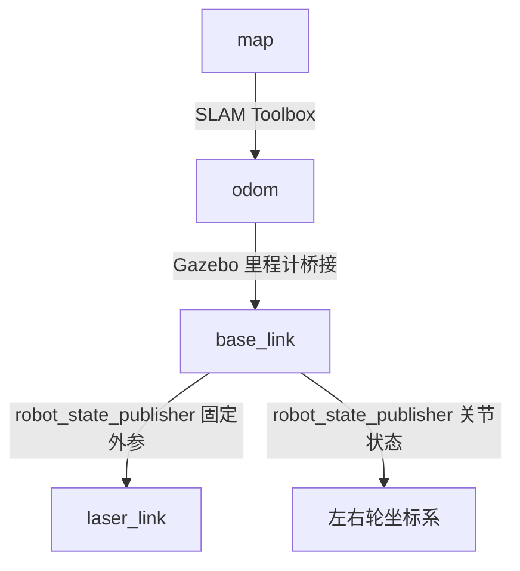
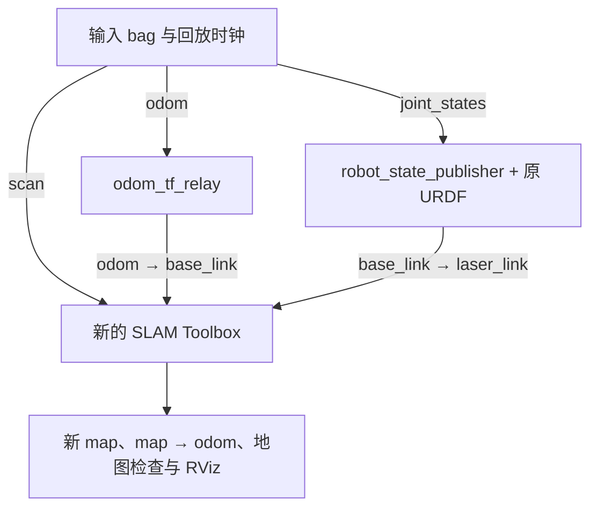

# ROS 2 第五周完整自学讲义：二维激光 SLAM、地图保存与离线重建

> 适用环境：Ubuntu 24.04 + ROS 2 Jazzy + Gazebo Harmonic。主语言 C++17，Launch 使用 Python。承接第四周已经完成的 Gazebo 差速底盘、激光雷达、TF 和速度保护工程。
>
> 本周成果：亲手建立一个有障碍物的房间地图；解释 `map → odom → base_link → laser_link`；写一个栅格地图检查节点；保存并重新加载地图；保存位姿图并继续建图；把同一份传感器录包送进 SLAM 再建一次地图。
>
> 本文包含本周新增文件的完整内容、操作顺序、例题、练习答案和排错步骤。第四周已经写好的底盘及保护节点通过命令复制复用，不需要重新编写；因此开始前必须保留 `~/ros2_week4_ws/src/gazebo_robot_lab`。

<a id="index"></a>
## 阅读导航

- [本周总安排与工程约定](#overview)
- [第 1 天：地图数据、坐标计算与 C++ 实验](#day1)
- [第 2 天：搭建建图房间并验证输入](#day2)
- [第 3 天：启动 SLAM，理解 TF 和生命周期](#day3)
- [第 4 天：编写地图检查节点，完成一圈建图](#day4)
- [第 5 天：保存栅格地图和位姿图](#day5)
- [第 6 天：加载地图、恢复建图和分析参数](#day6)
- [第 7 天：录制输入、离线重建与综合验收](#day7)
- [附录：排错、命令速查、测验答案、下周安排和来源](#appendix)

<a id="overview"></a>
## 本周总安排与工程约定

### 这周要解决的真实问题

第四周你已经能够让机器人在仿真里移动，获得 `/scan`、`/odom` 和 TF。但是，雷达每一帧只描述“此刻在雷达附近看到了什么”，里程计会随运动积累误差。第五周要把连续观察整理成一张可以保存、加载、交给后续导航系统使用的地图。

以下四个概念要先分开：

| 任务 | 已经有什么 | 需要求什么 | 本周做到哪里 |
|---|---|---|---|
| 建图 | 传感器和某种位姿估计 | 环境地图 | 完成二维占据栅格建图 |
| 定位 | 已知地图、实时传感器 | 机器人在地图中的位姿 | 理解概念；不配置 AMCL |
| SLAM | 连续传感器观察、运动信息 | 同时估计轨迹和地图 | 使用 SLAM Toolbox 完成 |
| 导航 | 地图、定位、目标、机器人运动能力 | 路径和可执行速度 | 第六周进入 Nav2 |

你不需要本周从零实现优化器，也不用把每个 SLAM 参数背下来。你必须能够判断输入对不对、地图有没有证据支持、文件保存了什么，以及出现问题应该检查哪一层。

### 七天时间表

每天建议 3～4 小时，第 4、7 天可预留 4～5 小时。仿真慢时按任务完成情况推进，不必为了“当天做完”跳过验收。

| 天 | 学习顺序与建议用时 | 当天交付物 | 通过标准 |
|---|---|---|---|
| 1 | 原理 50 分钟 → 手算 30 分钟 → 建工程及 C++ 100 分钟 → 练习 30 分钟 | `grid_math.hpp`、`test_grid` | 59 个检查通过，能手算栅格索引 |
| 2 | 场景 40 分钟 → 文件与启动 90 分钟 → 输入验收 50 分钟 → 练习 20 分钟 | 房间、桥接、仿真 Launch | 雷达、里程计、TF、时钟一致 |
| 3 | SLAM 与 TF 60 分钟 → 参数与 Launch 70 分钟 → 生命周期实验 50 分钟 → 练习 30 分钟 | SLAM 配置、第一张 `/map` | `active`，地图和雷达能对齐 |
| 4 | 地图节点 70 分钟 → 联合启动 30 分钟 → 绕房间建图 80 分钟 → 质量记录 40 分钟 | `map_inspector`、一圈建图结果 | 地图可解释，回到起点附近 |
| 5 | 文件格式 45 分钟 → 双重保存 50 分钟 → 像素例题 40 分钟 → 保存验收 40 分钟 | `.pgm/.yaml/.posegraph/.data` | 文件完整，清楚每种文件的用途 |
| 6 | 静态地图加载 50 分钟 → 续建 60 分钟 → 参数分析 45 分钟 → 故障练习 30 分钟 | 加载截图、续建记录 | 没有重复 TF 发布者，能解释两种启动 |
| 7 | 录包 45 分钟 → TF 转发节点 60 分钟 → 离线重建 70 分钟 → 对照实验及报告 60 分钟 | 输入 bag、重建地图、实验报告 | 同一数据能重建，来源与结果可追溯 |

### 本周固定命名

| 项目 | 本文固定值 |
|---|---|
| 新工作空间 | `~/ros2_week5_ws` |
| 复用包 | `gazebo_robot_lab`，从第四周复制源代码 |
| 新包 | `mapping_lab` |
| 仿真世界、机器人模型 | `week5`、`week5_bot` |
| Gazebo 通信分区 | `ros2_week5_lab` |
| ROS 域 | `ROS_DOMAIN_ID=42`，全部终端一致 |
| ROS 话题 | `/scan`、`/odom`、`/joint_states`、`/cmd_vel_raw`、`/cmd_vel`、`/map` |
| 建图 TF | `map → odom → base_link → laser_link` |
| 地图分辨率 | `0.05 m/格` |
| 保存目录 | `~/ros2_week5_ws/maps`、`~/ros2_week5_ws/bags`、`~/ros2_week5_ws/reports` |

本文所有 `~/...` 都指你 Ubuntu 虚拟机中的用户主目录。终端命令不含提示符，整段复制执行即可。代码框上方写的是应保存的文件路径，不要把说明文字写进代码文件。

**终端纪律：**第四周与第五周不能同时运行；本周在线建图、静态地图显示、离线重建也不能同时运行。它们复用了同名 ROS 话题。Gazebo 分区只隔离 Gazebo 通信，并不隔离同一 ROS 域中的 `/map` 或 `/tf`。

编译用一个只加载 Jazzy 基础环境的新终端。运行用新的终端加载本周 `setup_run.bash`。如果你的 `~/.bashrc` 自动加载了旧工作空间，先把那些 `source .../install/...` 行注释掉，再打开终端；不必删除旧工程。

### 最终工程会有哪些文件

| 位置，相对于 `~/ros2_week5_ws` | 用途 | 创建日 |
|---|---|---|
| `setup_build.bash`、`setup_run.bash` | 统一环境 | 1 |
| `src/gazebo_robot_lab/` | 已完成的底盘、保护节点、URDF | 1，直接复制 |
| `src/mapping_lab/package.xml`、`CMakeLists.txt` | 依赖与构建，CMake 分阶段更新 | 1、4、7 |
| `src/mapping_lab/include/mapping_lab/grid_math.hpp` | 栅格、二维变换、分类 | 1 |
| `src/mapping_lab/test/test_grid.cpp` | 独立数学检查 | 1 |
| `src/mapping_lab/worlds/mapping_room.sdf` | 房间和机器人 | 2 |
| `src/mapping_lab/config/bridge.yaml`、`laser_bridge.yaml`、`guard.yaml` | 桥接与速度保护 | 2 |
| `src/mapping_lab/launch/sim.launch.py` | 仿真输入链 | 2 |
| `src/mapping_lab/config/slam.yaml` | SLAM 参数 | 3 |
| `src/mapping_lab/launch/slam.launch.py`、`rviz/mapping.rviz` | SLAM 生命周期与显示 | 3 |
| `src/mapping_lab/src/map_inspector.cpp`、`launch/mapping.launch.py` | 地图检查与完整在线系统 | 4 |
| `src/mapping_lab/launch/map_view.launch.py`、`rviz/map_only.rviz` | 只加载静态地图 | 6 |
| `src/mapping_lab/src/odom_tf_relay.cpp`、`launch/rebuild.launch.py` | 从录包恢复输入 TF 并重新建图 | 7 |
| `src/mapping_lab/config/input_bag_qos.yaml` | 输入录包/回放 QoS | 7 |

目录结构用表列出，避免把文件树误当终端命令。第 1 天先建立空资源目录，后续逐步填入；不要提前把第 7 天 CMake 放进去，否则还没创建的源文件会导致构建失败。

### 本文的验证范围

本讲义的纯 C++ 栅格与坐标例程经过实际编译和运行；配置、文件结构、Launch Python 语法和代码引用经过静态检查，SLAM Toolbox、Nav2 地图保存接口按 Jazzy 官方实现核对。编写环境没有运行 ROS 2/Gazebo，因此仿真截图、地图尺寸、建图效果不是预先测得的结果。文中的运行观察是你在虚拟机上执行后应检查的现象，具体地图数值以实测为准。

<a id="day1"></a>
## 第 1 天：地图数据、坐标计算与 C++ 实验

### 1.1 今天学完，你应该能回答什么

你应能解释：一张地图为什么不只是图片；`resolution`、`origin` 和数组索引如何共同确定一个障碍物的位置；为什么未知区域不能视为可通行；二维坐标变换为什么不能只做平移。

### 1.2 从一束激光到一张地图

激光的一次测量可以简化为距离 `r` 和方向角 `θ`。在雷达坐标系中，命中点为：

\[
x_L=r\cos\theta,\qquad y_L=r\sin\theta.
\]

先通过固定外参 `base_link → laser_link` 得到点在底盘中的位置，再利用底盘在地图中的位姿得到地图坐标。把这个点投到栅格里，才知道它对应哪个格子。

直观上，一束有效激光说明“射线经过的空间大概率没有障碍物，命中位置附近大概率存在障碍物”。被障碍物挡住的后方没有被观测到，应该保留未知。多次观察会积累证据。实际软件还需要处理距离范围、噪声、匹配和运动误差；这里讲的是理解占据地图所需的基本关系，不是在复刻 SLAM Toolbox 的内部建图算法。

例如雷达位于地图 `(1,2)`，朝向为 `π/2`，测到正前方 `2 m` 的墙：雷达坐标命中点 `(2,0)`，地图坐标命中点 `(1,4)`。把它当成 `(3,2)`，就是漏做了旋转。

### 1.3 `nav_msgs/msg/OccupancyGrid` 的五个关键字段

| 字段 | 含义 | 本周如何使用 |
|---|---|---|
| `header.frame_id` | 整张地图所在坐标系 | `map` |
| `info.resolution` | 一个格子的边长，单位米 | 通常 `0.05` |
| `info.width`、`height` | 横向和纵向格子数量 | 不是米，需要乘分辨率 |
| `info.origin` | 栅格局部原点在地图坐标系中的位姿 | 包含平移和朝向，不保证为零 |
| `data` | 按行展开的一维有符号数组 | 长度必须为 `width × height` |

消息允许应用定义占据值解释；在本周 SLAM/Nav2 使用约定中，`-1` 表示未知，`0` 表示空闲，`100` 表示占据，中间值表达中间程度。不要与 Nav2 costmap 的字节代价值混用，也不要把 `int8_t` 随意改成无符号类型：`-1` 转成无符号后会变成 `255`，破坏语义。

为了写检查程序，本周约定 `0～25` 为 free、`26～64` 为 uncertain、`65～100` 为 occupied、`-1` 为 unknown。**这是我们的分类规则，不是消息类型强制的阈值。** SLAM Toolbox 的输出可能主要是 `-1/0/100`，所以 uncertain 为零完全正常。

地图长宽的米制尺寸为：

\[
L_x=W r,\qquad L_y=H r.
\]

例如 `W=200, H=160, r=0.05`，覆盖 `10 m × 8 m`。把分辨率从 `0.05` 改成 `0.025`，相同覆盖范围的格子总数大约变为四倍，不是两倍。

### 1.4 栅格索引：先手算，再写代码

数组按 `x` 先变化、`y` 后变化排列：

\[
i=g_y W+g_x.
\]

今天的小地图固定为 `W=4, H=3, r=0.5`，原点 `(-1,-0.5,0)`。下表按“上方是较大 y”显示；数组第一行仍是 `y=0`。

| 栅格行 | x=0 | x=1 | x=2 | x=3 |
|---|---:|---:|---:|---:|
| y=2 | -1 | 25 | 65 | 100 |
| y=1 | -1 | 0 | 50 | 100 |
| y=0 | -1 | 0 | 0 | 100 |

按数组顺序就是 `[-1,0,0,100, -1,0,50,100, -1,25,65,100]`。格子 `(3,2)` 的索引是 `2×4+3=11`，占据值 `100`。

当原点朝向为零时，格子中心的世界坐标为：

\[
x=o_x+(g_x+0.5)r,\quad y=o_y+(g_y+0.5)r.
\]

所以 `(3,2)` 的中心为 `(0.75,0.75)`。`+0.5` 不能漏，否则算出来的是格子角点。

反方向换算：

\[
g_x=\lfloor (x-o_x)/r\rfloor,\quad
g_y=\lfloor (y-o_y)/r\rfloor.
\]

本例有效区域为 `[-1,1) × [-0.5,1)`。右边界和上边界不包含。`x=1` 已经在图外；`x=-1.01` 也在图外，不能直接强制转换为整数让它落入第 0 列。负小数向零截断和数学上的向下取整不是一回事。

### 1.5 地图原点带旋转怎么办

设原点位姿为 `T=(o_x,o_y,ψ)`，栅格局部坐标为 `p`，地图坐标为 `q`：

\[
q=R(\psi)p+t,\qquad
R(\psi)=\begin{bmatrix}\cos\psi&-\sin\psi\\\sin\psi&\cos\psi\end{bmatrix}.
\]

世界点转栅格必须先计算 `p=R(ψ)ᵀ(q-t)`，再除分辨率取 floor。格子中心转世界坐标则先构造局部中心，再旋转、平移。

例题：原点 `(1,2,π/2)`，分辨率 `0.5`，格子 `(0,0)` 局部中心 `(0.25,0.25)`。旋转后是 `(-0.25,0.25)`，再平移得到 **`(0.75,2.25)`**。

对于两段位姿 `A=(a_x,a_y,a_θ)`、`B=(b_x,b_y,b_θ)`，组合 `A×B` 为：

\[
x=a_x+\cos a_\theta\,b_x-\sin a_\theta\,b_y,
\]
\[
y=a_y+\sin a_\theta\,b_x+\cos a_\theta\,b_y,\qquad
\theta=\operatorname{wrap}(a_\theta+b_\theta).
\]

`wrap` 用 `atan2(sin θ, cos θ)` 归一化角度；`π` 和 `-π` 表示同一朝向。第三天你会把这套计算直接用于解释 `map → odom → base_link`。

### 1.6 建立第五周工作空间，复用第四周成果

先停止第四周所有运行终端。打开新的终端，检查并复制源代码。下面的脚本放在子 shell 中，检查失败只终止这一段；不会关闭你的终端，也不会覆盖已经复制好的包。

```bash
(
  set -e
  test -f ~/ros2_week4_ws/src/gazebo_robot_lab/package.xml
  test -f ~/ros2_week4_ws/src/gazebo_robot_lab/src/velocity_guard.cpp
  test -f ~/ros2_week4_ws/src/gazebo_robot_lab/urdf/robot.urdf
  test -f ~/ros2_week4_ws/src/gazebo_robot_lab/rviz/robot.rviz
  mkdir -p ~/ros2_week5_ws/src
  if [ ! -d ~/ros2_week5_ws/src/gazebo_robot_lab ]; then
    cp -a ~/ros2_week4_ws/src/gazebo_robot_lab ~/ros2_week5_ws/src/
  fi
  mkdir -p ~/ros2_week5_ws/src/mapping_lab/include/mapping_lab
  mkdir -p ~/ros2_week5_ws/src/mapping_lab/src
  mkdir -p ~/ros2_week5_ws/src/mapping_lab/test
  mkdir -p ~/ros2_week5_ws/src/mapping_lab/worlds
  mkdir -p ~/ros2_week5_ws/src/mapping_lab/config
  mkdir -p ~/ros2_week5_ws/src/mapping_lab/rviz
  mkdir -p ~/ros2_week5_ws/src/mapping_lab/launch
  mkdir -p ~/ros2_week5_ws/maps ~/ros2_week5_ws/bags ~/ros2_week5_ws/reports
)
```

如果检查失败，先确认第四周源代码实际保存在哪里，把上面四处检查和一处 `cp` 的源路径改成真实位置。不要用一个空包冒充已经完成的底盘包。本周复用其速度保护节点、URDF 和基础 RViz 配置，新的世界、桥接、建图配置均放进 `mapping_lab`。

保存 `~/ros2_week5_ws/setup_build.bash`：

```bash
source /opt/ros/jazzy/setup.bash
export ROS_DOMAIN_ID=42
unset ROS_LOCALHOST_ONLY ROS_STATIC_PEERS
export ROS_AUTOMATIC_DISCOVERY_RANGE=LOCALHOST
export GZ_PARTITION=ros2_week5_lab
```

保存 `~/ros2_week5_ws/setup_run.bash`：

```bash
source ~/ros2_week5_ws/setup_build.bash
source ~/ros2_week5_ws/install/local_setup.bash
```

安装新增依赖。已经装过的包会保留，不会重复安装一套：

```bash
source ~/ros2_week5_ws/setup_build.bash
sudo apt update
sudo apt install ros-jazzy-slam-toolbox ros-jazzy-nav2-map-server ros-jazzy-teleop-twist-keyboard
```

如果 `apt` 找不到 Jazzy 包，先检查是不是 Ubuntu 24.04、第四周是否使用 Jazzy 以及 ROS apt 源是否仍可用，不要临时混装 Humble 或 Rolling。第四周的 Gazebo、ros_gz、RViz、编译工具继续使用已有安装。

### 1.7 完整文件：包说明与第一阶段构建

保存 `~/ros2_week5_ws/src/mapping_lab/package.xml`。这里一次性声明整周依赖；声明依赖并不要求你今天就写完后续源码。

```xml
<?xml version="1.0"?>
<package format="3">
  <name>mapping_lab</name><version>0.1.0</version>
  <description>Week 5 occupancy grids and laser mapping lab</description>
  <maintainer email="learner@example.com">learner</maintainer>
  <license>Apache-2.0</license>
  <buildtool_depend>ament_cmake</buildtool_depend>
  <depend>rclcpp</depend>
  <depend>nav_msgs</depend>
  <depend>geometry_msgs</depend>
  <depend>tf2</depend>
  <depend>tf2_ros</depend>
  <exec_depend>gazebo_robot_lab</exec_depend>
  <exec_depend>ament_index_python</exec_depend>
  <exec_depend>launch</exec_depend>
  <exec_depend>launch_ros</exec_depend>
  <exec_depend>lifecycle_msgs</exec_depend>
  <exec_depend>slam_toolbox</exec_depend>
  <exec_depend>nav2_map_server</exec_depend>
  <exec_depend>robot_state_publisher</exec_depend>
  <exec_depend>rviz2</exec_depend>
  <exec_depend>ros_gz_bridge</exec_depend>
  <exec_depend>ros_gz_sim</exec_depend>
  <exec_depend>teleop_twist_keyboard</exec_depend>
  <export><build_type>ament_cmake</build_type></export>
</package>
```

保存 `~/ros2_week5_ws/src/mapping_lab/CMakeLists.txt`。今天只编译纯 C++ 检查程序，第 4、7 天会给出完整替换版本。

```cmake
cmake_minimum_required(VERSION 3.8)
project(mapping_lab)
find_package(ament_cmake REQUIRED)
set(CMAKE_CXX_STANDARD 17)
set(CMAKE_CXX_STANDARD_REQUIRED ON)
set(CMAKE_CXX_EXTENSIONS OFF)
function(configure_program target)
  target_include_directories(${target} PRIVATE ${CMAKE_CURRENT_SOURCE_DIR}/include)
  target_compile_options(${target} PRIVATE -Wall -Wextra -Wpedantic)
  install(TARGETS ${target} DESTINATION lib/${PROJECT_NAME})
endfunction()
add_executable(test_grid test/test_grid.cpp)
configure_program(test_grid)
install(DIRECTORY worlds config rviz launch DESTINATION share/${PROJECT_NAME})
ament_package()
```

### 1.8 完整文件：栅格与二维变换工具

保存 `~/ros2_week5_ws/src/mapping_lab/include/mapping_lab/grid_math.hpp`：

```cpp
#pragma once
#include <cmath>
#include <cstddef>
#include <cstdint>
#include <limits>
#include <optional>
#include <stdexcept>
#include <vector>

namespace mapping_lab {
constexpr double pi = 3.14159265358979323846;
struct Pose2 { double x{0.0}, y{0.0}, yaw{0.0}; };
struct Point2 { double x{0.0}, y{0.0}; };
struct Cell { std::uint32_t x{0}, y{0}; };
struct GridMeta {
  std::uint32_t width{0}, height{0};
  double resolution{0.0};
  Pose2 origin;
};

inline double wrap(double a) { return std::atan2(std::sin(a), std::cos(a)); }
inline Point2 transform_point(const Pose2 &t, const Point2 &p) {
  const double c = std::cos(t.yaw), s = std::sin(t.yaw);
  return {t.x + c*p.x - s*p.y, t.y + s*p.x + c*p.y};
}
inline Pose2 compose(const Pose2 &a, const Pose2 &b) {
  const auto p = transform_point(a, {b.x, b.y});
  return {p.x, p.y, wrap(a.yaw + b.yaw)};
}
inline Pose2 inverse(const Pose2 &a) {
  const double c = std::cos(a.yaw), s = std::sin(a.yaw);
  return {-c*a.x-s*a.y, s*a.x-c*a.y, wrap(-a.yaw)};
}
inline bool valid_meta(const GridMeta &m) {
  const std::uint64_t count = static_cast<std::uint64_t>(m.width)*m.height;
  return m.width > 0 && m.height > 0 &&
    count <= std::numeric_limits<std::size_t>::max() &&
    std::isfinite(m.resolution) && m.resolution > 0.0 &&
    std::isfinite(m.origin.x) && std::isfinite(m.origin.y) &&
    std::isfinite(m.origin.yaw);
}
inline std::size_t cell_count(const GridMeta &m) {
  if (!valid_meta(m)) throw std::invalid_argument("Invalid grid metadata");
  return static_cast<std::size_t>(m.width) * m.height;
}
inline std::optional<std::size_t> index_of(const GridMeta &m, Cell cell) {
  if (!valid_meta(m) || cell.x >= m.width || cell.y >= m.height) return std::nullopt;
  return static_cast<std::size_t>(cell.y)*m.width + cell.x;
}
inline std::optional<Cell> world_to_cell(const GridMeta &m, Point2 world) {
  if (!valid_meta(m) || !std::isfinite(world.x) || !std::isfinite(world.y)) return std::nullopt;
  const auto local = transform_point(inverse(m.origin), world);
  const double x = local.x/m.resolution, y = local.y/m.resolution;
  if (!(x >= 0.0 && x < m.width && y >= 0.0 && y < m.height)) return std::nullopt;
  return Cell{static_cast<std::uint32_t>(std::floor(x)),
              static_cast<std::uint32_t>(std::floor(y))};
}
inline Point2 cell_center(const GridMeta &m, Cell cell) {
  if (!index_of(m, cell)) throw std::out_of_range("Cell outside grid");
  return transform_point(m.origin, {(cell.x+0.5)*m.resolution, (cell.y+0.5)*m.resolution});
}

enum class CellKind { Unknown, Free, Uncertain, Occupied, Invalid };
inline CellKind classify(int value) {
  if (value == -1) return CellKind::Unknown;
  if (value < 0 || value > 100) return CellKind::Invalid;
  if (value <= 25) return CellKind::Free;
  if (value >= 65) return CellKind::Occupied;
  return CellKind::Uncertain;
}
inline const char *kind_name(CellKind kind) {
  switch (kind) {
    case CellKind::Unknown: return "unknown";
    case CellKind::Free: return "free";
    case CellKind::Uncertain: return "uncertain";
    case CellKind::Occupied: return "occupied";
    default: return "invalid";
  }
}
struct GridStats {
  std::size_t unknown{0}, free{0}, uncertain{0}, occupied{0}, invalid{0};
};
inline GridStats summarize(const GridMeta &m, const std::vector<std::int8_t> &data) {
  if (data.size() != cell_count(m)) throw std::invalid_argument("Grid array length mismatch");
  GridStats out;
  for (const auto value : data) {
    switch (classify(value)) {
      case CellKind::Unknown: ++out.unknown; break;
      case CellKind::Free: ++out.free; break;
      case CellKind::Uncertain: ++out.uncertain; break;
      case CellKind::Occupied: ++out.occupied; break;
      case CellKind::Invalid: ++out.invalid; break;
    }
  }
  return out;
}
}  // namespace mapping_lab
```

阅读顺序：先读三个坐标变换函数，再读 `world_to_cell` 与 `cell_center`，最后读分类统计。`optional` 表示“可能没有合法结果”；地图外的点不会伪造索引。尺寸与数组长度不匹配属于输入错误，使用异常让上层明确处理。

`world_to_cell` 在转换无符号整数前检查范围，可以避免负数转成极大正数。图的边界在旋转之后判断，因此函数不局限于朝向为零的地图。浮点计算在边界附近存在舍入误差，测试采用格子中心做往返检查；实际应用不应靠某个边界上的浮点数恰好落入哪格决定安全性。

### 1.9 完整文件：把手算变成可运行例题

保存 `~/ros2_week5_ws/src/mapping_lab/test/test_grid.cpp`：

```cpp
#include "mapping_lab/grid_math.hpp"
#include <cstdlib>
#include <iostream>
#include <limits>
#include <string>

using namespace mapping_lab;
int checks = 0;
void check(bool ok, const std::string &name) {
  ++checks;
  if (!ok) { std::cerr << "FAIL: " << name << '\n'; std::exit(1); }
}
bool near(double a, double b) { return std::abs(a-b) < 1e-9; }

int main() {
  const GridMeta grid{4,3,0.5,{-1.0,-0.5,0.0}};
  const std::vector<std::int8_t> data{
    -1,0,0,100,
    -1,0,50,100,
    -1,25,65,100};
  check(valid_meta(grid), "metadata");
  check(cell_count(grid)==12, "width times height");
  const auto index = index_of(grid,{3,2});
  check(index && *index==11, "row-major index");
  const auto center = cell_center(grid,{3,2});
  check(near(center.x,0.75) && near(center.y,0.75), "cell center includes half-cell offset");
  const auto cell = world_to_cell(grid,{0.75,0.75});
  check(cell && cell->x==3 && cell->y==2, "world-to-cell inverse");
  check(!world_to_cell(grid,{-1.01,0.0}), "negative coordinate not truncated to zero");
  check(!world_to_cell(grid,{1.0,0.0}), "right boundary excluded");
  check(!world_to_cell(grid,{0.0,1.0}), "top boundary excluded");
  check(!world_to_cell(grid,{std::numeric_limits<double>::quiet_NaN(),0.0}), "NaN input");
  check(!index_of(grid,{4,0}), "out-of-range cell");
  auto bad = grid;
  bad.resolution = 0.0;
  check(!valid_meta(bad), "zero resolution");
  bad=grid; bad.width=0;
  check(!valid_meta(bad), "empty width");
  bad=grid; bad.origin.yaw=std::numeric_limits<double>::infinity();
  check(!valid_meta(bad), "invalid origin angle");
  const auto stats = summarize(grid,data);
  check(stats.unknown==3 && stats.free==4 && stats.uncertain==1 && stats.occupied==4 && stats.invalid==0,
        "map value counts");
  check(classify(-1)==CellKind::Unknown, "unknown stays signed");
  check(classify(25)==CellKind::Free && classify(65)==CellKind::Occupied, "classification boundaries");
  check(classify(26)==CellKind::Uncertain && classify(64)==CellKind::Uncertain, "intermediate range");
  check(classify(101)==CellKind::Invalid && classify(-2)==CellKind::Invalid, "illegal grid values");
  bool threw=false;
  try { summarize(grid,{0}); } catch (const std::invalid_argument &) { threw=true; }
  check(threw, "array size validation");
  threw=false;
  try { cell_center(grid,{0,3}); } catch (const std::out_of_range &) { threw=true; }
  check(threw, "cell-center bounds validation");

  const Pose2 map_odom{1.0,2.0,pi/2.0};
  const Pose2 odom_base{2.0,0.0,0.0};
  const auto map_base=compose(map_odom,odom_base);
  check(near(map_base.x,1.0) && near(map_base.y,4.0) && near(map_base.yaw,pi/2.0), "TF composition");
  const auto recovered=compose(inverse(map_odom),map_base);
  check(near(recovered.x,2.0) && near(recovered.y,0.0) && near(recovered.yaw,0.0), "inverse TF composition");
  const auto identity=compose(inverse(map_odom),map_odom);
  check(near(identity.x,0.0) && near(identity.y,0.0) && near(identity.yaw,0.0), "transform inverse");

  for (double yaw : {0.0,pi/2.0,-0.7}) {
    GridMeta rotated{4,3,0.5,{1.2,-0.7,yaw}};
    for (std::uint32_t y=0; y<rotated.height; ++y) {
      for (std::uint32_t x=0; x<rotated.width; ++x) {
        const auto p=cell_center(rotated,{x,y});
        const auto back=world_to_cell(rotated,p);
        check(back && back->x==x && back->y==y, "rotated grid round trip");
      }
    }
  }
  std::cout << "Grid counts: unknown=3 free=4 uncertain=1 occupied=4\n";
  std::cout << "TF example: map_base=(1, 4, pi/2)\n";
  std::cout << "PASS: " << checks << " checks\n";
}
```

编译终端执行：

```bash
source ~/ros2_week5_ws/setup_build.bash
cd ~/ros2_week5_ws
rosdep install --from-paths src --ignore-src -r -y --rosdistro jazzy
colcon build --symlink-install --packages-up-to mapping_lab
```

`--packages-up-to mapping_lab` 会把当前工作空间中作为依赖的 `gazebo_robot_lab` 一并纳入构建。不要加载第四周 install 来绕过本周源码构建。若 rosdep 提示没有初始化，执行一次 `sudo rosdep init`、`rosdep update` 后重试；提示已初始化时只运行 `rosdep update`。

新运行终端执行：

```bash
source ~/ros2_week5_ws/setup_run.bash
ros2 pkg prefix mapping_lab
ros2 pkg prefix gazebo_robot_lab
ros2 run mapping_lab test_grid
```

前两个路径应都指向 `ros2_week5_ws/install` 内的包。数学例题输出为：

```text
Grid counts: unknown=3 free=4 uncertain=1 occupied=4
TF example: map_base=(1, 4, pi/2)
PASS: 59 checks
```

如果 CMake 提示找不到后面几天的 `.cpp`，说明你提前使用了后续 CMake；恢复今天的版本。若头文件找不到，检查是不是保存成了 `include/mapping_lab/grid_math.hpp`，而不是 `include/grid_math.hpp`。

### 1.10 当天练习与答案

先遮住答案手算，再用程序检查。

| 题目 | 答案与推导 |
|---|---|
| 小地图 `(2,1)` 的索引、值、中心是多少？ | 索引 `1×4+2=6`；值 `50`；中心 `(0.25,0.25)` |
| 世界点 `(-0.9,-0.4)` 落在哪格？ | 局部 `(0.1,0.1)`，除以 `0.5` 后取 floor，得到 `(0,0)`，值 `-1` |
| 世界点 `(1,0)` 为什么不能访问？ | x 恰好在右边界，算出列号 4，而合法列只有 0～3 |
| 已知比例是多少？能叫“建图完成度”吗？ | `(12-3)/12=75%`；不能。它只针对当前矩形边界，不代表目标环境都被观察到 |
| 分辨率从 0.05 改到 0.1，相同区域的格子数如何变化？ | 横纵都约减半，总数约变为四分之一 |
| `map→odom=(1,2,π/2)`，`odom→base=(2,0,0)`，底盘在 map 中哪里？ | `(1,4,π/2)`，不能把平移直接相加成 `(3,2)` |

**当天验收：**保存一份 `reports/day1.md`，记录 59 个检查的输出，并自己写出 `world_to_cell` 的四个步骤：减原点、逆旋转、除分辨率取 floor、检查范围。你能口述清楚这四步，今天才算完成。

[回到导航](#index)

<a id="day2"></a>
## 第 2 天：搭建建图房间并验证输入

### 2.1 为什么换一个场景

第四周的小场景用于验证运动、雷达和保护。本周需要封闭边界、若干遮挡物，以及可以绕行的通道，才能看到“移动后新增观测”和“回到旧区域”的作用。

本周房间外墙中心在 `x=±5`、`y=±4`，厚度 `0.2 m`，墙内表面约为 `x=±4.9`、`y=±3.9`，内部尺寸约 `9.8 m × 7.8 m`。不要把墙中心间距当成可通行净宽。

| 物体 | 中心位置，米 | 平面尺寸，米 | 作用 |
|---|---|---|---|
| `box_a` | `(1.5,1.2)` | `1.0 × 1.0` | 形成明显遮挡 |
| `box_b` | `(-2.0,1.3)` | `0.6 × 1.0` | 打破场景对称性 |
| `partition` | `(2.0,-1.0)` | `0.2 × 1.6` | 提供细长边缘与墙后未知区 |
| 机器人 | 初始约 `(0,0)`，朝向 `+x` | 沿用第四周几何 | 建图起点 |

机器人仍是轮半径 `0.05 m`、轮距 `0.30 m`；雷达在底盘原点上方 `0.20 m`，平面扫描 361 束，量程 `0.05～8 m`，更新频率 10 Hz 仿真时间。机器人的物理模型与复用的 URDF 一致。URDF 负责给 ROS 提供几何与关节关系，SDF 负责 Gazebo 中的物理与传感器，两者都需要正确，不能互相代替。

### 2.2 完整文件：建图房间

保存 `~/ros2_week5_ws/src/mapping_lab/worlds/mapping_room.sdf`。这是完整文件，不需要下载外部模型或网格资源。

```xml
<?xml version="1.0"?>
<sdf version="1.9">
  <world name="week5">
    <gravity>0 0 -9.81</gravity>
    <physics name="physics" type="ignored">
      <max_step_size>0.001</max_step_size>
      <real_time_factor>1.0</real_time_factor>
    </physics>
    <plugin filename="gz-sim-physics-system" name="gz::sim::systems::Physics" />
    <plugin filename="gz-sim-user-commands-system" name="gz::sim::systems::UserCommands" />
    <plugin filename="gz-sim-scene-broadcaster-system" name="gz::sim::systems::SceneBroadcaster" />
    <plugin filename="gz-sim-sensors-system" name="gz::sim::systems::Sensors">
      <render_engine>ogre2</render_engine>
    </plugin>
    <scene>
      <ambient>0.6 0.6 0.6 1</ambient>
      <background>0.8 0.85 0.9 1</background>
    </scene>
    <light name="sun" type="directional">
      <pose>0 0 8 0 0 0</pose>
      <cast_shadows>false</cast_shadows>
      <diffuse>0.8 0.8 0.8 1</diffuse>
      <specular>0.2 0.2 0.2 1</specular>
      <direction>-0.5 0.1 -0.9</direction>
      <attenuation>
        <range>1000</range>
        <constant>0.9</constant>
        <linear>0.01</linear>
        <quadratic>0.001</quadratic>
      </attenuation>
    </light>
    <model name="ground">
      <static>true</static>
      <pose>0 0 -0.05 0 0 0</pose>
      <link name="link">
        <collision name="collision">
          <geometry>
            <box>
              <size>12 10 0.1</size>
            </box>
          </geometry>
        </collision>
        <visual name="visual">
          <geometry>
            <box>
              <size>12 10 0.1</size>
            </box>
          </geometry>
          <material>
            <ambient>0.75 0.75 0.75 1</ambient>
            <diffuse>0.75 0.75 0.75 1</diffuse>
          </material>
        </visual>
      </link>
    </model>
    <model name="north_wall">
      <static>true</static>
      <pose>0 4 0.5 0 0 0</pose>
      <link name="link">
        <collision name="collision">
          <geometry>
            <box>
              <size>10.2 0.2 1.0</size>
            </box>
          </geometry>
        </collision>
        <visual name="visual">
          <geometry>
            <box>
              <size>10.2 0.2 1.0</size>
            </box>
          </geometry>
          <material>
            <ambient>0.7 0.7 0.8 1</ambient>
            <diffuse>0.7 0.7 0.8 1</diffuse>
          </material>
        </visual>
      </link>
    </model>
    <model name="south_wall">
      <static>true</static>
      <pose>0 -4 0.5 0 0 0</pose>
      <link name="link">
        <collision name="collision">
          <geometry>
            <box>
              <size>10.2 0.2 1.0</size>
            </box>
          </geometry>
        </collision>
        <visual name="visual">
          <geometry>
            <box>
              <size>10.2 0.2 1.0</size>
            </box>
          </geometry>
          <material>
            <ambient>0.7 0.7 0.8 1</ambient>
            <diffuse>0.7 0.7 0.8 1</diffuse>
          </material>
        </visual>
      </link>
    </model>
    <model name="east_wall">
      <static>true</static>
      <pose>5 0 0.5 0 0 0</pose>
      <link name="link">
        <collision name="collision">
          <geometry>
            <box>
              <size>0.2 8.2 1.0</size>
            </box>
          </geometry>
        </collision>
        <visual name="visual">
          <geometry>
            <box>
              <size>0.2 8.2 1.0</size>
            </box>
          </geometry>
          <material>
            <ambient>0.7 0.7 0.8 1</ambient>
            <diffuse>0.7 0.7 0.8 1</diffuse>
          </material>
        </visual>
      </link>
    </model>
    <model name="west_wall">
      <static>true</static>
      <pose>-5 0 0.5 0 0 0</pose>
      <link name="link">
        <collision name="collision">
          <geometry>
            <box>
              <size>0.2 8.2 1.0</size>
            </box>
          </geometry>
        </collision>
        <visual name="visual">
          <geometry>
            <box>
              <size>0.2 8.2 1.0</size>
            </box>
          </geometry>
          <material>
            <ambient>0.7 0.7 0.8 1</ambient>
            <diffuse>0.7 0.7 0.8 1</diffuse>
          </material>
        </visual>
      </link>
    </model>
    <model name="box_a">
      <static>true</static>
      <pose>1.5 1.2 0.4 0 0 0</pose>
      <link name="link">
        <collision name="collision">
          <geometry>
            <box>
              <size>1.0 1.0 0.8</size>
            </box>
          </geometry>
        </collision>
        <visual name="visual">
          <geometry>
            <box>
              <size>1.0 1.0 0.8</size>
            </box>
          </geometry>
          <material>
            <ambient>0.85 0.3 0.15 1</ambient>
            <diffuse>0.85 0.3 0.15 1</diffuse>
          </material>
        </visual>
      </link>
    </model>
    <model name="box_b">
      <static>true</static>
      <pose>-2 1.3 0.4 0 0 0</pose>
      <link name="link">
        <collision name="collision">
          <geometry>
            <box>
              <size>0.6 1.0 0.8</size>
            </box>
          </geometry>
        </collision>
        <visual name="visual">
          <geometry>
            <box>
              <size>0.6 1.0 0.8</size>
            </box>
          </geometry>
          <material>
            <ambient>0.2 0.7 0.3 1</ambient>
            <diffuse>0.2 0.7 0.3 1</diffuse>
          </material>
        </visual>
      </link>
    </model>
    <model name="partition">
      <static>true</static>
      <pose>2 -1 0.4 0 0 0</pose>
      <link name="link">
        <collision name="collision">
          <geometry>
            <box>
              <size>0.2 1.6 0.8</size>
            </box>
          </geometry>
        </collision>
        <visual name="visual">
          <geometry>
            <box>
              <size>0.2 1.6 0.8</size>
            </box>
          </geometry>
          <material>
            <ambient>0.9 0.65 0.1 1</ambient>
            <diffuse>0.9 0.65 0.1 1</diffuse>
          </material>
        </visual>
      </link>
    </model>
    <model name="week5_bot" canonical_link="base_link">
      <pose>0 0 0.005 0 0 0</pose>
      <self_collide>false</self_collide>
      <link name="base_link">
        <inertial>
          <pose>-0.03 0 0.1 0 0 0</pose>
          <mass>2.0</mass>
          <inertia>
            <ixx>0.008333333</ixx>
            <iyy>0.011266667</iyy>
            <izz>0.016266667</izz>
            <ixy>0</ixy>
            <ixz>0</ixz>
            <iyz>0</iyz>
          </inertia>
        </inertial>
        <collision name="body_collision">
          <pose>0 0 0.1 0 0 0</pose>
          <geometry>
            <box>
              <size>0.24 0.20 0.10</size>
            </box>
          </geometry>
        </collision>
        <visual name="body_visual">
          <pose>0 0 0.1 0 0 0</pose>
          <geometry>
            <box>
              <size>0.24 0.20 0.10</size>
            </box>
          </geometry>
          <material>
            <ambient>0.1 0.35 0.9 1</ambient>
            <diffuse>0.1 0.35 0.9 1</diffuse>
          </material>
        </visual>
      </link>
      <link name="left_wheel">
        <pose>0 0.15 0.05 0 0 0</pose>
        <inertial>
          <pose>0 0 0 0 0 0</pose>
          <mass>0.2</mass>
          <inertia>
            <ixx>0.00014</ixx>
            <iyy>0.00025</iyy>
            <izz>0.00014</izz>
            <ixy>0</ixy>
            <ixz>0</ixz>
            <iyz>0</iyz>
          </inertia>
        </inertial>
        <collision name="left_collision">
          <pose>0 0 0 1.57079632679 0 0</pose>
          <geometry>
            <cylinder>
              <radius>0.05</radius>
              <length>0.03</length>
            </cylinder>
          </geometry>
          <surface>
            <friction>
              <ode>
                <mu>1.0</mu>
                <mu2>1.0</mu2>
              </ode>
            </friction>
          </surface>
        </collision>
        <visual name="left_visual">
          <pose>0 0 0 1.57079632679 0 0</pose>
          <geometry>
            <cylinder>
              <radius>0.05</radius>
              <length>0.03</length>
            </cylinder>
          </geometry>
          <material>
            <ambient>0.12 0.12 0.12 1</ambient>
            <diffuse>0.12 0.12 0.12 1</diffuse>
          </material>
        </visual>
      </link>
      <joint name="left_wheel_joint" type="revolute">
        <parent>base_link</parent>
        <child>left_wheel</child>
        <axis>
          <xyz>0 1 0</xyz>
          <limit>
            <lower>-1e16</lower>
            <upper>1e16</upper>
            <effort>5</effort>
            <velocity>20</velocity>
          </limit>
        </axis>
      </joint>
      <link name="right_wheel">
        <pose>0 -0.15 0.05 0 0 0</pose>
        <inertial>
          <pose>0 0 0 0 0 0</pose>
          <mass>0.2</mass>
          <inertia>
            <ixx>0.00014</ixx>
            <iyy>0.00025</iyy>
            <izz>0.00014</izz>
            <ixy>0</ixy>
            <ixz>0</ixz>
            <iyz>0</iyz>
          </inertia>
        </inertial>
        <collision name="right_collision">
          <pose>0 0 0 1.57079632679 0 0</pose>
          <geometry>
            <cylinder>
              <radius>0.05</radius>
              <length>0.03</length>
            </cylinder>
          </geometry>
          <surface>
            <friction>
              <ode>
                <mu>1.0</mu>
                <mu2>1.0</mu2>
              </ode>
            </friction>
          </surface>
        </collision>
        <visual name="right_visual">
          <pose>0 0 0 1.57079632679 0 0</pose>
          <geometry>
            <cylinder>
              <radius>0.05</radius>
              <length>0.03</length>
            </cylinder>
          </geometry>
          <material>
            <ambient>0.12 0.12 0.12 1</ambient>
            <diffuse>0.12 0.12 0.12 1</diffuse>
          </material>
        </visual>
      </link>
      <joint name="right_wheel_joint" type="revolute">
        <parent>base_link</parent>
        <child>right_wheel</child>
        <axis>
          <xyz>0 1 0</xyz>
          <limit>
            <lower>-1e16</lower>
            <upper>1e16</upper>
            <effort>5</effort>
            <velocity>20</velocity>
          </limit>
        </axis>
      </joint>
      <link name="caster_link">
        <pose>-0.09 0 0.025 0 0 0</pose>
        <inertial>
          <pose>0 0 0 0 0 0</pose>
          <mass>0.05</mass>
          <inertia>
            <ixx>1.25e-05</ixx>
            <iyy>1.25e-05</iyy>
            <izz>1.25e-05</izz>
            <ixy>0</ixy>
            <ixz>0</ixz>
            <iyz>0</iyz>
          </inertia>
        </inertial>
        <collision name="caster_collision">
          <pose>0 0 0 0 0 0</pose>
          <geometry>
            <sphere>
              <radius>0.025</radius>
            </sphere>
          </geometry>
          <surface>
            <friction>
              <ode>
                <mu>0</mu>
                <mu2>0</mu2>
              </ode>
            </friction>
          </surface>
        </collision>
        <visual name="caster_visual">
          <pose>0 0 0 0 0 0</pose>
          <geometry>
            <sphere>
              <radius>0.025</radius>
            </sphere>
          </geometry>
          <material>
            <ambient>0.5 0.5 0.5 1</ambient>
            <diffuse>0.5 0.5 0.5 1</diffuse>
          </material>
        </visual>
      </link>
      <joint name="caster_joint" type="fixed">
        <parent>base_link</parent>
        <child>caster_link</child>
      </joint>
      <link name="laser_link">
        <pose>0 0 0.20 0 0 0</pose>
        <inertial>
          <pose>0 0 -0.03 0 0 0</pose>
          <mass>0.1</mass>
          <inertia>
            <ixx>2.9e-05</ixx>
            <iyy>2.9e-05</iyy>
            <izz>3.125e-05</izz>
            <ixy>0</ixy>
            <ixz>0</ixz>
            <iyz>0</iyz>
          </inertia>
        </inertial>
        <collision name="laser_body_collision">
          <pose>0 0 -0.03 0 0 0</pose>
          <geometry>
            <cylinder>
              <radius>0.025</radius>
              <length>0.04</length>
            </cylinder>
          </geometry>
        </collision>
        <visual name="laser_body_visual">
          <pose>0 0 -0.03 0 0 0</pose>
          <geometry>
            <cylinder>
              <radius>0.025</radius>
              <length>0.04</length>
            </cylinder>
          </geometry>
          <material>
            <ambient>0.2 0.9 0.6 1</ambient>
            <diffuse>0.2 0.9 0.6 1</diffuse>
          </material>
        </visual>
        <sensor name="lidar" type="gpu_lidar">
          <pose>0 0 0 0 0 0</pose>
          <topic>/week5/scan</topic>
          <update_rate>10</update_rate>
          <always_on>true</always_on>
          <visualize>false</visualize>
          <lidar>
            <scan>
              <horizontal>
                <samples>361</samples>
                <resolution>1</resolution>
                <min_angle>-3.141592653589793</min_angle>
                <max_angle>3.141592653589793</max_angle>
              </horizontal>
              <vertical>
                <samples>1</samples>
                <resolution>1</resolution>
                <min_angle>0</min_angle>
                <max_angle>0</max_angle>
              </vertical>
            </scan>
            <range>
              <min>0.05</min>
              <max>8.0</max>
              <resolution>0.01</resolution>
            </range>
          </lidar>
        </sensor>
      </link>
      <joint name="laser_joint" type="fixed">
        <parent>base_link</parent>
        <child>laser_link</child>
      </joint>
      <plugin filename="gz-sim-diff-drive-system" name="gz::sim::systems::DiffDrive">
        <left_joint>left_wheel_joint</left_joint>
        <right_joint>right_wheel_joint</right_joint>
        <wheel_separation>0.30</wheel_separation>
        <wheel_radius>0.05</wheel_radius>
        <topic>/week5/cmd_vel</topic>
        <odom_topic>/week5/odom</odom_topic>
        <tf_topic>/week5/tf</tf_topic>
        <frame_id>odom</frame_id>
        <child_frame_id>base_link</child_frame_id>
        <odom_publish_frequency>50</odom_publish_frequency>
        <min_linear_velocity>-0.4</min_linear_velocity>
        <max_linear_velocity>0.4</max_linear_velocity>
        <min_angular_velocity>-1.0</min_angular_velocity>
        <max_angular_velocity>1.0</max_angular_velocity>
      </plugin>
      <plugin filename="gz-sim-joint-state-publisher-system" name="gz::sim::systems::JointStatePublisher">
        <topic>/week5/joint_states</topic>
        <update_rate>50</update_rate>
        <joint_name>left_wheel_joint</joint_name>
        <joint_name>right_wheel_joint</joint_name>
      </plugin>
    </model>
  </world>
</sdf>
```

需要认识的几个配置：

- `world name="week5"` 决定世界时钟路径 `/world/week5/clock`。
- 差速插件输出 `/week5/odom` 与 `/week5/tf`，显式指定 `odom`、`base_link`。
- 轮关节状态单独输出，供 `robot_state_publisher` 更新轮子的 TF。
- `gpu_lidar` 需要渲染后端，即便没有打开 Gazebo 窗口，也不代表可以完全跳过图形驱动。
- 原生差速插件会保留收到的最后一条速度，本周继续使用第四周保护节点持续发出经过检查的速度；单独关闭键盘进程不等于底盘插件自动超时。

### 2.3 完整文件：桥接和保护配置

保存 `~/ros2_week5_ws/src/mapping_lab/config/bridge.yaml`：

```yaml
- ros_topic_name: /clock
  gz_topic_name: /world/week5/clock
  ros_type_name: rosgraph_msgs/msg/Clock
  gz_type_name: gz.msgs.Clock
  direction: GZ_TO_ROS
  lazy: false
  qos_profile: CLOCK
- ros_topic_name: /cmd_vel
  gz_topic_name: /week5/cmd_vel
  ros_type_name: geometry_msgs/msg/Twist
  gz_type_name: gz.msgs.Twist
  direction: ROS_TO_GZ
  lazy: false
- ros_topic_name: /odom
  gz_topic_name: /week5/odom
  ros_type_name: nav_msgs/msg/Odometry
  gz_type_name: gz.msgs.Odometry
  direction: GZ_TO_ROS
  lazy: false
- ros_topic_name: /tf
  gz_topic_name: /week5/tf
  ros_type_name: tf2_msgs/msg/TFMessage
  gz_type_name: gz.msgs.Pose_V
  direction: GZ_TO_ROS
  lazy: false
- ros_topic_name: /joint_states
  gz_topic_name: /week5/joint_states
  ros_type_name: sensor_msgs/msg/JointState
  gz_type_name: gz.msgs.Model
  direction: GZ_TO_ROS
  lazy: false
```

保存 `~/ros2_week5_ws/src/mapping_lab/config/laser_bridge.yaml`：

```yaml
- ros_topic_name: /scan
  gz_topic_name: /week5/scan
  ros_type_name: sensor_msgs/msg/LaserScan
  gz_type_name: gz.msgs.LaserScan
  direction: GZ_TO_ROS
  qos_profile: SENSOR_DATA
  frame_id: laser_link
  lazy: false
```

雷达桥接里的 `frame_id` 把消息标记为 `laser_link`。它只修改标签，不会旋转或平移点。之所以可以这么用，是因为 Gazebo 中传感器的真实安装位置、URDF 中的固定外参和这个标签一致。安装关系错了，改标签不能补救。

保存 `~/ros2_week5_ws/src/mapping_lab/config/guard.yaml`：

```yaml
velocity_guard:
  ros__parameters:
    use_sim_time: true
    max_linear_mps: 0.2
    max_angular_rps: 0.4
    stop_distance_m: 0.6
    release_distance_m: 0.75
    slow_distance_m: 1.1
    command_timeout_s: 0.5
    scan_timeout_s: 1.0
    max_scan_age_s: 0.5
```

保护逻辑沿用第四周：扫描无效、时间异常、扫描过期或命令过期会输出零速度；全周方向的最小有效距离低于 `0.60 m` 时阻挡，超过 `0.75 m` 才解除；在 `1.10 m` 内减速。本周最大速度限制为 `0.20 m/s` 和 `0.40 rad/s`，键盘使用更低的 `0.15 m/s`、`0.35 rad/s`。

因为检查的是全向最近距离，贴墙太近时连转弯也可能被阻挡。这是当前练习的设计边界，不能通过直接给 `/cmd_vel` 发非零速度绕过保护。先按给定宽通道路线操作；如果已经卡住，就停止本次实验、关闭仿真并从初始场景重启。二维雷达保护也不等于真实机器人的完整安全系统。

### 2.4 完整文件：只启动传感器与底盘

保存 `~/ros2_week5_ws/src/mapping_lab/launch/sim.launch.py`：

```python
from pathlib import Path
from ament_index_python.packages import get_package_share_directory
from launch import LaunchDescription
from launch.actions import DeclareLaunchArgument, EmitEvent, ExecuteProcess, OpaqueFunction
from launch.conditions import IfCondition
from launch.events import Shutdown
from launch.substitutions import LaunchConfiguration
from launch_ros.actions import Node
from launch_ros.parameter_descriptions import ParameterValue


def start(context):
    share = Path(get_package_share_directory('mapping_lab'))
    base = Path(get_package_share_directory('gazebo_robot_lab'))
    gui = IfCondition(LaunchConfiguration('gui')).evaluate(context)
    headless = IfCondition(LaunchConfiguration('headless')).evaluate(context)
    if gui and headless:
        raise ValueError('headless:=true requires gui:=false')
    args = ['gz', 'sim', '-r', '-v', '3']
    if not gui:
        args.append('-s')
    if headless:
        args.append('--headless-rendering')
    args.append(str(share / 'worlds' / 'mapping_room.sdf'))
    description = (base / 'urdf' / 'robot.urdf').read_text(encoding='utf-8')
    return [
        ExecuteProcess(cmd=args, output='screen',
                       on_exit=[EmitEvent(event=Shutdown(reason='Gazebo exited'))]),
        Node(package='ros_gz_bridge', executable='parameter_bridge',
             name='base_bridge', output='screen',
             parameters=[{'config_file': str(share / 'config' / 'bridge.yaml')}],
             on_exit=[EmitEvent(event=Shutdown(reason='Base bridge exited'))]),
        Node(package='ros_gz_bridge', executable='parameter_bridge',
             name='laser_bridge', output='screen',
             parameters=[{'config_file': str(share / 'config' / 'laser_bridge.yaml')}]),
        Node(package='robot_state_publisher', executable='robot_state_publisher',
             name='robot_state_publisher', output='screen',
             parameters=[{'use_sim_time': True, 'publish_frequency': 50.0,
                          'robot_description': ParameterValue(description, value_type=str)}]),
        Node(package='gazebo_robot_lab', executable='velocity_guard',
             name='velocity_guard', output='screen',
             parameters=[str(share / 'config' / 'guard.yaml')],
             on_exit=[EmitEvent(event=Shutdown(reason='Velocity guard exited'))]),
        Node(package='rviz2', executable='rviz2', name='rviz2', output='screen',
             arguments=['-d', str(base / 'rviz' / 'robot.rviz')],
             parameters=[{'use_sim_time': True}],
             condition=IfCondition(LaunchConfiguration('rviz'))),
    ]


def generate_launch_description():
    return LaunchDescription([
        DeclareLaunchArgument('gui', default_value='true'),
        DeclareLaunchArgument('headless', default_value='false'),
        DeclareLaunchArgument('rviz', default_value='true'),
        OpaqueFunction(function=start),
    ])
```

这里暂时使用第四周的 RViz 配置，Fixed Frame 是 `odom`。还没有 `map`，所以此时选择 `map` 会报缺少坐标系，属于使用顺序问题。

编译终端执行：

```bash
source ~/ros2_week5_ws/setup_build.bash
cd ~/ros2_week5_ws
colcon build --symlink-install --packages-up-to mapping_lab
```

终端 A 启动：

```bash
source ~/ros2_week5_ws/setup_run.bash
ros2 launch mapping_lab sim.launch.py
```

低负载方式是关闭 Gazebo GUI、保留 RViz，适合仍有正常桌面图形环境的虚拟机：

```bash
source ~/ros2_week5_ws/setup_run.bash
ros2 launch mapping_lab sim.launch.py gui:=false
```

上面两种启动方式选一种，不能并行启动。只有确实配置了可用 EGL 离屏渲染时，再用 `gui:=false headless:=true`；没有 GUI 并不保证 GPU 雷达一定能出数据。若第四周雷达可用，本周优先沿用当时验证过的渲染方式。

### 2.5 输入验收：按此顺序检查

终端 B：

```bash
source ~/ros2_week5_ws/setup_run.bash
ros2 topic echo /clock --once
ros2 topic echo /scan --once --qos-reliability best_effort --field header
ros2 topic echo /odom --once --field header
ros2 topic echo /odom --once --field child_frame_id
ros2 topic echo /joint_states --once --field name
```

期望：时钟已经大于零，扫描 frame 为 `laser_link`，里程计 header 为 `odom`、child 为 `base_link`，关节名与 URDF 的左右轮关节匹配。

接着执行以下命令，每条持续观察几秒后按 Ctrl+C，再执行下一条：

```bash
ros2 run tf2_ros tf2_echo odom base_link --ros-args -p use_sim_time:=true
ros2 run tf2_ros tf2_echo base_link laser_link --ros-args -p use_sim_time:=true
ros2 topic hz /scan
```

第一条应能连续得到机器人位姿；第二条平移应约为 `(0,0,0.20)`、旋转为单位旋转。第三条的显示频率受虚拟机实际运行速度和 CLI 接收影响：10 Hz 是按仿真时间定义的传感器频率，仿真慢于实时，墙上时间测到的频率可能较低。先确认数据连续、时间戳递增，不要因为数字不是恰好 10.000 就改传感器参数。

RViz 中，雷达点应落在房间墙面和障碍物轮廓上；轮子和机器人姿态稳定。如果有数据但方向错了，检查外参、雷达扫描方向和模型，而不是先调 SLAM。

### 2.6 键盘控制和停止流程

终端 C：

```bash
source ~/ros2_week5_ws/setup_run.bash
ros2 run teleop_twist_keyboard teleop_twist_keyboard --ros-args \
  -p speed:=0.15 -p turn:=0.35 -p stamped:=false \
  -r cmd_vel:=/cmd_vel_raw
```

| 按键 | 本周用途 |
|---|---|
| `i` | 前进 |
| `,` | 后退；先观察后方空间 |
| `j`、`l` | 原地左转、右转 |
| `k` | 发零速度停止 |
| `u`、`o` | 一边前进一边转弯；本周先不用 |

该键盘程序按按键事件发送消息；本教程不依赖 `repeat_rate` 或 `key_timeout` 之类未在此版本接口中提供的参数。持续运动时把焦点放在键盘终端并持续按住相应键，利用系统按键重复。若只点按一次，保护节点在约 `0.5 s` 没收到新命令后停车，这是预期行为。首次按住时若系统重复延迟较长，可能先走一下再继续，不能误判为建图故障。

今天只做短距离前进、停止、左右转动，确认链路即可，不走完整一圈。另一个终端可看保护状态：

```bash
source ~/ros2_week5_ws/setup_run.bash
ros2 topic echo /guard_status
```

要结束实验，先在键盘终端按 `k`，观察 `/cmd_vel` 为零，再退出键盘和仿真。也可以在键盘已停止输入后发一次零请求：

```bash
ros2 topic pub --once /cmd_vel_raw geometry_msgs/msg/Twist '{}'
ros2 topic echo /cmd_vel --once
```

不要用 Gazebo 的 Reset World/Reset Simulation 在运行中的建图实验里“回到起点”。时间或里程计坐标重置会破坏当前轨迹假设；第四周保护节点还会锁定时间倒退错误。需要重来时，退出整套相关节点再重新启动。

### 2.7 当天例题、故障练习与答案

**例题 A：**`/scan` 有消息，`odom→base_link` 查不到，能开始 SLAM 吗？

答案：不能。建图需要知道各帧扫描发生时的运动关系，只有 `/odom` 话题名称存在还不够。先检查桥接配置中的 `/week5/tf`、差速插件 frame 设置和 `/tf` 消息；第三天会看到 SLAM Toolbox 通过 TF 查询里程计位姿。

**例题 B：**把 `laser_bridge.yaml` 中 Gazebo 话题误写成 `/week4/scan`，会怎样？

答案：桥接进程可能仍在，但新世界发布的是 `/week5/scan`，ROS 端没有扫描数据；保护节点停车，SLAM 无地图。进程活着不等于数据链通了。

**例题 C：**`GZ_PARTITION` 不同，为什么旧的 ROS 节点仍会干扰？

答案：分区管 Gazebo 通信；ROS 发现使用的是 ROS 域。本周和第四周都用域 42，所以旧 ROS 发布者仍可能与新节点交换消息。结束旧系统，不要同时跑两套同名 TF。

**练习：**写一张输入验收表，填入 `/scan` 的 frame、量程、时间戳，`/odom` 的两个 frame，以及 `base_link→laser_link` 的平移。参考答案分别为 `laser_link`、约 `0.05～8 m`、随仿真递增，`odom/base_link`，`(0,0,0.20)`。扫描时间戳具体数字由运行时决定。

**当天验收：**保存 `reports/day2.md`，必须同时有“数据消息存在”和“TF 能查到”两类证据，再进入 SLAM。

[回到导航](#index)

<a id="day3"></a>
## 第 3 天：启动 SLAM，理解 TF 和生命周期

### 3.1 SLAM Toolbox 到底在做什么

先用四步理解整件事：

1. **运动初值：**用里程计 TF 估计两帧扫描之间机器人大概移动了多少。
2. **扫描匹配：**让当前激光观察与已有扫描/局部结构对齐，修正仅靠里程计得到的估计。
3. **位姿图：**保留选中的扫描位姿作为节点，节点之间记录运动与匹配约束。
4. **回环与优化：**再次看到以前到过的区域时，若候选通过匹配检查，就添加新的约束，调整整条轨迹；再根据轨迹与扫描生成地图。

“异步建图”表示输入到来后按异步方式处理；不意味着时间戳可以乱写，也不意味着每一束扫描都必须成为图节点。扫描频率、关键扫描进入图的频率、栅格地图发布频率是三件不同的事。

回环检测不是“坐标看起来接近就强行闭合”。走到相同位置只是提供候选机会，仍需足够的观测一致性。场景过于对称、速度过快、扫描失真或里程计错误，都可能导致匹配失败或错误匹配。

### 3.2 `map` 和 `odom` 为什么要同时存在

`odom` 适合表示短时间连续运动。里程计可能逐渐漂移，但局部控制希望轨迹尽量连续。`map` 表示全局一致的参考；SLAM 修正历史误差时，机器人在 map 中的估计位置可能出现调整。

本周的 TF 发布责任固定如下：



| TF 边 | 在线建图的唯一责任方 | 为什么不能重复 |
|---|---|---|
| `map → odom` | SLAM Toolbox | 额外发一个单位静态变换会与 SLAM 争用同一关系 |
| `odom → base_link` | Gazebo 差速插件，经桥接进入 ROS | 不再启动另一套里程计 TF 发布器 |
| `base_link → laser_link` | `robot_state_publisher` | 与 SDF 的传感器安装几何一致 |
| `base_link → wheels` | `robot_state_publisher` | 来自 URDF 与 `/joint_states` |

`map` 并不是 Gazebo 的 `world` 换了一个名字。SLAM 用传感器与运动估计建立参考系，并不知道我们手写在 SDF 里的每个障碍物真值。不要增加 `world→map` 单位变换来“让画面看起来正常”。

二维位姿满足：

\[
T_{map,base}=T_{map,odom}\,T_{odom,base},
\]
\[
T_{map,odom}=T_{map,base}\,(T_{odom,base})^{-1}.
\]

**直线例题：**里程计认为机器人在 `(3.1,0,0)`，激光匹配估计机器人在地图中为 `(3.0,0,0)`，此时 `map→odom` 的 x 平移约 `-0.1 m`。SLAM 通过这段变换把两种估计联系起来，不需要把原始 `/odom` 消息改成 3.0。

**带旋转例题：**`map→odom=(1,2,π/2)`、`odom→base=(2,0,0)`，组合为 `(1,4,π/2)`。第一天程序已经验证过，不可直接相加平移。

### 3.3 哪些输入是直接使用，哪些是间接使用

SLAM Toolbox 订阅 `/scan`，根据扫描时间戳通过 TF 查询机器人在 `odom` 中的位姿，并取得雷达外参。**本配置不是通过订阅 `/odom` 消息直接获得运动输入。** `/odom` 留给检查和第七天的录包使用。

这能解释两个看似矛盾的现象：

- `/odom` 消息正常但缺少 `odom→base_link` TF：SLAM 仍可能丢扫描。
- `/odom` 没有被 SLAM 订阅但 SLAM 正常：只要对应的 TF 和其他输入正确，这是正常的。

每帧扫描的 `header.stamp` 是测量发生的时间。TF 查询需要在该时间附近找到运动关系；把旧扫描的 stamp 随便改成“现在”，会把旧观测配给新位姿。调大缓存只对真实的延迟范围有帮助，不能修复乱掉的时间基准。

所有在线建图节点都使用仿真时间。`/clock` 是 Gazebo 世界时钟桥接产生的唯一时间源；机器人的消息时间戳也来自这个仿真。

### 3.4 完整文件：SLAM 配置

保存 `~/ros2_week5_ws/src/mapping_lab/config/slam.yaml`：

```yaml
slam_toolbox:
  ros__parameters:
    use_sim_time: true
    use_lifecycle_manager: false
    solver_plugin: solver_plugins::CeresSolver
    ceres_linear_solver: SPARSE_NORMAL_CHOLESKY
    ceres_preconditioner: SCHUR_JACOBI
    ceres_trust_strategy: LEVENBERG_MARQUARDT
    ceres_dogleg_type: TRADITIONAL_DOGLEG
    ceres_loss_function: "None"
    mode: mapping
    odom_frame: odom
    map_frame: map
    base_frame: base_link
    scan_topic: /scan
    use_map_saver: true
    debug_logging: false
    throttle_scans: 1
    scan_queue_size: 1
    transform_publish_period: 0.05
    transform_timeout: 0.2
    tf_buffer_duration: 30.0
    restamp_tf: false
    map_update_interval: 2.0
    resolution: 0.05
    min_laser_range: 0.05
    max_laser_range: 8.0
    minimum_time_interval: 0.2
    minimum_travel_distance: 0.10
    minimum_travel_heading: 0.15
    check_min_dist_and_heading_precisely: true
    use_scan_matching: true
    use_scan_barycenter: true
    do_loop_closing: true
    scan_buffer_size: 10
    scan_buffer_maximum_scan_distance: 10.0
    link_match_minimum_response_fine: 0.1
    link_scan_maximum_distance: 1.5
    loop_search_maximum_distance: 3.0
    loop_match_minimum_chain_size: 10
    loop_match_maximum_variance_coarse: 3.0
    loop_match_minimum_response_coarse: 0.35
    loop_match_minimum_response_fine: 0.45
    enable_interactive_mode: false
    stack_size_to_use: 40000000
```

按以下优先级理解参数，不需要逐个背诵：

| 参数组 | 本周设置与含义 | 首先避免的错误 |
|---|---|---|
| 坐标与输入 | `map/odom/base_link`、`/scan` | 默认示例中的 `base_footprint` 与我们的机器人不一致 |
| 时间 | `use_sim_time=true`、`restamp_tf=false` | 混用系统时间和仿真时间 |
| 栅格 | `resolution=0.05` | 盲目减小分辨率以为必然更准 |
| 雷达范围 | `0.05～8.0 m` | 超出实际传感器范围 |
| 图节点筛选 | 距离 `0.10 m`、角度 `0.15 rad`、时间 `0.2 s` | 把 10 Hz 扫描误认为每秒一定增加 10 个图节点 |
| 旋转判断 | `check_min_dist_and_heading_precisely=true` | 原地旋转也应有机会贡献关键扫描 |
| TF | 发布周期 `0.05 s`，超时容差 `0.2 s` | 靠很大容差掩盖错误时间戳 |
| 地图刷新 | `map_update_interval=2.0` | 要求每条激光来一帧新地图 |
| 回环 | `do_loop_closing=true`，其余阈值先固定 | 为了“看到回环”随意放松验证阈值 |
| 优化器 | Ceres 配置 | 初学阶段频繁换解算器导致变量过多 |

`minimum_travel_heading=0.15 rad` 约等于 `8.6°`。本配置启用精确检查，平移或转角达到相应条件，才有机会通过这部分筛选；此外仍有时间间隔和内部处理条件，不可把某一个阈值理解为绝对发布周期。

`map_update_interval` 是软件更新栅格的周期配置，不要用它推断雷达采样时间或运动速度。此实现的更新线程还受到调度和计算耗时影响；暂停仿真后仍可能看到旧地图被重新发布，不代表机器人产生了新观测。

### 3.5 生命周期：为什么节点存在却不工作

Jazzy 的 SLAM Toolbox 使用生命周期节点。你本周必须会区分：

| 状态 | 简化含义 | 你应该采取的动作 |
|---|---|---|
| `unconfigured` | 进程存在，功能尚未配置 | `configure` |
| `inactive` | 已配置，但尚未进入工作状态 | `activate` |
| `active` | 可以正常处理建图输入 | 检查数据和输出 |
| 错误或终止状态 | 初始化失败、资源错误或进程结束 | 阅读日志，修复后重新启动 |

生命周期和消息是否到来是两个检查项。进入 active 不代表扫描一定正确；有 `/scan` 也不代表未激活的节点会开始建图。

### 3.6 完整文件：自动/手动激活 Launch

保存 `~/ros2_week5_ws/src/mapping_lab/launch/slam.launch.py`：

```python
from pathlib import Path
from ament_index_python.packages import get_package_share_directory
from launch import LaunchDescription
from launch.actions import DeclareLaunchArgument, EmitEvent, OpaqueFunction, RegisterEventHandler
from launch.conditions import IfCondition
from launch.events import Shutdown, matches_action
from launch.substitutions import LaunchConfiguration
from launch_ros.actions import LifecycleNode
from launch_ros.event_handlers import OnStateTransition
from launch_ros.events.lifecycle import ChangeState
from lifecycle_msgs.msg import Transition


def start(context):
    params = Path(LaunchConfiguration('params_file').perform(context)).expanduser()
    if not params.is_file():
        raise RuntimeError(f'SLAM parameter file does not exist: {params}')
    graph = LaunchConfiguration('graph').perform(context).strip()
    if graph:
        graph = str(Path(graph).expanduser().resolve())
        for suffix in ('.posegraph', '.data'):
            if not Path(graph + suffix).is_file():
                raise RuntimeError(f'Pose graph file missing: {graph + suffix}')
    slam = LifecycleNode(
        package='slam_toolbox', executable='async_slam_toolbox_node',
        name='slam_toolbox', namespace='', output='screen',
        parameters=[str(params), {'use_sim_time': True, 'use_lifecycle_manager': False,
                                 'map_file_name': graph, 'map_start_at_dock': bool(graph)}],
        on_exit=[EmitEvent(event=Shutdown(reason='SLAM process exited'))])
    if not IfCondition(LaunchConfiguration('autostart')).evaluate(context):
        return [slam]
    activate = RegisterEventHandler(OnStateTransition(
        target_lifecycle_node=slam, start_state='configuring', goal_state='inactive',
        entities=[EmitEvent(event=ChangeState(
            lifecycle_node_matcher=matches_action(slam),
            transition_id=Transition.TRANSITION_ACTIVATE))]))
    configure = EmitEvent(event=ChangeState(
        lifecycle_node_matcher=matches_action(slam),
        transition_id=Transition.TRANSITION_CONFIGURE))
    return [activate, slam, configure]


def generate_launch_description():
    share = Path(get_package_share_directory('mapping_lab'))
    return LaunchDescription([
        DeclareLaunchArgument('params_file', default_value=str(share / 'config' / 'slam.yaml')),
        DeclareLaunchArgument('autostart', default_value='true'),
        DeclareLaunchArgument('graph', default_value=''),
        OpaqueFunction(function=start),
    ])
```

默认自动发送 configure，进入 inactive 后再发送 activate。也可以指定 `autostart:=false`，手动观察状态变化。`graph` 参数在第六天用于恢复位姿图；空字符串表示从头建图。

保存 `~/ros2_week5_ws/src/mapping_lab/rviz/mapping.rviz`：

```yaml
Panels:
- Class: rviz_common/Displays
  Name: Displays
Visualization Manager:
  Class: ''
  Global Options:
    Background Color: 48; 48; 48
    Fixed Frame: map
    Frame Rate: 30
  Displays:
  - Class: rviz_default_plugins/Grid
    Name: Grid
    Value: true
    Cell Size: 0.5
    Plane Cell Count: 30
  - Class: rviz_default_plugins/Map
    Name: Map
    Value: true
    Alpha: 0.75
    Draw Behind: true
    Topic:
      Value: /map
      Reliability Policy: Reliable
      Durability Policy: Transient Local
      History Policy: Keep Last
      Depth: 1
  - Class: rviz_default_plugins/RobotModel
    Name: RobotModel
    Value: true
    Visual Enabled: true
    Collision Enabled: false
    Description Source: Topic
    Description Topic:
      Value: /robot_description
      Reliability Policy: Reliable
      Durability Policy: Transient Local
      History Policy: Keep Last
      Depth: 1
  - Class: rviz_default_plugins/TF
    Name: TF
    Value: true
    Show Names: true
    Show Axes: true
    Show Arrows: false
    Marker Scale: 0.2
  - Class: rviz_default_plugins/LaserScan
    Name: LaserScan
    Value: true
    Topic:
      Value: /scan
      Reliability Policy: Best Effort
      Durability Policy: Volatile
      History Policy: Keep Last
      Depth: 5
    Style: Points
    Size (Pixels): 4
    Decay Time: 0
    Color Transformer: FlatColor
    Color: 255; 255; 0
  Views:
    Current:
      Class: rviz_default_plugins/Orbit
      Distance: 13
      Focal Point:
        X: 0.7
        Y: 0
        Z: 0.1
      Pitch: 0.8
      Yaw: 0.8
Window Geometry:
  Width: 1100
  Height: 800
```

地图订阅使用 Reliable + Transient Local，让晚启动的显示端有机会收到发布者保留的最近一张地图。激光采用适配传感器的 QoS。Fixed Frame 设为 `map`，这样可以同时查看地图、机器人与扫描的相对位置。

### 3.7 逐层启动，亲手走一遍生命周期

先结束第二天的所有运行进程，确保机器人已经停止。编译终端：

```bash
source ~/ros2_week5_ws/setup_build.bash
cd ~/ros2_week5_ws
colcon build --symlink-install --packages-up-to mapping_lab
```

终端 A 只启动输入，先不启动 RViz：

```bash
source ~/ros2_week5_ws/setup_run.bash
ros2 launch mapping_lab sim.launch.py rviz:=false
```

终端 B 启动暂不自动激活的 SLAM：

```bash
source ~/ros2_week5_ws/setup_run.bash
ros2 launch mapping_lab slam.launch.py autostart:=false
```

终端 C 一条一条执行：

```bash
source ~/ros2_week5_ws/setup_run.bash
ros2 lifecycle get /slam_toolbox
ros2 lifecycle set /slam_toolbox configure
ros2 lifecycle get /slam_toolbox
ros2 lifecycle set /slam_toolbox activate
ros2 lifecycle get /slam_toolbox
```

依次应看到 `unconfigured`、`inactive`、`active`。若 configure 失败，不要继续连续敲 activate；到终端 B 找参数文件、TF、文件加载或插件相关错误。

在终端 C 检查并打开 RViz：

```bash
ros2 param get /slam_toolbox use_sim_time
ros2 topic info /map --verbose
ros2 topic echo /map --once --field info \
  --qos-reliability reliable --qos-durability transient_local
ros2 run rviz2 rviz2 -d ~/ros2_week5_ws/src/mapping_lab/rviz/mapping.rviz \
  --ros-args -p use_sim_time:=true
```

启动后留几秒给第一帧扫描和栅格更新。预期 `/map` 有一个 SLAM 发布者，地图分辨率为 `0.05`，宽高大于零。地图尺寸和 origin 由当前观测决定，不要求等于某个固定示例数字。

终端 D 检查 TF，观察后 Ctrl+C 结束查询：

```bash
source ~/ros2_week5_ws/setup_run.bash
ros2 run tf2_ros tf2_echo map odom --ros-args -p use_sim_time:=true
```

接着可运行第二天的键盘命令，在起点附近缓慢原地转一圈。请同时观察扫描是否与墙面轮廓贴合。第一次看到局部地图不等于整间房已经建完，被箱体遮住的部分仍可能未知。

如果只想使用自动方式：先退出终端 B 的手动 SLAM，再执行 `ros2 launch mapping_lab slam.launch.py`；不要叠加第二个 SLAM 节点。第四天将使用完整联合启动，不再需要手动打开这几个组件。

### 3.8 当天练习与答案

| 题目 | 参考答案 |
|---|---|
| `/map` 话题存在但迟迟没有消息，第一组检查是什么？ | 生命周期是否 active、`/scan` 是否连续、扫描时间处的 TF 是否可用、use_sim_time 是否一致 |
| 为何不加静态 `map→odom=(0,0,0)` 消除 RViz 报错？ | 这条边属于 SLAM；静态发布会掩盖未启动问题并与后续估计冲突 |
| RViz 的 map 模式下机器人位置发生修正，是物理机器人瞬移吗？ | 不一定，是全局估计或 `map→odom` 调整；同时比较 odom 中连续运动与 Gazebo 物理位置 |
| 到达起点且开启回环，就能写“回环成功”吗？ | 不能；开启功能、提供候选机会、实际接受回环约束是不同证据层级 |
| `/odom` 有 50 Hz，但 SLAM 日志说缺少 TF，应改哪个频率？ | 先不改频率；检查 TF 边、frame 名和扫描时间戳，`/odom` 消息不自动等价于 TF |
| 用系统时间写 `/scan`、仿真时间写 `/tf`，增加 TF 缓存能修好吗？ | 不能，两种时间轴不一致，必须统一来源 |

**当天验收：**在 `reports/day3.md` 记录生命周期三步、`/map` 的分辨率和一组 `map→odom` 输出，并用自己的话解释这条边为什么不是写死的零变换。

[回到导航](#index)

<a id="day4"></a>
## 第 4 天：编写地图检查节点，完成一圈建图

### 4.1 为什么自己写一个地图节点

看见一张图片，只证明显示链路通了。今天让你直接读 `OccupancyGrid`，把第一天的坐标计算接入 ROS：统计地图内容、报告实际米制尺寸、查询机器人在地图中的位置，再定位到对应格子。

这是一项适合你的 C++ 练习：没有复杂算法库遮住核心逻辑，但能用到消息、QoS、TF、定时器、输入校验和异常处理。

### 4.2 节点处理流程

收到 `/map` 后：

1. 检查 frame 是否为 `map`，原点四元数是否合法、是否为二维平面旋转。
2. 检查尺寸、分辨率、数组长度和值域。
3. 统计 unknown/free/uncertain/occupied。
4. 缓存最近一张合法地图。

每秒执行一次诊断：查询最新 `map→base_link`，把机器人中心转换成栅格索引，打印该格的值。TF 不存在就报告等待，不伪造 `(0,0)`；机器人落在图外就报告图外，不访问非法数组。

此处的 `TimePointZero` 表示查询可用的最新 TF，不是查询仿真第 0 秒。这个节点用于观察当前地图和当前位姿，**不是严格按同一历史时间同步的传感器融合器**。地图生成存在延迟，因此短暂显示未知或边界外时先检查时间与图的扩展，不要直接下结论说机器人撞墙。

### 4.3 完整文件：地图检查节点

保存 `~/ros2_week5_ws/src/mapping_lab/src/map_inspector.cpp`：

```cpp
#include "mapping_lab/grid_math.hpp"
#include <rclcpp/rclcpp.hpp>
#include <nav_msgs/msg/occupancy_grid.hpp>
#include <tf2/exceptions.hpp>
#include <tf2/time.hpp>
#include <tf2_ros/buffer.hpp>
#include <tf2_ros/transform_listener.hpp>
#include <chrono>
#include <cmath>
#include <memory>
#include <stdexcept>

class MapInspector : public rclcpp::Node {
 public:
  MapInspector() : Node("map_inspector") {
    buffer_ = std::make_unique<tf2_ros::Buffer>(get_clock());
    listener_ = std::make_unique<tf2_ros::TransformListener>(*buffer_);
    map_sub_ = create_subscription<nav_msgs::msg::OccupancyGrid>(
      "/map", rclcpp::QoS(1).reliable().transient_local(),
      [this](nav_msgs::msg::OccupancyGrid::ConstSharedPtr msg) { receive(msg); });
    timer_ = create_wall_timer(std::chrono::seconds(1), [this]() { inspect_robot(); });
  }

 private:
  void receive(nav_msgs::msg::OccupancyGrid::ConstSharedPtr msg) {
    try {
      const auto &p = msg->info.origin.position;
      const auto &q = msg->info.origin.orientation;
      const double norm = q.x*q.x + q.y*q.y + q.z*q.z + q.w*q.w;
      if (msg->header.frame_id != "map" || !std::isfinite(norm) ||
          std::abs(norm-1.0) > 1e-3 || std::abs(q.x) > 1e-5 ||
          std::abs(q.y) > 1e-5 || !std::isfinite(p.z) || std::abs(p.z) > 1e-5) {
        throw std::invalid_argument("Expected a planar map in frame 'map'");
      }
      mapping_lab::GridMeta meta{msg->info.width, msg->info.height,
        msg->info.resolution, {p.x,p.y,2.0*std::atan2(q.z,q.w)}};
      const auto stats = mapping_lab::summarize(meta,msg->data);
      if (stats.invalid != 0) throw std::invalid_argument("Grid contains values outside [-1,100]");
      map_ = msg;
      meta_ = meta;
      const auto count = mapping_lab::cell_count(meta);
      const double known_percent = 100.0*static_cast<double>(count-stats.unknown)/count;
      RCLCPP_INFO(get_logger(),
        "map=%ux%u resolution=%.3f size=%.2fx%.2fm "
        "unknown=%zu free=%zu uncertain=%zu occupied=%zu known=%.1f%%",
        meta.width,meta.height,meta.resolution,meta.width*meta.resolution,
        meta.height*meta.resolution,stats.unknown,stats.free,
        stats.uncertain,stats.occupied,known_percent);
    } catch (const std::exception &e) {
      map_.reset();
      RCLCPP_ERROR(get_logger(),"Rejected map: %s",e.what());
    }
  }

  void inspect_robot() {
    if (!map_) return;
    try {
      const auto transform = buffer_->lookupTransform("map","base_link",tf2::TimePointZero);
      const auto &p = transform.transform.translation;
      const auto cell = mapping_lab::world_to_cell(meta_,{p.x,p.y});
      if (!cell) {
        RCLCPP_WARN_THROTTLE(get_logger(),log_clock_,3000,
          "Robot center (%.2f,%.2f) is outside current grid",p.x,p.y);
        return;
      }
      const auto index = mapping_lab::index_of(meta_,*cell);
      const int value = map_->data.at(*index);
      RCLCPP_INFO_THROTTLE(get_logger(),log_clock_,2000,
        "robot_map=(%.2f,%.2f) cell=(%u,%u) index=%zu value=%d (%s)",
        p.x,p.y,cell->x,cell->y,*index,value,
        mapping_lab::kind_name(mapping_lab::classify(value)));
    } catch (const tf2::TransformException &e) {
      RCLCPP_WARN_THROTTLE(get_logger(),log_clock_,3000,"Waiting for map->base_link: %s",e.what());
    }
  }

  mapping_lab::GridMeta meta_;
  nav_msgs::msg::OccupancyGrid::ConstSharedPtr map_;
  rclcpp::Clock log_clock_{RCL_STEADY_TIME};
  std::unique_ptr<tf2_ros::Buffer> buffer_;
  std::unique_ptr<tf2_ros::TransformListener> listener_;
  rclcpp::Subscription<nav_msgs::msg::OccupancyGrid>::SharedPtr map_sub_;
  rclcpp::TimerBase::SharedPtr timer_;
};

int main(int argc,char **argv) {
  rclcpp::init(argc,argv);
  rclcpp::spin(std::make_shared<MapInspector>());
  rclcpp::shutdown();
  return 0;
}
```

关键解释：

- 地图订阅要求 `transient_local`，可以接收发布者保存的最近地图；这不表示地图自动写入硬盘。
- `map_` 保存消息的共享指针，不需要每秒复制整个数组。
- `summarize` 只在新地图回调里执行，定时器只做一次 TF 查询和一次索引，不每秒反复遍历全部格子。
- `RCLCPP_*_THROTTLE` 使用稳态时钟限制日志频率，仿真暂停不会造成诊断刷屏或异常计时。
- 本周单线程执行普通回调，TF listener 维护自己的缓存线程；没有让两个业务回调同时修改 `map_`。
- 代码检查原点是否为平面旋转，因此 `yaw=2×atan2(qz,qw)` 在这里适用。不能把这个简化式直接用于有任意 roll/pitch 的三维姿态。

### 4.4 完整替换：第二阶段 CMake

把 `~/ros2_week5_ws/src/mapping_lab/CMakeLists.txt` 全部替换为：

```cmake
cmake_minimum_required(VERSION 3.8)
project(mapping_lab)
find_package(ament_cmake REQUIRED)
set(CMAKE_CXX_STANDARD 17)
set(CMAKE_CXX_STANDARD_REQUIRED ON)
set(CMAKE_CXX_EXTENSIONS OFF)
function(configure_program target)
  target_include_directories(${target} PRIVATE ${CMAKE_CURRENT_SOURCE_DIR}/include)
  target_compile_options(${target} PRIVATE -Wall -Wextra -Wpedantic)
  install(TARGETS ${target} DESTINATION lib/${PROJECT_NAME})
endfunction()
add_executable(test_grid test/test_grid.cpp)
configure_program(test_grid)
find_package(rclcpp REQUIRED)
find_package(nav_msgs REQUIRED)
find_package(geometry_msgs REQUIRED)
find_package(tf2 REQUIRED)
find_package(tf2_ros REQUIRED)
add_executable(map_inspector src/map_inspector.cpp)
configure_program(map_inspector)
ament_target_dependencies(map_inspector rclcpp nav_msgs geometry_msgs tf2 tf2_ros)
install(DIRECTORY worlds config rviz launch DESTINATION share/${PROJECT_NAME})
ament_package()
```

### 4.5 完整文件：一条命令启动在线建图

保存 `~/ros2_week5_ws/src/mapping_lab/launch/mapping.launch.py`：

```python
from pathlib import Path
from ament_index_python.packages import get_package_share_directory
from launch import LaunchDescription
from launch.actions import DeclareLaunchArgument, IncludeLaunchDescription
from launch.conditions import IfCondition
from launch.launch_description_sources import PythonLaunchDescriptionSource
from launch.substitutions import LaunchConfiguration
from launch_ros.actions import Node


def generate_launch_description():
    share = Path(get_package_share_directory('mapping_lab'))
    return LaunchDescription([
        DeclareLaunchArgument('gui', default_value='true'),
        DeclareLaunchArgument('headless', default_value='false'),
        DeclareLaunchArgument('rviz', default_value='true'),
        DeclareLaunchArgument('graph', default_value=''),
        DeclareLaunchArgument('params_file', default_value=str(share / 'config' / 'slam.yaml')),
        IncludeLaunchDescription(
            PythonLaunchDescriptionSource(str(share / 'launch' / 'sim.launch.py')),
            launch_arguments={'gui': LaunchConfiguration('gui'),
                              'headless': LaunchConfiguration('headless'), 'rviz': 'false'}.items()),
        IncludeLaunchDescription(
            PythonLaunchDescriptionSource(str(share / 'launch' / 'slam.launch.py')),
            launch_arguments={'graph': LaunchConfiguration('graph'),
                              'params_file': LaunchConfiguration('params_file')}.items()),
        Node(package='mapping_lab', executable='map_inspector',
             name='map_inspector', output='screen', parameters=[{'use_sim_time': True}]),
        Node(package='rviz2', executable='rviz2', name='rviz2', output='screen',
             arguments=['-d', str(share / 'rviz' / 'mapping.rviz')],
             parameters=[{'use_sim_time': True}],
             condition=IfCondition(LaunchConfiguration('rviz'))),
    ])
```

它包含仿真和 SLAM 启动文件，关闭仿真 Launch 自带的 RViz，再启动面向建图的 RViz 与检查节点。这样只会开一个 RViz，也只会有一套 SLAM。

停止第三天全部运行节点后，在编译终端执行：

```bash
source ~/ros2_week5_ws/setup_build.bash
cd ~/ros2_week5_ws
colcon build --symlink-install --packages-up-to mapping_lab
```

终端 A：

```bash
source ~/ros2_week5_ws/setup_run.bash
ros2 launch mapping_lab mapping.launch.py
```

如果虚拟机运行较慢，用 `ros2 launch mapping_lab mapping.launch.py gui:=false`，仍保留 RViz。只选一种启动命令。

终端 B：

```bash
source ~/ros2_week5_ws/setup_run.bash
ros2 lifecycle get /slam_toolbox
ros2 topic info /map --verbose
ros2 topic info /cmd_vel --verbose
ros2 run tf2_ros tf2_echo map base_link --ros-args -p use_sim_time:=true
```

前两项应表明 SLAM active、`/map` 只有一个当前建图发布者；`/cmd_vel` 的非零控制来源应是保护节点，而不是键盘直接发布。最后一条持续输出，观察后 Ctrl+C。

`map_inspector` 的日志形式类似下面的占位模板，尖括号不是实际数字：

```text
map=<宽>x<高> resolution=0.050 size=<米>x<米> unknown=... free=... uncertain=... occupied=... known=...%
robot_map=(...,...) cell=(...,...) index=... value=0 (free)
```

地图 origin 和尺寸会随着探索变化，同一个世界点的数组索引可能改变，这是正常现象。不要把昨天某个数组下标当作“永远对应同一个墙角”。要追踪环境中的固定位置，应保存地图坐标并在当前地图上重新求索引。

### 4.6 完整建图路线：从宽通道开始

以下是**人工遥控的近似参考点**，单位米、坐标来自 `odom`，不是要发送给导航系统的目标。第四周差速仿真起点接近 `(0,0)`，这些参考点适合本章给出的固定房间；你修改世界后必须重新检查通道。

终端 B 可保持运行：

```bash
ros2 run tf2_ros tf2_echo odom base_link --ros-args -p use_sim_time:=true
```

终端 C 打开键盘：

```bash
source ~/ros2_week5_ws/setup_run.bash
ros2 run teleop_twist_keyboard teleop_twist_keyboard --ros-args \
  -p speed:=0.15 -p turn:=0.35 -p stamped:=false \
  -r cmd_vel:=/cmd_vel_raw
```

| 段 | 从哪里到哪里 | 前进朝向约为 | 操作要点 |
|---|---|---|---|
| 0 | 起点附近 | 原地慢转一圈，再准备朝南 | 观察初始地图，不贴近箱体 |
| 1 | `(0,0) → (0,-2.8)` | `-π/2` | 先按 `k`，转到朝南，再按住 `i` |
| 2 | `(0,-2.8) → (-3.5,-2.8)` | `π` 或 `-π` | 到参考点附近先停，再朝西 |
| 3 | `(-3.5,-2.8) → (-3.5,2.8)` | `π/2` | 沿西侧宽通道向北 |
| 4 | `(-3.5,2.8) → (3.5,2.8)` | `0` | 沿北侧通道向东，补看箱体背面 |
| 5 | `(3.5,2.8) → (3.5,-2.8)` | `-π/2` | 沿东侧通道向南，补看隔板背面 |
| 6 | `(3.5,-2.8) → (0,-2.8)` | `π` 或 `-π` | 向西回到中间 |
| 7 | `(0,-2.8) → (0,0)` | `π/2` | 回到起点附近，停止并缓慢转回初始朝向 |

不用追求厘米级到点，重点是保持在通道中央。到转角先停住，再原地转向，减少新手同时控制平移和转弯造成的偏离。`j` 为绕 z 正向左转，`l` 为右转；以 TF/画面为准，不要只凭按键时间推测角度。

给定折线路径的理想中心线与墙、箱体边缘至少约 `1.0 m`，高于本周 `0.60 m` 的阻挡阈值，但靠近 `1.10 m` 的减速区时速度可能降低。实际遥控误差仍可能让你更接近障碍物；不允许为了追赶预定时间绕过保护。

一圈约 30.8 m，加上转弯、观察和减速，通常需要数分钟仿真时间，虚拟机墙上耗时可能更久。在每个参考点停下，检查雷达与墙是否对齐；出现明显双墙就先停下来排查，不继续带着错误轨迹绕完房间。

### 4.7 怎样评价地图，而不是只评价颜色

| 观察项目 | 较好的表现 | 需要警惕的表现 |
|---|---|---|
| 外墙 | 边缘基本连续，形状与房间对应 | 长直墙变成明显弯曲、多条平行重影 |
| 箱体与隔板 | 数量、相对位置能对上 | 障碍物重复出现、镜像或漂移 |
| 扫描叠加 | 当前雷达点贴近已知障碍物边界 | 静止时仍大面积错位 |
| 新探索区域 | 绕到背面后未知区域合理减少 | 未观察的墙后被全部当作空闲 |
| 返回起点 | 与已有区域能较一致地衔接 | 接缝很大、机器人在 map 中持续不合理跳变 |
| 运行链 | TF、时钟、扫描连续 | 大量重复 TF、时间倒退、丢弃扫描 |

`known=95%` 不一定比 `known=80%` 更好。SLAM 扩展地图边界后，矩形里可能新增许多尚未观测的格子，使比例下降；也可能得到一个很小但已知比例很高的局部图。比较质量时要同时看覆盖范围、几何一致性和原始扫描。

理想仿真里程计可能漂移很小，因此回到起点时不一定出现明显地图跳动。不要为了得到“戏剧性的回环效果”手工扭曲 TF。报告可以诚实写“完成闭合路线，未观察到明显全局修正；本次没有独立确认内部接受了回环约束”。

### 4.8 当天练习与答案

**练习 1：**地图从 `200×160` 扩成 `240×200`，已知格由 25000 变为 30000。已知比例变大还是变小？

答案：原来 `25000/32000≈78.1%`，后来 `30000/48000=62.5%`。已知面积增加，但比例下降。不能只用比例判断探索是否退步。

**练习 2：**机器人格子值偶尔为 `-1`，应不应该立即修改它为 0？

答案：不应该。先检查 map 更新延迟、TF、原点、边界扩展和机器人当前是否真的被这张地图覆盖；修改数据会抹掉问题证据。这个检查节点也不是碰撞检测器。

**练习 3：**地图稳定但机器人模型的左右轮朝向奇怪，该先改 SLAM 参数吗？

答案：先检查 URDF 关节轴和 `/joint_states`。地图估计与机器人可视化关节链是不同责任，不能把所有视觉异常归因于 SLAM。

**练习 4：**为什么我们的检查节点在无 TF 时不输出“机器人位于原点”？

答案：缺少估计与估计结果为零是两种不同状态。伪造原点会让下游误把失败当成功，还可能产生非法路线或错误验收。

**当天验收：**在 `reports/day4.md` 记录起点、绕到箱体背面、回到起点三次观察；保留一张完整地图截图和一张扫描叠加截图。机器人停好后可以直接继续第五天保存；若当天要退出，先完成第五天的两条保存命令，或者明天重新运行本节路线。

[回到导航](#index)

<a id="day5"></a>
## 第 5 天：保存栅格地图和位姿图

### 5.1 先弄清楚你到底要保存什么

| 保存对象 | 本周文件 | 包含什么 | 能直接做什么 | 不能凭它做到什么 |
|---|---|---|---|---|
| 栅格地图 | `.pgm + .yaml` | 格子占据结果、分辨率、原点等 | 地图显示、供定位/导航系统读取 | 恢复完整 SLAM 轨迹和约束 |
| SLAM 位姿图 | `.posegraph + .data` | 序列化图结构及相应扫描等数据 | 在兼容条件下继续建图 | 自动知道机器人重启后被搬到了哪里 |
| 原始输入录包 | bag 目录，含 `metadata.yaml` 与存储文件 | 本教程选择的扫描、里程计、关节消息 | 用同一输入重新运行算法 | 自动包含没录的外参、程序和参数 |

第一种是一个空间结果，第二种是算法恢复所需的数据，第三种是可以再处理的输入。`ros2 bag record /map` 只录到了算法输出，不能因为用了 bag 就把它称为原始建图输入。

今天保存前两种，第七天制作第三种。地图和位姿图应使用不同的 basename，让目录一眼就能看懂。

### 5.2 保存前的停靠与检查

保持第四天在线系统运行，把机器人停在起点附近并按 `k`。等至少几次地图更新，确认画面已经稳定，再保存。若已经关机，重新启动 `mapping.launch.py` 并完成需要的探索；运行内存不会因为上次出现过地图就自动恢复。

新的检查终端：

```bash
source ~/ros2_week5_ws/setup_run.bash
ros2 lifecycle get /slam_toolbox
ros2 topic echo /cmd_vel --once
ros2 topic echo /map --once --field info \
  --qos-reliability reliable --qos-durability transient_local
mkdir -p ~/ros2_week5_ws/maps
```

如果 `/map` 没有数据，先解决建图输入和生命周期，再调用保存。保存命令不会替你产生地图。

### 5.3 保存 `.pgm + .yaml` 的完整命令

```bash
ros2 run nav2_map_server map_saver_cli \
  -t /map \
  -f "$HOME/ros2_week5_ws/maps/room_v1" \
  --fmt pgm --mode trinary --free 0.25 --occ 0.65 \
  --ros-args -p use_sim_time:=true -p save_map_timeout:=10.0
```

命令成功后会得到 `room_v1.pgm` 和 `room_v1.yaml`。`-f` 传入不带扩展名的输出前缀；`--ros-args` 放在应用自身选项之后。`save_map_timeout` 给订阅地图留出时间，不是让算法多建 10 秒图。

Jazzy 的地图保存 CLI 自己执行必要的配置后订阅地图并写文件，你不需要额外启动一个 map_server 才能保存。再次用同名前缀会覆盖对应结果；想保留对照实验，改成 `room_v2`、`room_rebuilt_005` 等清晰名字。

检查：

```bash
ls -lh ~/ros2_week5_ws/maps/room_v1.*
cat ~/ros2_week5_ws/maps/room_v1.yaml
file ~/ros2_week5_ws/maps/room_v1.pgm
```

有图形桌面时，可以在文件管理器进入 `~/ros2_week5_ws/maps` 双击 PGM，或执行 `xdg-open ~/ros2_week5_ws/maps/room_v1.pgm`。文件浏览器不能打开某种格式时，明天通过 map_server + RViz 加载即可，不需要为了预览安装完整图像编辑软件。

### 5.4 YAML 不是一张“随便配的说明纸”

下面只用于解释字段，**不要用这段示例覆盖自动生成的真实文件**：

```yaml
image: room_v1.pgm
mode: trinary
resolution: 0.05
origin: [-5.0, -4.0, 0.0]
negate: 0
occupied_thresh: 0.65
free_thresh: 0.196
```

| 字段 | 正确理解 |
|---|---|
| `image` | 图像路径；相对路径通常相对于该 YAML 所在目录解析 |
| `mode` | 本周采用 trinary：加载后主要得到未知、空闲、占据三类 |
| `resolution` | 一像素/格代表多少米；错了会导致整张地图比例错误 |
| `origin` | 栅格局部原点在 map 中的 `[x,y,yaw]`，yaw 单位弧度 |
| `negate` | 控制灰度转占据的方向，本周固定为 0 |
| 两个 threshold | 读取图像时，将灰度换算得到的占据程度分类 |

**不要把 origin 改成机器人当前坐标。** origin 是图像/栅格摆放位置，机器人位姿属于 TF 或定位结果。SLAM 可能扩展地图边界，生成的 origin 不保证恰好等于房间墙角或初始起点。

复制地图时把 PGM 和 YAML 一起复制；若 `image` 写的是相对 basename，两者继续放同一目录最简单。只发一张图片给别人，对方无法可靠知道比例和摆放位置。

### 5.5 最容易弄错的地方：灰度不是直接的占据值

本周保存模式 trinary，保存器先根据输入 `OccupancyGrid` 的 `--free 0.25`、`--occ 0.65` 进行分类，再写固定灰度：

| 输入地图值 | 保存为 PGM 的常见灰度 | 图像含义 |
|---|---:|---|
| `0～25` | 254 | 接近白色，空闲 |
| `65～100` | 0 | 黑色，占据 |
| `-1`，以及 `26～64` | 205 | 灰色，未知/无法明确分类 |

因此中间值 50 在 trinary 保存后不能原样恢复为 50。这个保存操作有信息损失，不是无损序列化原消息。

对于本周灰度图、`negate=0`，加载阶段可用下式理解占据程度：

\[
p=1-\frac{c}{255}.
\]

灰度 `c=0` 得 `p=1`，判断占据；`c=254` 得 `p≈0.00392`，判断空闲；`c=205` 得 `p≈0.196078`，应保留未知。

为什么命令里写了 `--free 0.25`，生成的 YAML 却可能是 `free_thresh: 0.196`？因为它们作用在不同阶段：

- `--free 0.25` 用于把**输入地图值**分类成固定图像灰度。
- 当前 Jazzy Nav2 保存 trinary 时使用固定输出灰度，并给 YAML 写入配套的读取阈值 `0.196/0.65`。

这不是保存参数丢失。若你随手把 YAML 的 free 阈值改成 0.25，灰度 205 的 `p≈0.196078` 反而会落进空闲区，让原本未知的区域变成空闲。保留工具生成的配套元数据，不要为了让两边数字一致而修改它。

### 5.6 图像上下方向和地图数组方向

图像像素通常从左上角开始按行排列，第一天的地图数组从栅格 `y=0` 那行开始。保存时要做 y 翻转：

\[
u=g_x,\qquad v=H-1-g_y.
\]

例题：第一天 `4×3` 地图的格子 `(3,2)` 在数组索引 11，但在图像中对应 `(u=3,v=0)`，即最上面一行的最右像素。你不能把 PGM 的第 0 行直接当成地图最低一行。

例题：真实地图 `H=160`，图像像素 `(u=20,v=30)` 对应格子 `(20,129)`。如果 `r=0.05`、origin 为 `(-5,-4,0)`，该格中心为：

\[
x=-5+(20.5)\times0.05=-3.975,
\]
\[
y=-4+(129.5)\times0.05=2.475.
\]

原点有旋转时还要应用第一天的旋转公式。

### 5.7 保存 SLAM 位姿图的完整命令

在同一套在线建图仍然运行时，先确认服务和接口，再保存：

```bash
ros2 service type /slam_toolbox/serialize_map
ros2 interface show slam_toolbox/srv/SerializePoseGraph
ros2 service call /slam_toolbox/serialize_map slam_toolbox/srv/SerializePoseGraph \
  "{filename: '$HOME/ros2_week5_ws/maps/room_graph_v1'}"
```

期望服务类型为 `slam_toolbox/srv/SerializePoseGraph`，响应包含 `result: 0`，表示成功；`255` 表示写文件失败。保存前目录必须已经存在并可写。

然后检查：

```bash
ls -lh ~/ros2_week5_ws/maps/room_graph_v1.posegraph
ls -lh ~/ros2_week5_ws/maps/room_graph_v1.data
test -s ~/ros2_week5_ws/maps/room_graph_v1.posegraph
test -s ~/ros2_week5_ws/maps/room_graph_v1.data
```

两个文件都需要保留；给接口传的是 `room_graph_v1`，不要追加 `.yaml`，也不要只给 `.posegraph` 完整文件名。命令内使用双引号包住 YAML，请求中的 `$HOME` 由 shell 展开成绝对路径，避免把字面量 `~` 交给服务当文件名。

位姿图格式应在相同或明确兼容的软件版本、模型和参数条件下使用。不要把它当作跨所有 SLAM 程序通用的地图格式，也不要承诺任意升级后都能直接续建。第七天把包版本、配置和录包一起记录，保留重新处理的能力。

### 5.8 当天练习与答案

| 题目 | 参考答案 |
|---|---|
| 保存了 `room_v1.yaml`，为什么缺图像还不能加载地图？ | YAML 只有元数据和图像引用，不包含全部像素 |
| PGM 里灰度 205 是占据概率 80.4% 吗？ | 不是。205 是本保存模式的未知编码；`negate=0` 时理解式得到约 19.6078%，应配合阈值保留未知 |
| trinary 保存前值 50，重新加载一定还是 50 吗？ | 不是，通常作为中间/未知分类保存，加载为 -1 |
| 仅保存 PGM/YAML 后，能恢复历史回环约束继续优化吗？ | 不能，需保存位姿图及数据；或者保留原始输入重建 |
| 地图 origin 是 `[-5,-4,0]`，机器人就位于 `(-5,-4)` 吗？ | 不是，origin 表示栅格摆放，机器人位姿由 TF/定位确定 |
| 服务返回成功但只复制了 `.posegraph` 给另一台机器，够吗？ | 不够，本流程还需要匹配的 `.data` 文件和兼容运行条件 |

**当天验收：**地图目录包含四个非空文件：`room_v1.pgm`、`room_v1.yaml`、`room_graph_v1.posegraph`、`room_graph_v1.data`。在 `reports/day5.md` 记录保存命令、返回码、真实地图元数据和文件大小。完成后按第二天停止流程退出在线系统。

[回到导航](#index)

<a id="day6"></a>
## 第 6 天：加载地图、恢复建图和分析参数

### 6.1 今天要做两个相互独立的实验

实验 A：关闭 Gazebo 和 SLAM，只让 map_server 读取昨天的栅格地图，显示出来。

实验 B：关闭实验 A，重启同一个初始场景，加载位姿图，继续运行 SLAM。

两个实验都用到“旧成果”，但运行目标不同。前者验证地图可移交，后者验证建图进度可恢复。它们不要同时运行，否则会出现两个 `/map` 发布者。

### 6.2 完整文件：静态地图显示

保存 `~/ros2_week5_ws/src/mapping_lab/rviz/map_only.rviz`：

```yaml
Panels:
- Class: rviz_common/Displays
  Name: Displays
Visualization Manager:
  Class: ''
  Displays:
  - Class: rviz_default_plugins/Grid
    Name: Grid
    Value: true
    Cell Size: 0.5
    Plane Cell Count: 30
  - Class: rviz_default_plugins/Map
    Name: Map
    Value: true
    Alpha: 0.75
    Draw Behind: true
    Topic:
      Value: /map
      Reliability Policy: Reliable
      Durability Policy: Transient Local
      History Policy: Keep Last
      Depth: 1
  Global Options:
    Background Color: 48; 48; 48
    Fixed Frame: map
    Frame Rate: 30
  Views:
    Current:
      Class: rviz_default_plugins/Orbit
      Distance: 13
      Focal Point:
        X: 0.7
        Y: 0
        Z: 0.1
      Pitch: 0.8
      Yaw: 0.8
Window Geometry:
  Height: 800
  Width: 1100
```

保存 `~/ros2_week5_ws/src/mapping_lab/launch/map_view.launch.py`：

```python
from pathlib import Path
from ament_index_python.packages import get_package_share_directory
from launch import LaunchDescription
from launch.actions import DeclareLaunchArgument
from launch.substitutions import LaunchConfiguration
from launch_ros.actions import Node
from launch_ros.parameter_descriptions import ParameterValue


def generate_launch_description():
    share = Path(get_package_share_directory('mapping_lab'))
    return LaunchDescription([
        DeclareLaunchArgument('map', description='Absolute path to a saved map YAML'),
        Node(package='nav2_map_server', executable='map_server', name='map_server',
             output='screen', parameters=[{'use_sim_time': False, 'frame_id': 'map',
                 'topic_name': 'map', 'yaml_filename': ParameterValue(LaunchConfiguration('map'), value_type=str)}]),
        Node(package='rviz2', executable='rviz2', name='rviz2', output='screen',
             parameters=[{'use_sim_time': False}],
             arguments=['-d', str(share / 'rviz' / 'map_only.rviz')]),
    ])
```

这个 Launch 没有仿真、机器人、SLAM，也没有 `/clock` 来源，因此 map_server 和 RViz 明确使用系统时间。我们只读静态地图，不在这里执行基于历史扫描的定位。

编译终端：

```bash
source ~/ros2_week5_ws/setup_build.bash
cd ~/ros2_week5_ws
colcon build --symlink-install --packages-up-to mapping_lab
```

### 6.3 实验 A：地图服务器的生命周期

确保第五天在线系统已经退出。终端 A：

```bash
source ~/ros2_week5_ws/setup_run.bash
ros2 launch mapping_lab map_view.launch.py \
  map:="$HOME/ros2_week5_ws/maps/room_v1.yaml"
```

终端 B：

```bash
source ~/ros2_week5_ws/setup_run.bash
ros2 lifecycle get /map_server
ros2 lifecycle set /map_server configure
ros2 lifecycle get /map_server
ros2 lifecycle set /map_server activate
ros2 lifecycle get /map_server
ros2 topic info /map --verbose
ros2 topic echo /map --once --field info \
  --qos-reliability reliable --qos-durability transient_local
```

依次应是 unconfigured、inactive、active；激活后 RViz 显示昨天的图。发布者是 map_server，SLAM Toolbox 没有参与。把 RViz 关闭再单独打开，也应能通过持久订阅拿到当前地图。

如果 configure 失败，优先检查：传入的是否为绝对 YAML 路径；YAML 的 image 是否指向存在的 PGM；这两个文件是否可读；字段类型是否被手工改坏。地图服务器运行正常后，没有机器人模型是预期结果。

**关键结论：**map_server 读取地图并发布 `/map`，不会自动估计机器人位置，也不会因此产生 `map→odom`。给 RViz 的地图层设置好 Fixed Frame 不等于完成定位。下一周加入 AMCL 或继续使用 SLAM 定位时，才会让实时机器人与这张地图发生定位关系。

检查完毕，在终端 A Ctrl+C，完全结束静态地图实验。

### 6.4 实验 B：从位姿图继续建图

本实验限定条件：

- 使用本周同一个 SDF 世界，障碍物几何不变。
- Gazebo 全新启动，机器人回到与第一次建图第一帧附近一致的初始位置和朝向。
- 使用相同模型、雷达外参、frame 名和兼容的 SLAM Toolbox。
- 读取的是 `.posegraph + .data` 的 basename，不是地图 YAML。

这里使用 `map_start_at_dock=true` 的“从图的首节点开始”方式。参数里的 dock 在此表示首节点恢复方式，并不要求你实现一个充电桩。它建立在“机器人确实回到了首节点附近”的假设上；任意搬动机器人后不能盲目使用这一模式。

终端 A：

```bash
source ~/ros2_week5_ws/setup_run.bash
ros2 launch mapping_lab mapping.launch.py \
  graph:="$HOME/ros2_week5_ws/maps/room_graph_v1"
```

本周 `slam.launch.py` 会先检查两个图文件是否存在，然后把图前缀传给 `map_file_name`，并启用 `map_start_at_dock`。不要把 `graph` 改成 `room_v1.yaml`。此处需要重启并重新配置 SLAM；在已经 active 的节点上随意 `ros2 param set map_file_name ...` 不是本文的加载流程。

终端 B：

```bash
source ~/ros2_week5_ws/setup_run.bash
ros2 lifecycle get /slam_toolbox
ros2 param get /slam_toolbox map_file_name
ros2 param get /slam_toolbox map_start_at_dock
ros2 topic info /map --verbose
ros2 topic echo /map --once --field info \
  --qos-reliability reliable --qos-durability transient_local
```

检查日志中的图加载信息和错误；RViz 应恢复旧地图的主要范围，新扫描应与旧轮廓对应。仅仅“图文件存在”不足以证明机器人已经正确关联到旧图，要看扫描叠加和位姿是否合理。

再打开键盘，用第四天给出的路线补看尚未充分覆盖的区域，或者重新走一小段宽通道。不要在地图错位明显时继续移动。结束后可以保存新版本：

```bash
ros2 run nav2_map_server map_saver_cli \
  -t /map -f "$HOME/ros2_week5_ws/maps/room_v2" \
  --fmt pgm --mode trinary --free 0.25 --occ 0.65 \
  --ros-args -p use_sim_time:=true -p save_map_timeout:=10.0
ros2 service call /slam_toolbox/serialize_map slam_toolbox/srv/SerializePoseGraph \
  "{filename: '$HOME/ros2_week5_ws/maps/room_graph_v2'}"
```

即使观察区域已经完整，v2 仍有意义：它证明恢复流程可执行。不要为了让 v2 看起来不同，手动涂图或移动墙体。本周不展开动态环境长期建图和任意初始位姿恢复，它们需要额外的数据关联与定位设置。

### 6.5 参数如何影响结果：一次只改一个问题

| 参数/现象 | 合理理解 | 本周处理方式 |
|---|---|---|
| `resolution` | 栅格离散尺度；更细不自动带来更准确的轨迹 | 第七天用相同 bag 对比 0.05 与 0.10 |
| `minimum_travel_distance` | 把足够平移的扫描纳入处理的条件之一 | 先保留 0.10，避免稀疏到跳过结构 |
| `minimum_travel_heading` | 转角达到一定程度时有机会纳入扫描 | 保留 0.15，并保留精确距离/角度检查 |
| `minimum_time_interval` | 限制扫描处理时间间隔 | 按扫描时间理解，不按键盘按键速度理解 |
| `map_update_interval` | 栅格刷新节奏 | 先保留 2.0，不把慢地图当作雷达没数据 |
| `transform_timeout` | 时间查询/发布相关容差 | 先修复 TF 时间轴，再讨论小幅调节 |
| loop 参数 | 接受历史区域匹配的门槛 | 本周固定，避免引入不可靠回环 |

更细分辨率会增加地图格子数量及生成/发布的负担，但 SLAM 位姿图优化的耗时不只由格子数决定。更粗分辨率也不保证总运行时间恰好缩短到四分之一。

准备一个只改变 resolution 的配置，供第七天公平对比。执行下面脚本，它不修改原 `slam.yaml`：

```bash
python3 - <<'PY'
from pathlib import Path
root = Path.home() / 'ros2_week5_ws/src/mapping_lab/config'
source = root / 'slam.yaml'
text = source.read_text(encoding='utf-8')
old = '    resolution: 0.05'
new = '    resolution: 0.10'
if text.count(old) != 1:
    raise SystemExit('Expected exactly one resolution setting; check slam.yaml first')
target = root / 'slam_coarse.yaml'
target.write_text(text.replace(old, new, 1), encoding='utf-8')
print(target)
PY
```

这里直接给 Launch 传源文件绝对路径即可，不必重新编译 C++。修改会改变节点配置的 YAML 后，应重启对应建图过程；不要一边沿用旧图，一边声称只比较不同分辨率从头建图。

### 6.6 故障推理练习与答案

**练习 A：**静态图能显示，点击 RViz 中某个位置，机器人没有移动。为什么？

答案：此实验没有机器人、定位、规划器和控制器。RViz 中有按钮不代表后台已经提供导航行为。

**练习 B：**读取位姿图后，机器人在仿真中被放在房间另一角，仍用 `map_start_at_dock=true`。你应该相信哪一个初始位姿？

答案：这个配置的前提被破坏，不能相信自动得到的关联。恢复相同起点重做本周实验；任意起点应设计专门的初始定位流程，不能通过发布伪造 TF 补齐。

**练习 C：**一套 SLAM 和一套 map_server 同时发布 `/map`，看起来画面跳来跳去，改 RViz 颜色能解决吗？

答案：不能。先用 `ros2 topic info /map --verbose` 确认发布者，关闭不属于本实验的系统；颜色只是渲染。

**练习 D：**不同路线各建一次，再说 0.05 比 0.10 更好，实验公平吗？

答案：不够公平。路线、速度、遮挡、丢帧都变了；第七天固定同一 bag、相同配置和启动条件，只改变 resolution，再比较结果。

**当天验收：**`reports/day6.md` 至少写两段：“地图加载实验的发布者和生命周期”“位姿图续建的初始位置假设”。保存加载截图、续建后的新文件，以及 `slam_coarse.yaml`。

[回到导航](#index)

<a id="day7"></a>
## 第 7 天：录制输入、离线重建与综合验收

### 7.1 今天的目标：同一份数据，重新运行算法

离线重建不是回放保存好的 `/map`。你将把原来的 `/scan`、`/odom`、`/joint_states` 重新送入节点，让 SLAM Toolbox 在一个新的进程中从头估计地图。

这样做可以比较参数、复现问题，也可以在没有 Gazebo 的情况下分析已有数据。程序、参数、URDF 和录包共同构成可复现实验；只交出一张截图，别人无法知道它是如何得到的。

### 7.2 为什么本周的输入 bag 不录 `/tf`

在线 `/tf` 里混合了多个来源：底盘里程计、机器人关节，以及 SLAM 的 `map→odom`。若把它们全部回放，再同时启动新的 SLAM，就可能出现旧 `map→odom` 与新估计竞争。

本周采用容易解释和验证的输入方案：

| 项目 | 是否录入 | 离线时从哪里来 |
|---|---|---|
| `/scan` | 是 | bag |
| `/odom` | 是 | bag；新节点把其原始位姿和时间戳转成 `odom→base_link` |
| `/joint_states` | 是 | bag；交给 robot_state_publisher |
| `/tf` | 否 | 里程计转发节点、RSP、新 SLAM 各自负责自己的边 |
| `/tf_static` | 否 | 同一份 URDF 由 RSP 重新发布 |
| `/clock` | 不作为录制话题 | player 根据 bag 时间轴生成 |
| `/map` | 否 | 新 SLAM 重新计算 |
| `/cmd_vel` 等控制话题 | 否 | 重建不控制机器人 |

这适用于本周这种“Gazebo 的 Odometry 与里程计 TF 描述同一底盘位姿”的工程。换真实机器人时，需要确认 `/odom` 与被替代 TF 的来源、frame 和时间戳确实一致，不能普遍假设所有系统都能这样替换。

离线结构如下：



### 7.3 完整文件：输入录包的 QoS

保存 `~/ros2_week5_ws/src/mapping_lab/config/input_bag_qos.yaml`：

```yaml
/scan:
  history: keep_last
  depth: 5
  reliability: best_effort
  durability: volatile
/odom:
  history: keep_last
  depth: 10
  reliability: reliable
  durability: volatile
/joint_states:
  history: keep_last
  depth: 10
  reliability: reliable
  durability: volatile
```

这份配置同时用于录制和回放。`/scan` 与本周传感器发布端一致使用 Best Effort、Volatile；里程计和关节消息使用 Reliable、Volatile。声明 Reliable 不会把传感器已经丢失的测量找回来；回放时也不能凭 QoS 凭空补齐缺帧。

### 7.4 完整文件：保留原时间戳的里程计 TF 转发

保存 `~/ros2_week5_ws/src/mapping_lab/src/odom_tf_relay.cpp`：

```cpp
#include <rclcpp/rclcpp.hpp>
#include <nav_msgs/msg/odometry.hpp>
#include <geometry_msgs/msg/transform_stamped.hpp>
#include <tf2_ros/transform_broadcaster.hpp>
#include <cmath>
#include <memory>

class OdomTfRelay : public rclcpp::Node {
 public:
  OdomTfRelay() : Node("odom_tf_relay") {
    broadcaster_ = std::make_unique<tf2_ros::TransformBroadcaster>(*this);
    sub_ = create_subscription<nav_msgs::msg::Odometry>(
      "/odom",rclcpp::QoS(10).reliable(),
      [this](nav_msgs::msg::Odometry::ConstSharedPtr msg) {
        const auto &p=msg->pose.pose.position;
        const auto &q=msg->pose.pose.orientation;
        const double norm=q.x*q.x+q.y*q.y+q.z*q.z+q.w*q.w;
        if (msg->header.frame_id!="odom" || msg->child_frame_id!="base_link" ||
            !std::isfinite(p.x) || !std::isfinite(p.y) || !std::isfinite(p.z) ||
            !std::isfinite(norm) || std::abs(norm-1.0)>1e-3) {
          RCLCPP_WARN_THROTTLE(get_logger(),log_clock_,2000,"Rejected invalid odometry");
          return;
        }
        geometry_msgs::msg::TransformStamped transform;
        transform.header=msg->header;  // Preserve the recorded timestamp.
        transform.child_frame_id=msg->child_frame_id;
        transform.transform.translation.x=p.x;
        transform.transform.translation.y=p.y;
        transform.transform.translation.z=p.z;
        transform.transform.rotation=q;
        broadcaster_->sendTransform(transform);
      });
  }
 private:
  rclcpp::Clock log_clock_{RCL_STEADY_TIME};
  std::unique_ptr<tf2_ros::TransformBroadcaster> broadcaster_;
  rclcpp::Subscription<nav_msgs::msg::Odometry>::SharedPtr sub_;
};

int main(int argc,char **argv) {
  rclcpp::init(argc,argv);
  rclcpp::spin(std::make_shared<OdomTfRelay>());
  rclcpp::shutdown();
  return 0;
}
```

关键行是 `transform.header=msg->header`。`/odom` 描述的是录制时刻的位姿，应保留原始 header stamp。若改成 `now()`，DDS 调度、播放速率和处理延迟都会使 TF 对错时间；把回放变慢并不能修复这种语义错误。

节点要求 `header.frame_id=odom`、`child_frame_id=base_link`，检查坐标有限和四元数归一化。它只是转发已有估计，不积分速度，也不优化定位。**只在离线启动中使用**，不要和 Gazebo 的里程计 TF 桥接同时运行。

### 7.5 完整替换：最终 CMake

把 `~/ros2_week5_ws/src/mapping_lab/CMakeLists.txt` 全部替换为：

```cmake
cmake_minimum_required(VERSION 3.8)
project(mapping_lab)
find_package(ament_cmake REQUIRED)
set(CMAKE_CXX_STANDARD 17)
set(CMAKE_CXX_STANDARD_REQUIRED ON)
set(CMAKE_CXX_EXTENSIONS OFF)
function(configure_program target)
  target_include_directories(${target} PRIVATE ${CMAKE_CURRENT_SOURCE_DIR}/include)
  target_compile_options(${target} PRIVATE -Wall -Wextra -Wpedantic)
  install(TARGETS ${target} DESTINATION lib/${PROJECT_NAME})
endfunction()
add_executable(test_grid test/test_grid.cpp)
configure_program(test_grid)
find_package(rclcpp REQUIRED)
find_package(nav_msgs REQUIRED)
find_package(geometry_msgs REQUIRED)
find_package(tf2 REQUIRED)
find_package(tf2_ros REQUIRED)
add_executable(map_inspector src/map_inspector.cpp)
configure_program(map_inspector)
ament_target_dependencies(map_inspector rclcpp nav_msgs geometry_msgs tf2 tf2_ros)
add_executable(odom_tf_relay src/odom_tf_relay.cpp)
configure_program(odom_tf_relay)
ament_target_dependencies(odom_tf_relay rclcpp nav_msgs geometry_msgs tf2 tf2_ros)
install(DIRECTORY worlds config rviz launch DESTINATION share/${PROJECT_NAME})
ament_package()
```

### 7.6 完整文件：离线重建 Launch

保存 `~/ros2_week5_ws/src/mapping_lab/launch/rebuild.launch.py`：

```python
from pathlib import Path
from ament_index_python.packages import get_package_share_directory
from launch import LaunchDescription
from launch.actions import DeclareLaunchArgument, IncludeLaunchDescription
from launch.launch_description_sources import PythonLaunchDescriptionSource
from launch.substitutions import LaunchConfiguration
from launch_ros.actions import Node
from launch_ros.parameter_descriptions import ParameterValue


def generate_launch_description():
    share = Path(get_package_share_directory('mapping_lab'))
    base = Path(get_package_share_directory('gazebo_robot_lab'))
    description = (base / 'urdf' / 'robot.urdf').read_text(encoding='utf-8')
    return LaunchDescription([
        DeclareLaunchArgument('params_file', default_value=str(share / 'config' / 'slam.yaml')),
        Node(package='robot_state_publisher', executable='robot_state_publisher',
             name='robot_state_publisher', output='screen',
             parameters=[{'use_sim_time': True, 'publish_frequency': 50.0,
                 'robot_description': ParameterValue(description, value_type=str)}]),
        Node(package='mapping_lab', executable='odom_tf_relay',
             name='odom_tf_relay', output='screen', parameters=[{'use_sim_time': True}]),
        IncludeLaunchDescription(
            PythonLaunchDescriptionSource(str(share / 'launch' / 'slam.launch.py')),
            launch_arguments={'params_file': LaunchConfiguration('params_file'), 'graph': ''}.items()),
        Node(package='mapping_lab', executable='map_inspector',
             name='map_inspector', output='screen', parameters=[{'use_sim_time': True}]),
        Node(package='rviz2', executable='rviz2', name='rviz2', output='screen',
             arguments=['-d', str(share / 'rviz' / 'mapping.rviz')],
             parameters=[{'use_sim_time': True}]),
    ])
```

里面没有 Gazebo、桥接、键盘或速度保护节点，只有回放所需的 RSP、里程计 TF、新 SLAM 和观察节点。`graph` 固定为空，保证这是从输入重新建图，没有偷用昨天的图结构。

编译终端执行：

```bash
source ~/ros2_week5_ws/setup_build.bash
cd ~/ros2_week5_ws
colcon build --symlink-install --packages-up-to mapping_lab
```

新运行终端快速验证可执行文件与数学程序：

```bash
source ~/ros2_week5_ws/setup_run.bash
ros2 pkg executables mapping_lab
ros2 run mapping_lab test_grid
```

应包含 `test_grid`、`map_inspector`、`odom_tf_relay`；数学检查仍为 59 项通过。

### 7.7 录制一份干净的输入

先结束第六天所有系统。终端 A 从空图和初始场景开始：

```bash
source ~/ros2_week5_ws/setup_run.bash
ros2 launch mapping_lab mapping.launch.py
```

不要传 `graph`。保持机器人在起点不动，先等 `/clock`、扫描、TF 和 SLAM ready。

终端 B 开始录制。输出目录不能已经存在；第一次用 `room_inputs_v1`，重新录制时用 v2 并把后面所有播放路径同步修改。

```bash
source ~/ros2_week5_ws/setup_run.bash
ros2 bag record \
  --output "$HOME/ros2_week5_ws/bags/room_inputs_v1" \
  --use-sim-time \
  --qos-profile-overrides-path "$HOME/ros2_week5_ws/src/mapping_lab/config/input_bag_qos.yaml" \
  --topics /scan /odom /joint_states
```

`--use-sim-time` 让录制器用 `/clock` 给 bag 的消息接收时间建立仿真时间轴，收到首条时钟前不写数据。它不是把所有消息 header 重写一遍，也不表示 `/clock` 自动变成你选中的录制话题。

看到三个话题开始记录后，让机器人再静止约 10 秒仿真时间，然后在终端 C 使用完整键盘命令：

```bash
source ~/ros2_week5_ws/setup_run.bash
ros2 run teleop_twist_keyboard teleop_twist_keyboard --ros-args \
  -p speed:=0.15 -p turn:=0.35 -p stamped:=false \
  -r cmd_vel:=/cmd_vel_raw
```

按第四天路线绕一圈，回到起点附近，按 `k` 停止，再保留约 10 秒静止数据。然后到终端 B 按 Ctrl+C，让录制器正常关闭文件；不要直接删除运行中的 bag 目录。

终端 D 检查录包并保存在线参考结果：

```bash
source ~/ros2_week5_ws/setup_run.bash
ros2 bag info "$HOME/ros2_week5_ws/bags/room_inputs_v1"
ros2 run nav2_map_server map_saver_cli \
  -t /map -f "$HOME/ros2_week5_ws/maps/room_online_input" \
  --fmt pgm --mode trinary --free 0.25 --occ 0.65 \
  --ros-args -p use_sim_time:=true -p save_map_timeout:=10.0
```

bag info 应包含三种消息类型、三个输入话题和非零数量。`metadata.yaml` 与存储文件构成一个整体，不要只复制 metadata。不同安装可能使用不同默认存储格式，以实际文件和 info 输出为准。

如果 `/scan` 为零，先检查录制 QoS、雷达发布与开始时间；没有扫描的 bag 无法靠离线 SLAM 补救。若记录了 `/map`、`/tf` 等额外话题，说明你没有使用本节指定的录制集合，重新制作一份清晰的输入包更容易验证。

保存后停止键盘，退出终端 A 在线系统，确认 Gazebo 和所有桥接都已经停止。

### 7.8 用 bag 从头重建

终端 A：

```bash
source ~/ros2_week5_ws/setup_run.bash
ros2 launch mapping_lab rebuild.launch.py
```

起初没有 `/clock` 和扫描，RViz 等待数据是正常的。新 SLAM 应完成生命周期激活；不要因为暂无地图就偷偷启动 Gazebo。

终端 B：

```bash
source ~/ros2_week5_ws/setup_run.bash
ros2 lifecycle get /slam_toolbox
ros2 bag play "$HOME/ros2_week5_ws/bags/room_inputs_v1" \
  --clock 50 --rate 0.5 --delay 3.0 \
  --qos-profile-overrides-path "$HOME/ros2_week5_ws/src/mapping_lab/config/input_bag_qos.yaml"
```

`--clock 50` 由播放器发布回放时间，`--rate 0.5` 按半速播放，给虚拟机更多处理余量。半速是让相同消息时间轴花更长的墙上时间播放；消息的原始 header stamp 不应被缩放或重写。起始延迟用于给发布/订阅发现一点时间，不是在修改传感器采样时刻。

在播放器终端按空格可暂停/继续，注意焦点不要留在已退出的键盘控制终端。正常顺序是先启动重建节点、再播放，不用 `--loop`。循环回放会让仿真时间回到起点，而已有图和缓存还在；每次完整重建都应重新启动重建 Launch。

终端 C 在播放期间检查：

```bash
source ~/ros2_week5_ws/setup_run.bash
ros2 topic info /clock --verbose
ros2 topic info /map --verbose
ros2 node list
ros2 run tf2_ros tf2_echo map base_link --ros-args -p use_sim_time:=true
```

应只有播放器负责 `/clock`，只有新 SLAM 负责 `/map`。节点列表里不应出现本实验不需要的 `base_bridge`、`laser_bridge` 或 `velocity_guard`。TF 查询应随回放轨迹变化，RViz 中地图重新逐步形成；不会像回放已完成 `/map` 那样只显示旧结果。

播放结束后保持终端 A 的重建进程运行，再保存新地图：

```bash
ros2 run nav2_map_server map_saver_cli \
  -t /map -f "$HOME/ros2_week5_ws/maps/room_rebuilt_005" \
  --fmt pgm --mode trinary --free 0.25 --occ 0.65 \
  --ros-args -p use_sim_time:=false -p save_map_timeout:=10.0
```

这里保存 CLI 使用系统时间，因为播放器可能已经退出，不再给新启动节点提供 `/clock`；CLI 只订阅已有栅格并写文件，不计算动态 TF，所以不会改变 SLAM 的时间基准。SLAM、RSP 和检查节点仍使用仿真时间，保留刚才的重建结果。先保存，再退出终端 A。

离线图与在线图应在主要几何与覆盖范围上接近，但不要求图片逐像素相同。启动首帧、消息调度、异步处理和丢帧都可能造成差异。出现明显形变则先查输入完整性、原始时间戳和 TF，而不是直接把差异归因于随机性。

### 7.9 受控实验：只改变分辨率

确保 `slam_coarse.yaml` 已在第六天创建。先退出前一次 `rebuild.launch.py`，再从新进程开始。

终端 A：

```bash
source ~/ros2_week5_ws/setup_run.bash
ros2 launch mapping_lab rebuild.launch.py \
  params_file:="$HOME/ros2_week5_ws/src/mapping_lab/config/slam_coarse.yaml"
```

终端 B：

```bash
source ~/ros2_week5_ws/setup_run.bash
ros2 param get /slam_toolbox resolution
ros2 bag play "$HOME/ros2_week5_ws/bags/room_inputs_v1" \
  --clock 50 --rate 0.5 --delay 3.0 \
  --qos-profile-overrides-path "$HOME/ros2_week5_ws/src/mapping_lab/config/input_bag_qos.yaml"
```

确认分辨率为 0.1。播放结束后在另一个已加载环境的终端保存：

```bash
ros2 run nav2_map_server map_saver_cli \
  -t /map -f "$HOME/ros2_week5_ws/maps/room_rebuilt_010" \
  --fmt pgm --mode trinary --free 0.25 --occ 0.65 \
  --ros-args -p use_sim_time:=false -p save_map_timeout:=10.0
```

记录实际结果，表里不要预填虚构数字：

| 项目 | 0.05 m/格 | 0.10 m/格 | 如何解释 |
|---|---|---|---|
| width × height | 待填 | 待填 | 同样物理范围时粗图格子数约为细图四分之一 |
| 物理范围，米 | 待填 | 待填 | 应大致接近，边界离散化可有差异 |
| PGM 文件大小 | 待填 | 待填 | 受像素数量和文件格式影响 |
| 细长隔板形状 | 待填 | 待填 | 粗格子使边界阶梯和厚度量化更明显 |
| 双墙/明显错位 | 待填 | 待填 | 不能仅靠粗化地图遮盖轨迹误差 |
| 持续丢扫描或 TF 错误 | 待填 | 待填 | 若存在，先说明实验有效性限制 |

比较图片时注意两张图的分辨率不同，不要在图像查看器中按相同像素缩放误以为物理房间变小。必要时分别通过第六天地图服务器加载，按米制网格检查。

### 7.10 记录版本与实验条件

在运行终端保存包版本和 bag 元数据摘要：

```bash
dpkg-query -W ros-jazzy-slam-toolbox ros-jazzy-nav2-map-server ros-jazzy-ros-gz-bridge \
  > ~/ros2_week5_ws/reports/package_versions.txt
ros2 bag info "$HOME/ros2_week5_ws/bags/room_inputs_v1" \
  > ~/ros2_week5_ws/reports/input_bag_info.txt
```

在 `~/ros2_week5_ws/reports/week5_report.md` 写下面这份报告。所有“待填”都由你实际执行后填写，不要直接保留为完成品：

```markdown
# 第五周二维激光建图实验报告

## 环境与输入
- 系统、ROS 发行版、软件包版本：待填
- 世界与机器人：week5 / week5_bot，是否修改几何：待填
- bag 路径、三个话题及各自消息数：待填
- 回放速率、时钟来源：待填

## TF 与时间责任
- 在线 map→odom、odom→base_link、雷达外参各由谁提供：待填
- 离线如何替换里程计 TF，为什么保留原始时间戳：待填
- 如何确认没有重复地图发布者：待填

## 建图与保存
- 探索路线与仍未知的区域：待填
- 墙面、箱体、隔板是否出现明显重影：待填
- 栅格地图文件和位姿图文件：待填
- 静态加载和续建是否成功，初始位置假设：待填

## 同数据分辨率对比
- 0.05 的尺寸、范围、文件大小、观察：待填
- 0.10 的尺寸、范围、文件大小、观察：待填
- 哪些变化符合预期，哪些结论证据不足：待填

## 遇到的问题
- 现象：待填
- 检查证据：待填
- 原因与修复：待填
- 尚未确认的限制：待填
```

### 7.11 把工程整理成可继续学习的成果

把源代码、配置和报告纳入 Git；大体积 bag 保留在本机单独备份，地图/位姿图也要有可靠副本。下面在第五周新目录初始化仓库；如果你已经在这个目录管理 Git，就沿用原仓库，只检查忽略规则再提交。

保存 `~/ros2_week5_ws/.gitignore`：

```gitignore
build/
install/
log/
bags/
maps/
__pycache__/
*.pyc
```

然后执行：

```bash
cd ~/ros2_week5_ws
git init
git add .gitignore setup_build.bash setup_run.bash src/mapping_lab reports
git status --short
git commit -m "Add ROS 2 week 5 laser mapping lab"
```

这条提交包含本周新增包与报告；复用的 `gazebo_robot_lab` 应保留第四周源码备份，并在报告注明来源。若第四周包不是独立嵌套 Git 仓库，也可以在本仓库把它作为普通源码一起提交；先查看 `git status`，不要让它无意间变成缺少内容的嵌套仓库引用。地图和 bag 被 Git 忽略只是避免仓库膨胀，**不等于它们已备份**，请将整个 maps、bags 目录连同配置另存一份。

### 7.12 当天练习与答案

| 题目 | 参考答案 |
|---|---|
| 录了 `/map` 再播放，能用来比较 SLAM 参数吗？ | 不足以重新估计轨迹；需要算法输入，如本周的 scan/odom 和配套外参 |
| 回放原 `/tf` 后又开 SLAM，会有什么风险？ | 原 TF 中可能含旧 map→odom，与新 SLAM 竞争 |
| relay 把 stamp 改成当前系统时间，RViz 为什么可能报错？ | 扫描仍在录包时间轴，TF 却在另一时间轴，无法在扫描时刻查询 |
| 为什么每轮参数对比都重启重建 Launch？ | 清空旧图、旧 TF 缓存和时间状态，避免时间回退或继承上一次结果 |
| 半速播放意味着机器人数据里的速度也减半吗？ | 不是，原始消息仍描述原运动，变化的是墙上播放速度和 `/clock` 推进速度 |
| 离线重建结束后 map_saver 用系统时间会改写地图几何吗？ | 不会，它只是读取栅格写文件，不进行运动估计 |

**当天验收：**同一个 bag 分别得到 0.05 与 0.10 两组新地图；报告写明时间源、TF 责任和实验限制；纯 C++ 检查仍通过。完成后结束播放器和重建节点。

[回到导航](#index)

<a id="appendix"></a>
## 附录 A：按照现象排错

不要一次改五个参数。先确定故障发生在哪一层，再改一个原因，重启相关实验验证。

| 现象 | 优先检查 | 具体处理 |
|---|---|---|
| 找不到 `mapping_lab` | 是否构建成功、当前 overlay 路径 | `source ~/ros2_week5_ws/setup_run.bash`，再 `ros2 pkg prefix mapping_lab` |
| 找到的是旧底盘包 | 终端加载了第四周 install | 关闭终端，取消旧 overlay 自动加载，重新构建本周依赖 |
| Gazebo 打开但没有 `/scan` | 新世界话题、渲染、雷达桥接 | 核对 `/week5/scan`；GUI 关闭不代表渲染问题解决 |
| 雷达 frame 不是 `laser_link` | laser bridge 配置是否加载 | 核对文件路径与单独雷达桥接，不用伪造外参补救 |
| `/scan` 与 TF 时间相差很大 | `/clock` 来源、use_sim_time | 在线只由 Gazebo 供钟；离线只由 bag player 供钟 |
| `Message Filter dropping message` | 对应扫描时间的 TF、队列和负载 | 先修 frame/时间；离线可降到 `--rate 0.25` 并完整重启重建 |
| SLAM 节点存在但没地图 | 生命周期、扫描、TF | `ros2 lifecycle get /slam_toolbox`，再按第 2、3 天输入顺序检查 |
| `base_footprint` 不存在 | 使用了默认他人配置 | 本机器人是 `base_link`，使用本文参数文件 |
| 地图晚启动订阅者收不到 | durability 与发布者状态 | `/map` 使用 Reliable + Transient Local，确认发布者仍活着 |
| 机器人附近雷达明显旋转错位 | 雷达真实安装、URDF 外参 | frame_id 只是标签，核对实际几何 |
| 地图有两层墙 | 外参、时间、位姿、速度与丢帧 | 先静止观察；查 TF，降低运动速度，不先放宽回环阈值 |
| 地图不断跳换 | 同时存在 map_server 与 SLAM | `ros2 topic info /map --verbose`，停止多余系统 |
| 机器人突然被保护停住 | `/guard_status` | `COMMAND_TIMEOUT` 查按键；`SCAN_TIMEOUT` 查数据；`OBSTACLE_STOP` 查距离 |
| 时间倒退后一直停车 | 重置了仿真时间 | 停止并重启整套在线系统，不绕过时间保护 |
| `map_saver_cli` 超时 | `/map` 是否实际发布、QoS | active 后再保存；使用给出的 10 秒订阅超时 |
| 图片能看但 map_server 加载失败 | image 相对路径、YAML 字段 | PGM/YAML 一起放置，configure 日志会给出文件错误 |
| 地图比例不对 | resolution 被手工改动 | 恢复原始生成的 YAML；不能用缩放图片代替正确元数据 |
| 原本未知区域被加载为空闲 | trinary 的读取阈值改错 | 保留保存器产生的 free/occupied 阈值，理解灰度 205 |
| 续建提示缺少图文件 | basename、扩展名、文件成对 | 参数传不带后缀的绝对前缀，同时保留 posegraph/data |
| 续建地图存在但扫描对不上 | 起点假设不成立 | 从同一初始场景开始，检查模型和首节点，不继续移动 |
| bag 输出目录存在 | 重复使用旧名称 | 改用新目录名，不删除尚未备份的成果 |
| 离线扫描有数据但没有 odom TF | relay 未编译/未启动、frame 名 | 最终 CMake 构建；检查 `odom/base_link` 与节点日志 |
| 离线一开始有短暂 TF 等待 | 发现顺序、首帧缓存 | 等静止开头数据进入；持续出现才按时间与负载排查 |
| 离线同时出现两个 `/clock` 发布者 | 在线仿真未退出 | 关闭在线系统后，重启整轮回放 |
| 下一轮回放结果怪异 | 同进程循环/重新播放导致时间倒退 | 退出重建 Launch，再开全新进程，禁止沿用旧图做对比 |

若 `ros2 node list` 出现重复名称，先回到自己开的终端按 Ctrl+C 结束对应进程；不要对所有 Python 或所有 ROS 进程一概强制杀死。若只剩 CLI 缓存疑问，可在加载正确环境后执行 `ros2 daemon stop`，再重新运行发现命令；这不替代关闭真实的旧节点。

### 排查顺序速记

先确认进程和生命周期，再看时钟，再看传感器消息，再查 TF，最后看地图与显示。框架输入没通时，SLAM 匹配阈值不是第一修复对象。

## 附录 B：最终操作速查

以下是完成整周文件后的速查命令，每组选择一种模式，切换前先停止上一组。详细前提和停止流程见对应章节。

### B.1 编译

```bash
source ~/ros2_week5_ws/setup_build.bash
cd ~/ros2_week5_ws
colcon build --symlink-install --packages-up-to mapping_lab
```

### B.2 在线新建图

```bash
source ~/ros2_week5_ws/setup_run.bash
ros2 launch mapping_lab mapping.launch.py
```

另一个终端：

```bash
source ~/ros2_week5_ws/setup_run.bash
ros2 run teleop_twist_keyboard teleop_twist_keyboard --ros-args \
  -p speed:=0.15 -p turn:=0.35 -p stamped:=false \
  -r cmd_vel:=/cmd_vel_raw
```

### B.3 保存两种成果

在已停稳且 SLAM 仍 active 的在线实验中：

```bash
source ~/ros2_week5_ws/setup_run.bash
ros2 run nav2_map_server map_saver_cli \
  -t /map -f "$HOME/ros2_week5_ws/maps/room_final" \
  --fmt pgm --mode trinary --free 0.25 --occ 0.65 \
  --ros-args -p use_sim_time:=true -p save_map_timeout:=10.0
ros2 service call /slam_toolbox/serialize_map slam_toolbox/srv/SerializePoseGraph \
  "{filename: '$HOME/ros2_week5_ws/maps/room_graph_final'}"
```

### B.4 只加载栅格地图

```bash
source ~/ros2_week5_ws/setup_run.bash
ros2 launch mapping_lab map_view.launch.py \
  map:="$HOME/ros2_week5_ws/maps/room_final.yaml"
```

另一个终端：

```bash
source ~/ros2_week5_ws/setup_run.bash
ros2 lifecycle set /map_server configure
ros2 lifecycle set /map_server activate
```

### B.5 从同一起点继续建图

```bash
source ~/ros2_week5_ws/setup_run.bash
ros2 launch mapping_lab mapping.launch.py \
  graph:="$HOME/ros2_week5_ws/maps/room_graph_final"
```

### B.6 离线重新建图

```bash
source ~/ros2_week5_ws/setup_run.bash
ros2 launch mapping_lab rebuild.launch.py
```

另一个终端：

```bash
source ~/ros2_week5_ws/setup_run.bash
ros2 bag play "$HOME/ros2_week5_ws/bags/room_inputs_v1" \
  --clock 50 --rate 0.5 --delay 3.0 \
  --qos-profile-overrides-path "$HOME/ros2_week5_ws/src/mapping_lab/config/input_bag_qos.yaml"
```

## 附录 C：本周知识自测与参考答案

不用死记命令，试着在不看正文时用两三句话作答。

| 编号 | 问题 |
|---|---|
| 1 | map、odom、base_link 分别表达什么？谁发布两条动态 TF？ |
| 2 | 只有 `/odom`、没有相应 TF，SLAM Toolbox 为什么仍可能失败？ |
| 3 | OccupancyGrid 的 origin 为什么不能默认是 `(0,0,0)`？ |
| 4 | 格子 `(gx,gy)` 的索引和中心坐标怎么求？ |
| 5 | -1、0、100 分别代表什么？为什么不能把 -1 无符号化后直接比较？ |
| 6 | 激光穿过的地方、命中位置和障碍物后方分别提供什么证据？ |
| 7 | 开启回环、走回起点、真正接受回环约束有什么区别？ |
| 8 | map_server 为什么不能单独让机器人在旧地图上导航？ |
| 9 | PGM/YAML 与 posegraph/data 有什么区别？ |
| 10 | 为什么本周 bag 不录 `/tf`？离线怎么补回来？ |
| 11 | 为什么离线 TF 必须保留原消息时间戳？ |
| 12 | 同数据分辨率对比时，哪些变量必须保持一致？ |

参考答案：

1. map 提供全局参考，odom 表示连续局部运动，base_link 固连机器人。在线由 SLAM 发布 map→odom，Gazebo 差速插件经桥接发布 odom→base_link。
2. 此配置直接订阅扫描，通过 TF 查询扫描时刻的里程计位姿。Odometry 消息不会自动变成 TF。
3. 地图会围绕已观测区域确定边界并可能扩展，原点是栅格摆放位姿，既不是机器人当前位置，也不必是初始点。
4. 索引 `gy×width+gx`；局部中心 `((gx+0.5)r,(gy+0.5)r)`，再应用 origin 的旋转和平移。反方向先求逆变换，再 floor，最后校验范围。
5. 未知、空闲、占据；有符号 -1 变成无符号 255 后会混淆数据语义。
6. 有效射线经过的空间提供空闲证据，命中处提供占据证据；被挡住的后方没有因此被观测，应保留未知。
7. 参数开启功能；绕回提供候选机会；算法实际通过一致性检查并加入约束才是被接受的回环。需要相应证据才下结论。
8. 它只发布地图，还需要定位、实时 TF/传感器、规划与控制等导航组件。
9. 前者是栅格结果与元数据；后者用于在兼容条件和正确初始关联下恢复 SLAM 图结构与数据。
10. 避免回放旧的 map→odom。由 relay 用原始 odom 重建 odom→base_link，由 RSP 重新给外参和关节关系，由新 SLAM 计算 map→odom。
11. 传感器与位姿必须对应同一个测量时刻；用处理时的 now() 会引入错误时序，慢放也改变不了这个事实。
12. bag、URDF、世界来源、其他参数、启动顺序、播放速率和空图初始状态保持一致；只改 resolution，记录丢帧等影响实验有效性的限制。

## 附录 D：周末验收清单

- [ ] 59 项 C++ 检查通过，能手算带旋转地图的坐标变换。
- [ ] 第五周独立工作空间能构建，两个包均来自本周 install。
- [ ] `/scan`、里程计 TF、雷达外参和仿真时钟一致。
- [ ] 能手动 configure/activate SLAM，并解释状态区别。
- [ ] 每条 TF 边有明确责任方，没有人为补零的 map→odom。
- [ ] 完成宽通道绕行，地图能对应外墙、两个箱体和隔板。
- [ ] 地图检查节点报告合法尺寸、分类数量和机器人所在格。
- [ ] 保存并重新加载 PGM/YAML，理解灰度、阈值、origin 和 y 翻转。
- [ ] 保存 posegraph/data，在相同起点条件下完成续建。
- [ ] bag 中三个输入话题都有消息，版本、配置与 URDF 有记录。
- [ ] 离线从头建图，没有运行 Gazebo，也没有回放旧地图或旧 map→odom。
- [ ] 同一 bag 完成 0.05/0.10 对比，结论区分观察与推测。
- [ ] 报告、源代码、地图和录包已整理并备份。

前四项没通过，先修基础链路；后几项没完成，就继续补本周，不急着堆 Nav2 功能。

## 附录 E：第六周会怎样承接

下一周使用本周生成的地图进入 Nav2，核心问题从“环境长什么样”变成“我在哪里、如何到达目标并保持可控”。建议按以下顺序学习，完整教材在下一周展开：

| 顺序 | 下周主题 | 复用本周什么 |
|---|---|---|
| 1 | Nav2 架构与生命周期管理 | 节点、时间、生命周期的排查习惯 |
| 2 | map_server + AMCL 定位、设置初始位姿 | 栅格地图、map→odom 的责任划分 |
| 3 | 全局与局部 costmap、机器人 footprint | 激光、TF、未知区域概念；区分地图与代价地图 |
| 4 | 全局路径与局部控制 | 差速运动、速度限制与当前保护链 |
| 5 | `NavigateToPose` Action、反馈和取消 | 前几周 Action 基础 |
| 6 | 多目标任务、失败恢复与录包诊断 | 本周可复现实验方法 |
| 7 | 完整室内导航演示与工程报告 | 当前房间和地图资产 |

接入导航前需要重新设计保护节点与 Nav2 控制的配合，特别是目前“全向过近时连旋转也阻挡”的逻辑。不要把本周的人工遥控绕行直接当成已经完成自动规划。

## 附录 F：官方资料与接口核对来源

以下用于追溯本文依据，本周必学内容已在正文解释，不要求跳转阅读才能完成练习。核对日期：2026-09-23；代码接口以 Jazzy 分支为主，软件小版本以你机器上的版本记录为准。

| 资料 | 本文采用的内容 |
|---|---|
| [SLAM Toolbox 官方 Jazzy 仓库与 README](https://github.com/SteveMacenski/slam_toolbox/tree/jazzy) | 建图模式、位姿图、恢复与参数解释 |
| [Jazzy 官方异步 SLAM Launch](https://github.com/SteveMacenski/slam_toolbox/blob/jazzy/launch/online_async_launch.py) | 生命周期配置、激活顺序 |
| [Jazzy 异步参数示例](https://github.com/SteveMacenski/slam_toolbox/blob/jazzy/config/mapper_params_online_async.yaml) | frame、优化器、扫描和回环参数 |
| [SLAM Toolbox 主实现](https://github.com/SteveMacenski/slam_toolbox/blob/jazzy/src/slam_toolbox_common.cpp) | 扫描与 TF、地图发布 QoS、关键扫描筛选、恢复参数 |
| [SerializePoseGraph 服务](https://github.com/SteveMacenski/slam_toolbox/blob/jazzy/srv/SerializePoseGraph.srv) | filename 请求和 result 返回码 |
| [Nav2 地图服务器配置](https://docs.nav2.org/configuration/packages/configuring-map-server.html) | 地图加载、参数与生命周期 |
| [Nav2 地图保存器配置](https://docs.nav2.org/configuration/packages/map_server/configuring-map-saver.html) | 保存超时和地图订阅行为 |
| [Jazzy 地图保存 CLI 实现](https://github.com/ros-navigation/navigation2/blob/jazzy/nav2_map_server/src/map_saver/main_cli.cpp) | `-f/-t/--fmt/--mode/--free/--occ` 命令接口 |
| [Jazzy 地图读写实现](https://github.com/ros-navigation/navigation2/blob/jazzy/nav2_map_server/src/map_io.cpp) | 灰度值、y 翻转、trinary 配套 YAML 阈值 |
| [OccupancyGrid 消息](https://github.com/ros2/common_interfaces/blob/jazzy/nav_msgs/msg/OccupancyGrid.msg) 与 [MapMetaData 消息](https://github.com/ros2/common_interfaces/blob/jazzy/nav_msgs/msg/MapMetaData.msg) | 数组排列、分辨率、原点和尺寸 |
| [rosbag2 Jazzy record](https://github.com/ros2/rosbag2/blob/jazzy/ros2bag/ros2bag/verb/record.py) 与 [play](https://github.com/ros2/rosbag2/blob/jazzy/ros2bag/ros2bag/verb/play.py) | sim time、clock、rate、QoS、指定话题 |
| [teleop_twist_keyboard 官方说明](https://github.com/ros2/teleop_twist_keyboard/tree/rolling) | 按键、speed/turn、Twist 与 stamped 参数；以当前安装接口为准 |

[回到导航](#index)
