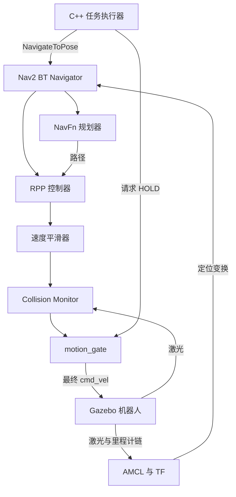

# ROS 2 第八周完整自学讲义：项目交付、独立复现与八周结课

> 承接《ROS2-Week7-Complete-Guide.md》，这是原八周基础计划的最后一周。
>
> 环境继续使用 Ubuntu 24.04、ROS 2 Jazzy、Gazebo Harmonic、C++17。
>
> 本周约 **12～16 小时**，前提是第七周已经实际验收通过。目标是把已有仿真导航和 C++ 多目标任务整理成可以构建、复现、解释和展示的第三个机器人项目。
>
> 本文中的 Bash、ROS 命令都在你的 **Ubuntu 终端**执行；Windows 只用于阅读、编辑或观看视频。文档生成完成不代表你已经做完项目。

<a id="contents"></a>
## 阅读导航

- [本周定位、安排与完成标准](#overview)
- [第 1 天：冻结功能，建立正式项目副本](#day1)
- [第 2 天：整理资源路径和启动入口](#day2)
- [第 3 天：执行最终验收，建立证据对应关系](#day3)
- [第 4 天：整理参数实验和项目结论](#day4)
- [第 5 天：完成 README、运行说明与源码归档](#day5)
- [第 6 天：从全新目录构建和复现](#day6)
- [第 7 天：录演示、项目讲解与八周结课](#day7)
- [附录 A：项目追问与答案要点](#questions)
- [附录 B：故障速查](#troubleshooting)
- [附录 C：结课后做什么](#next)
- [附录 D：资料与验证范围](#references)

<a id="overview"></a>
## 本周定位、安排与完成标准

### 0.1 第七周和第八周分别解决什么

第七周已经安排了受限恢复行为树、C++ 串行任务执行器、取消和超时处理、CSV 报告、两组前瞻距离实验。第八周把这些成果组成一个交付版本，让你能回答：别人拿到源码，怎样启动？发生故障时怎样停止？哪些结论有数据支持？哪些部分是自己写的？

你本周的正式项目可以命名为：

**中文：基于 ROS 2/Nav2 的差速机器人自主导航与多目标任务系统**  
**英文：ROS 2 Differential-Drive Navigation and Mission System**  
**目录建议：`03_ros2_navigation_mission_system`**

这是继“多线程机器人数据流水线”“差速运动学、里程计与 PID 仿真”之后的第三个完整项目。前两个项目不必为了本周再重写一次；本周工程仍沿用第七周的 Gazebo 仿真和 Nav2。

### 0.2 七天安排

这里的“天”是一个学习单元，不要求连续七个日历日。

| 天 | 主要任务 | 当天产出 | 净用时 |
|---|---|---|---:|
| 1 | 确认范围、保存基线、复制正式工程 | week8 工作空间、交付清单 | 1.5～2 小时 |
| 2 | 安装资源、统一地图和参数入口 | `robot_project_bringup`、启动清单 | 2.5～3 小时 |
| 3 | 构建、已有测试、正常与故障验收 | 最终验收表、日志、CSV | 2～2.5 小时 |
| 4 | 复算第七周实验，明确指标口径 | 实验报告、配置选择说明 | 1～1.5 小时 |
| 5 | README、运行手册、版本和归档 | 可交付源码、文档 | 1.5～2 小时 |
| 6 | 在另一目录重新构建和运行 | 复现记录、遗漏修复 | 1.5～2 小时 |
| 7 | 录制演示、准备讲解、结课自测 | 视频、讲稿、最终检查表 | 2～3 小时 |

合计 **12～16 小时**。按每天 2 小时约需 6～8 个学习日；每天 3～4 小时约需 3～6 个学习日。环境下载、编译等待和前几周未完成的故障排查另算。

### 0.3 本周沿用的接口

| 内容 | 本周约定 |
|---|---|
| 工作空间 | `~/ros2_week8_ws` |
| 已有包 | `gazebo_robot_lab`、`mapping_lab`、`navigation_lab`、`mission_lab` |
| 新增的组织包 | `robot_project_bringup`，仅放入口和交付配置 |
| ROS 域 / Gazebo 分区 | `42` / `ros2_week8_lab` |
| 世界 / 机器人内部名称 | 保留 `week5` / `week5_bot` |
| 地图 | `room_final.yaml` 和配套 `room_final.pgm` |
| 导航 Action | `/navigate_to_pose` |
| 任务取消 | `/mission/cancel`，`std_srvs/srv/Trigger` |
| 软件停车锁 | `/motion_gate/set_hold`，`std_srvs/srv/SetBool` |
| 最终速度发布者 | `motion_gate` 独占 `/cmd_vel` |
| 行为树 | `nav_clear_wait_once.xml` |
| 默认任务 | 已在第七周验证的 `mission.txt` |

速度路径保持：`/cmd_vel_nav → /cmd_vel_smoothed → /cmd_vel_checked → /cmd_vel`。任务执行器只发 Action 目标；最终速度仍经过原有保护链。

地图、任务点、控制器、行为树、机器人模型保持第七周已验证版本。没有证据说明 `look060` 更合适，就继续采用 `look045`；本周不再开展新的算法比较。

### 0.4 最终必须交出的六样东西

1. 源码和运行资源：别人不需要你的 `build/`、`install/` 就能重建。
2. README 和运行手册：说明环境、构建、初始化、执行、停止和排错。
3. 验收证据：正常任务、不可达、取消、超时、输入错误的实际结果。
4. 参数实验报告：能从第七周原始数据复算，不只贴结论。
5. 一份完整任务演示，以及一段取消或失败停止演示。
6. 一份能讲 5～8 分钟的项目介绍，能区分自己编写与框架提供的内容。

完成这些且通过第六天的复现，就可以结束原八周基础计划。后面的 EKF、ros2_control、实车等属于下一阶段。

<a id="day1"></a>
## 第 1 天：冻结功能，建立正式项目副本

### 1.1 开工门槛

先检查第七周是否已经做到以下事项：

- `mission_runner` 在你的 Jazzy 中真实构建过；纯 C++ 测试通过。
- 正常路线能串行执行；失败或停止请求后不再发送后续点。
- 能主动取消，能解释 Action 终态和 HOLD 的区别。
- 两组前瞻距离各有至少三次独立尝试，或已明确记录还缺哪些试验。
- 已保存对应任务文件、BT、参数、地图、报告和日志。

缺少前四项时，先完成第七周相应部分。第八周的 12～16 小时估算不包含重新编写整个任务执行器。

### 1.2 写下版本范围

在新项目的 `docs/scope.md` 中最终写明：

```markdown
# 交付范围

## 本版本包含
- Jazzy + Harmonic 中的差速机器人仿真。
- 已保存地图上的 AMCL 定位与 Nav2 导航。
- NavFn 规划、RPP 跟踪和一棵受限恢复行为树。
- C++ 多目标串行执行、主动取消、墙上时间超时与 CSV 报告。
- 速度平滑、Collision Monitor 与最终 motion_gate。
- 功能验收、前瞻距离实验和复现说明。

## 当前边界
- 单机器人、单机、固定测试场景。
- 需要手动设置初始定位，并检查后手动解除 HOLD。
- 任务失败后结束，不自动跳点、不自动断点续跑。
- 本版本的验证对象是仿真系统。
- 尚未测得的定位精度、长期可靠性等不写成已实现指标。
```

这份范围说明会帮助你收尾：遇到“要不要顺便加个网页、换个控制器、接块开发板”，先记到后续计划，本周按这里交付。

### 1.3 复制已完成源码

先正常停止第七周的任务、导航、定位、仿真和回放，再在 Ubuntu 执行。下面命令要求 `ros2_week8_ws` 尚不存在，避免混入旧构建结果。

```bash
(
  set -e
  src_ws="$HOME/ros2_week7_ws"
  dst_ws="$HOME/ros2_week8_ws"
  test -d "$src_ws/src/mission_lab"
  test -f "$src_ws/maps/room_final.yaml"
  test -f "$src_ws/maps/room_final.pgm"
  if [ -e "$dst_ws" ]; then
    echo "ros2_week8_ws already exists; inspect it before continuing." >&2
    exit 1
  fi
  mkdir -p "$dst_ws"/{src,maps,baseline,docs,media,bags,reports/week7,reports/final}
  for pkg in gazebo_robot_lab mapping_lab navigation_lab mission_lab; do
    test -f "$src_ws/src/$pkg/package.xml"
    cp -a "$src_ws/src/$pkg" "$dst_ws/src/"
  done
  cp -a "$src_ws/maps/." "$dst_ws/maps/"
  cp -a "$src_ws/baseline/." "$dst_ws/baseline/"
  cp -a "$src_ws/reports/." "$dst_ws/reports/week7/"
)
```

若你的地图实际叫 `room_v1`，把整份操作中的地图名对应替换；不能把不匹配的 YAML 和 PGM 凑成一组。保留第七周工作空间，后面用来核对原始结果。

这里不复制 `build/`、`install/`、`log/`、`core_test_build/`。bag 可以继续保存在第七周目录，另在证据索引中写清位置；只复制需要展示的少量片段即可。

### 1.4 写两个可随目录迁移的环境脚本

保存工作空间根目录的 `setup_build.bash`：

```bash
# Source this file; do not execute it as a child process.
source /opt/ros/jazzy/setup.bash || return 1
export ROS_DOMAIN_ID=42
unset ROS_LOCALHOST_ONLY ROS_STATIC_PEERS
export ROS_AUTOMATIC_DISCOVERY_RANGE=LOCALHOST
export GZ_PARTITION=ros2_week8_lab
```

保存根目录的 `setup_run.bash`：

```bash
# Source this file from any directory.
_robot_w8_dir="$(cd -- "$(dirname -- "${BASH_SOURCE[0]}")" && pwd)"
source "$_robot_w8_dir/setup_build.bash" || return 1
if [ ! -f "$_robot_w8_dir/install/local_setup.bash" ]; then
  echo "Build this workspace before sourcing setup_run.bash." >&2
  unset _robot_w8_dir
  return 1
fi
source "$_robot_w8_dir/install/local_setup.bash"
unset _robot_w8_dir
```

`BASH_SOURCE[0]` 是当前脚本的路径，因此项目放到别的目录后，run 脚本仍能找到同目录的 install。调用时使用 `source`，因为我们需要修改当前终端环境。

注意：再次 source 一个新脚本不会可靠地清掉先前加载的所有旧工作空间路径。关闭旧终端；检查 `.bashrc`，取消其中自动 source week5/week6/week7 install 的行，再打开新终端。第六天还会检查实际包来源。

### 1.5 保存环境信息

本周只在已经能工作的 Jazzy/Harmonic 环境里整理项目，不在交付中途升级系统。执行：

```bash
cd ~/ros2_week8_ws
source ./setup_build.bash
date -Is > reports/final/preparation_time.txt
cat /etc/os-release > reports/final/os_release.txt
uname -m > reports/final/architecture.txt
g++ --version > reports/final/compiler.txt
cmake --version > reports/final/cmake.txt
dpkg-query -W 'ros-jazzy-*' 'gz-*' 'libgz-*' \
  > reports/final/package_versions.txt 2> reports/final/package_version_notes.txt
```

若某个包模式没有匹配项，检查 notes，不能仅凭这个命令的退出码认定 ROS 已坏。额外手工记下 VMware 的 CPU/内存分配、是否使用虚拟机和明显的仿真卡顿情况。

**当天验收：**新工作空间只有源码、资源、证据和文档；旧工作空间保留；范围明确；两个环境脚本没有写死 week7 安装路径。

[回到导航](#contents)

<a id="day2"></a>
## 第 2 天：整理资源路径和启动入口

### 2.1 为什么要增加 bringup 包

`bringup` 表示把各部分启动起来。新包负责“使用哪张地图、哪份参数、怎样调用原有 launch”，不改写导航算法，也不另起一套 mission_runner。

| 包 | 保留职责 |
|---|---|
| `gazebo_robot_lab` | 机器人、世界、仿真资源 |
| `mapping_lab` | 先前建图相关资源和功能 |
| `navigation_lab` | 定位、Nav2、motion_gate、原有启动文件 |
| `mission_lab` | C++ 任务逻辑、任务点、行为树和统计脚本 |
| `robot_project_bringup` | 正式地图、最终参数、统一启动入口 |

正式运行时由 ament 包索引找到 `install` 中的资源。输出的报告放在可写工作目录；不要往安装包的 share 目录写实验数据。

### 2.2 建立新包并复制正式资源

```bash
cd ~/ros2_week8_ws
mkdir -p src/robot_project_bringup/{launch,config,maps,rviz}
cp maps/room_final.yaml src/robot_project_bringup/maps/
cp maps/room_final.pgm src/robot_project_bringup/maps/
cp src/mission_lab/config/variants/nav2_look045.yaml \
  src/robot_project_bringup/config/nav2_final.yaml
```

默认命令采用 `look045`。若第七周证据支持 `look060`，在此改为复制 `nav2_look060.yaml`，并在 `docs/experiment.md` 写明选择依据。

打开正式地图 YAML，只把 `image:` 改成同目录相对文件名：

```yaml
image: room_final.pgm
```

保留 `resolution`、`origin`、`negate`、阈值和其他原字段不变。不要把这一行当成整个 YAML 覆盖保存。

如果第七周保存了自己的 RViz 文件，把它复制到新包的 `rviz/navigation.rviz`；否则使用 Nav2 默认文件：

```bash
source ~/ros2_week8_ws/setup_build.bash
if [ -f ~/ros2_week8_ws/src/navigation_lab/rviz/navigation.rviz ]; then
  cp ~/ros2_week8_ws/src/navigation_lab/rviz/navigation.rviz \
    ~/ros2_week8_ws/src/robot_project_bringup/rviz/navigation.rviz
else
  cp "$(ros2 pkg prefix --share nav2_bringup)/rviz/nav2_default_view.rviz" \
    ~/ros2_week8_ws/src/robot_project_bringup/rviz/navigation.rviz
fi
```

启动后确认 RViz 的 Fixed Frame 为 `map`，scan 和 map 正确显示。如果原 RViz 配置保存了本机绝对资源路径，也要改成项目可用的路径。

### 2.3 package.xml 与 CMakeLists.txt

保存 `src/robot_project_bringup/package.xml`：

```xml
<?xml version="1.0"?>
<package format="3">
  <name>robot_project_bringup</name>
  <version>1.0.0</version>
  <description>Reproducible entry points for the navigation mission project</description>
  <maintainer email="learner@example.com">learner</maintainer>
  <license>Apache-2.0</license>
  <buildtool_depend>ament_cmake</buildtool_depend>
  <exec_depend>ament_index_python</exec_depend>
  <exec_depend>launch</exec_depend>
  <exec_depend>launch_ros</exec_depend>
  <exec_depend>rviz2</exec_depend>
  <exec_depend>nav2_bringup</exec_depend>
  <exec_depend>gazebo_robot_lab</exec_depend>
  <exec_depend>mapping_lab</exec_depend>
  <exec_depend>navigation_lab</exec_depend>
  <exec_depend>mission_lab</exec_depend>
  <export><build_type>ament_cmake</build_type></export>
</package>
```

维护者信息换成自己的公开信息；许可证与工程实际选择一致。这里只是沿用第七周示例的声明，不能据此更改第三方素材的许可证。

保存 `src/robot_project_bringup/CMakeLists.txt`：

```cmake
cmake_minimum_required(VERSION 3.8)
project(robot_project_bringup)
find_package(ament_cmake REQUIRED)
install(DIRECTORY launch config maps rviz DESTINATION share/${PROJECT_NAME})
ament_package()
```

这行 install 的作用是把运行资源放入安装空间。即使编译出的 C++ 可执行文件存在，漏装地图、SDF 或 YAML，运行仍可能失败。

### 2.4 基础系统入口：仿真、定位、RViz

保存 `src/robot_project_bringup/launch/base.launch.py`：

```python
from pathlib import Path

from ament_index_python.packages import get_package_share_directory
from launch import LaunchDescription
from launch.actions import DeclareLaunchArgument, IncludeLaunchDescription
from launch.launch_description_sources import PythonLaunchDescriptionSource
from launch.substitutions import LaunchConfiguration
from launch_ros.actions import Node


def generate_launch_description():
    project = Path(get_package_share_directory('robot_project_bringup'))
    navigation = Path(get_package_share_directory('navigation_lab'))
    return LaunchDescription([
        DeclareLaunchArgument(
            'map', default_value=str(project / 'maps' / 'room_final.yaml')),
        IncludeLaunchDescription(PythonLaunchDescriptionSource(
            str(navigation / 'launch' / 'sim.launch.py'))),
        IncludeLaunchDescription(
            PythonLaunchDescriptionSource(
                str(navigation / 'launch' / 'localization.launch.py')),
            launch_arguments={'map': LaunchConfiguration('map')}.items()),
        Node(
            package='rviz2', executable='rviz2', name='project_rviz',
            arguments=['-d', str(project / 'rviz' / 'navigation.rviz')],
            parameters=[{'use_sim_time': True}], output='screen'),
    ])
```

该文件复用第七周已确认的 `sim.launch.py` 和 `localization.launch.py map:=...` 接口。它启动三个部分，但不表示 ROS 节点已经全部就绪。地图、时钟、TF 和生命周期检查通过后，才进入下一步。

沿用的子 launch 应已经启用仿真时间。外层 RViz 设置 `use_sim_time` 不会自动替子 launch 中的所有节点设置该参数；第三天要检查实际值。

### 2.5 导航入口：加载最终参数

保存 `src/robot_project_bringup/launch/navigation.launch.py`：

```python
from pathlib import Path

from ament_index_python.packages import get_package_share_directory
from launch import LaunchDescription
from launch.actions import DeclareLaunchArgument, IncludeLaunchDescription
from launch.launch_description_sources import PythonLaunchDescriptionSource
from launch.substitutions import LaunchConfiguration


def generate_launch_description():
    project = Path(get_package_share_directory('robot_project_bringup'))
    navigation = Path(get_package_share_directory('navigation_lab'))
    return LaunchDescription([
        DeclareLaunchArgument(
            'params', default_value=str(project / 'config' / 'nav2_final.yaml')),
        IncludeLaunchDescription(
            PythonLaunchDescriptionSource(
                str(navigation / 'launch' / 'nav.launch.py')),
            launch_arguments={'params': LaunchConfiguration('params')}.items()),
    ])
```

保持“基础系统 → 人工检查定位 → 导航 → 人工检查 → 任务”的顺序。固定延迟几秒不能证明 AMCL 已正确定位，本周保留检查步骤。

### 2.6 排查旧路径和遗漏资源

在工作空间执行：

```bash
cd ~/ros2_week8_ws
grep -RInE '/home/|ros2_week[567]_ws|expanduser|Path\.home' \
  src --include='*.py' --include='*.yaml' --include='*.rviz' \
  --include='*.sdf' --include='*.urdf' --include='*.xacro' \
  --include='CMakeLists.txt' --include='*.cpp'
```

`grep` 没匹配时返回 1，这本身不是构建失败。逐项判断命中的代码是否在运行时使用，注释和历史说明不用为了清零搜索结果而乱改。

| 发现的问题 | 修改方式 |
|---|---|
| launch 写死 `~/ros2_week6_ws/maps/...` | 保留外部 map 参数；默认值改为可找到的包资源或明确要求传参 |
| launch/SDF 引用旧工作空间的模型和世界 | 通过所属包 share 找资源，或修正该包已有资源搜索路径 |
| `navigation_lab` 自身地图默认值仍为 week6 | 正式入口已经显式传 map；同时在文档说明不要直接使用旧默认值 |
| 仿真 launch 写死旧分区环境变量 | 让它沿用外部 `GZ_PARTITION`，与 setup 脚本一致 |
| 地图 YAML 的 `image` 是绝对旧路径 | 改成同目录 `room_final.pgm` |
| 配置里引用旧 BT 或其他文件 | 使用安装目录中实际可读取的文件，或保留显式传参机制 |

包内资源路径的常见写法是：

```python
from pathlib import Path
from ament_index_python.packages import get_package_share_directory

package_share = Path(get_package_share_directory('gazebo_robot_lab'))
# 将这里的相对资源名替换成该包中已有的真实文件名。
# resource = package_share / 'worlds' / '实际文件名.sdf'
```

不要假设所有旧包都是 `ament_cmake`。CMake 包检查相应 `install(DIRECTORY ...)`；Python 包检查 `setup.py` 的 `data_files` 是否包含 launch、模型和配置。只补缺失项，保留原有构建逻辑。

`week5` 世界名和 `week5_bot` 模型名用于桥接、实体与插件配置，仍是有效内部标识；不要机械替换为 week8。

### 2.7 构建并检查安装空间

在新终端执行：

```bash
cd ~/ros2_week8_ws
source ./setup_build.bash
rosdep install --from-paths src --ignore-src --rosdistro jazzy -y
colcon build --symlink-install --packages-up-to robot_project_bringup \
  --cmake-args -DCMAKE_BUILD_TYPE=RelWithDebInfo -DBUILD_TESTING=ON
source ./setup_run.bash
ros2 pkg prefix robot_project_bringup
ros2 pkg prefix navigation_lab
ros2 pkg prefix mission_lab
ros2 launch robot_project_bringup base.launch.py --show-args
ros2 launch robot_project_bringup navigation.launch.py --show-args
```

三个包都应来自 week8。`--show-args` 用来检查入口参数，不会证明仿真启动成功。

如果 `rosdep` 未初始化，按你原来安装 ROS 时的方式初始化一次：`sudo rosdep init`，再 `rosdep update`；已有初始化文件就不要反复 init。若报依赖无法解析，先检查 `package.xml` 与网络/软件源，不删除依赖项来让命令假装通过。

`rosdep` 根据声明安装依赖。以前手工装过、却没写进 package.xml 的依赖，仍可能漏掉。核对原有 launch 使用的包、Gazebo 资源和脚本依赖，补回实际所属包。

确认任务和 BT 也已经安装：

```bash
mission_share="$(ros2 pkg prefix --share mission_lab)"
project_share="$(ros2 pkg prefix --share robot_project_bringup)"
test -f "$mission_share/config/mission.txt"
test -f "$mission_share/behavior_trees/nav_clear_wait_once.xml"
test -f "$mission_share/scripts/summarize_runs.py"
test -f "$project_share/maps/room_final.yaml"
test -f "$project_share/maps/room_final.pgm"
test -f "$project_share/config/nav2_final.yaml"
```

任何 test 返回非零，先修正安装规则再继续。保存 YAML/launch 后重新构建是可靠习惯；不要把 `--symlink-install` 对部分文件的即时生效当成完整安装验证。

**当天验收：**安装目录能找到地图、参数、任务、BT；包来源正确；两个入口能显示参数；运行资源不依赖旧工作空间的绝对路径。

[回到导航](#contents)

<a id="day3"></a>
## 第 3 天：执行最终验收，建立证据对应关系

### 3.1 先跑已有测试

```bash
cd ~/ros2_week8_ws
source ./setup_run.bash
colcon test --packages-select mission_lab --ctest-args --output-on-failure
colcon test-result --verbose
```

应查看退出码和测试结果；不能只看 build 成功。第七周的测试程序内部有 26 项检查，CTest/colcon 可能只显示一个测试程序通过，这不矛盾。没有发现任何测试时，检查 `BUILD_TESTING` 和第七周的 CMake 测试注册。

若需要确认程序的具体输出，执行：

```bash
ctest --test-dir ~/ros2_week8_ws/build/mission_lab -V
```

这些测试验证解析和串行状态约束，无法验证 AMCL、Nav2 Action 取消或实际停车；后面仍要运行仿真。

### 3.2 用正式入口启动

每个运行终端先执行 `source ~/ros2_week8_ws/setup_run.bash`。停止其他工作空间程序；ROS_DOMAIN_ID 相同的旧节点不会因为 Gazebo 分区不同就自动隔离。

**终端 A：基础系统。**

```bash
source ~/ros2_week8_ws/setup_run.bash
ros2 launch robot_project_bringup base.launch.py
```

等待 Gazebo 运行，RViz 地图显示，设置正确的 2D Pose Estimate，观察激光与地图对齐。保留原 `sim.launch.py` 的 motion_gate；不要额外手动启动第二个 gate。

**终端 B：检查定位。**

```bash
source ~/ros2_week8_ws/setup_run.bash
ros2 lifecycle get /amcl
ros2 param get /amcl use_sim_time
ros2 topic info /clock --verbose
ros2 topic echo /clock --once
ros2 run tf2_ros tf2_echo map base_link
```

AMCL 应 active，仿真时间为 true，`/clock` 只有预期时钟源且持续推进；TF 命令应能取得变换。用 Ctrl+C 结束 **tf2_echo 这个观察程序**；它不是任务客户端。仅有 TF 数字不证明定位正确，还要看 scan 与 map 对齐。

**终端 C：启动导航。**

```bash
source ~/ros2_week8_ws/setup_run.bash
ros2 launch robot_project_bringup navigation.launch.py
```

**终端 D：运行前检查。**

```bash
source ~/ros2_week8_ws/setup_run.bash
ros2 lifecycle get /bt_navigator
ros2 lifecycle get /controller_server
ros2 action info /navigate_to_pose
ros2 param get /bt_navigator use_sim_time
ros2 param get /controller_server use_sim_time
ros2 param get /controller_server FollowPath.lookahead_dist
ros2 param get /controller_server FollowPath.use_velocity_scaled_lookahead_dist
ros2 topic info /cmd_vel --verbose
ros2 topic echo /motion_gate/status --once --qos-durability transient_local
```

确认导航节点 active、Action 服务器存在、仿真时间为 true、lookahead 与最终 YAML 一致、固定前瞻仍为 false（参数 `use_velocity_scaled_lookahead_dist`），且 `/cmd_vel` 唯一发布者是 motion_gate。

`ros2 action info` 显示服务器数量，不能证明“没有活动目标”。本次从整套系统新启动，且未在 RViz 发目标、未启动其他导航客户端，才有明确的无旧目标起点。若上一轮终态未知，先按 3.7 恢复，不靠猜测继续。

### 3.3 给任务增加一个记录入口

这个脚本只是包装第七周已写好的程序，负责确定资源位置、创建独立报告目录、保存日志和退出码。

在根目录创建 `scripts/`，保存 `scripts/run_mission.bash`：

```bash
#!/usr/bin/env bash
set -eo pipefail

if [ "$#" -lt 1 ] || [ "$#" -gt 3 ]; then
  echo "Usage: bash scripts/run_mission.bash RUN_ID [MISSION_FILE] [DEADLINE_S]" >&2
  exit 2
fi
run_id="$1"
if [[ ! "$run_id" =~ ^[A-Za-z0-9_-]+$ ]]; then
  echo "RUN_ID must contain only letters, digits, underscores or hyphens." >&2
  exit 2
fi

project_root="$(cd -- "$(dirname -- "${BASH_SOURCE[0]}")/.." && pwd)"
source "$project_root/setup_run.bash"
mission_share="$(ros2 pkg prefix --share mission_lab)"
mission_file="$(realpath -e "${2:-$mission_share/config/mission.txt}")"
deadline_s="${3:-300.0}"
bt_file="$mission_share/behavior_trees/nav_clear_wait_once.xml"
test -f "$mission_file"
test -f "$bt_file"

mkdir -p "$project_root/reports/final"
run_dir="$project_root/reports/final/$run_id"
mkdir "$run_dir"  # Refuse an existing run directory.
cp -- "$mission_file" "$run_dir/mission_input.txt"
cp -- "$bt_file" "$run_dir/behavior_tree.xml"
date -Is > "$run_dir/start_time.txt"
printf '%s\n' "$deadline_s" > "$run_dir/deadline_s.txt"

set +e
ros2 run mission_lab mission_runner --ros-args \
  -p use_sim_time:=true \
  -p mission_file:="$mission_file" \
  -p report_file:="$run_dir/mission.csv" \
  -p variant:="$run_id" \
  -p deadline_s:="$deadline_s" \
  -p bt_xml:="$bt_file" \
  2>&1 | tee "$run_dir/runner.log"
pipeline_codes=("${PIPESTATUS[@]}")
set -e
printf '%s\n' "${pipeline_codes[0]}" > "$run_dir/runner_exit_code.txt"
printf '%s\n' "${pipeline_codes[1]}" > "$run_dir/tee_exit_code.txt"
date -Is > "$run_dir/end_time.txt"
if [ "${pipeline_codes[1]}" -ne 0 ]; then
  echo "Log writing failed; this evidence set is incomplete." >&2
  exit 3
fi
exit "${pipeline_codes[0]}"
```

`PIPESTATUS[0]` 对应任务程序的退出码；`PIPESTATUS[1]` 对应 tee。单纯看到 tee 成功不能证明任务成功。脚本没有代替第七周程序的取消和 HOLD 逻辑，也没有设置进程被强杀后的自动恢复。

该入口**不会自动解除 HOLD**。每次确认定位、终态和速度链后，在运行任务前手动解锁。`RUN_ID` 已存在就换新编号；不要删除失败报告来复用名字。

第七周 `mission_runner` 正常完成全部点并确认 HOLD 时返回 0；停止或错误通常返回 2。故障测试返回 2 可以符合测试预期，仍须看具体状态和日志。

### 3.4 正常任务的完整流程

先保存实际运行参数：

```bash
ros2 param dump /controller_server \
  > ~/ros2_week8_ws/reports/final/controller_before_acceptance.yaml
ros2 param dump /amcl \
  > ~/ros2_week8_ws/reports/final/amcl_before_acceptance.yaml
```

在终端 D 中确认无旧目标后执行：

```bash
ros2 service call /motion_gate/set_hold std_srvs/srv/SetBool '{data: false}'
```

检查服务回复成功。然后终端 E：

```bash
source ~/ros2_week8_ws/setup_run.bash
cd ~/ros2_week8_ws
bash scripts/run_mission.bash normal01
```

程序结束后，在终端 D 观察：

```bash
ros2 topic echo /motion_gate/status --once --qos-durability transient_local
ros2 topic echo /cmd_vel
```

连续观察约 2～3 秒零速度，且 Gazebo 实体停稳，之后结束 echo。若发布停止、数据不再更新，不能把“屏幕还停留在旧的零”当成新鲜停车证据；回看话题和 gate 是否仍工作。

检查 `reports/final/normal01/`：任务点数与 CSV 行数一致、顺序一致、每点 `SUCCEEDED` 且 stop_reason 为空、日志有 HOLD 确认、任务退出码为 0。截图或录像应能关联到本次编号。

最后的“零速度 + 停稳”观察记录到验收表，因为 CSV 本身没有完整证明这个事实。

### 3.5 最终验收矩阵

沿用第七周的任务文件。每次测试前确认上一轮已知终态和停车；不可达/超时用例需要相同或明确记录的物理起点时，正常关闭并重启整套系统，再重新定位。

| 编号 | 测试与输入 | 操作 | 通过条件 |
|---|---|---|---|
| N01 | 正常 `mission.txt` | 完整执行一次 | 全部点顺序成功；HOLD 确认；最终零速度与停稳 |
| F01 | `mission_unreachable.txt` | A → 地图外 BAD → C | BAD 非成功；C 未发送，记 skipped；任务结束并停车 |
| F02 | 正常可达任务 | 在运动途中调用取消服务 | 记录 USER_CANCEL；当前目标终态确认；不发后续点；停车 |
| F03 | `mission_timeout.txt` | deadline 设 0.5 秒 | 触发 DEADLINE；保留真实终态；后续不执行；停车 |
| F04 | 缺字段输入 | 输入 `A 1.0 2.0` | 发目标前拒绝，无 SEND；日志指出解析问题 |
| P01 | 新目录与安装资源 | 第六天重新构建运行 | 不调用旧工作空间；资源齐全；正常任务通过 |

正常、不可达、取消、超时四项需要在**最终代码和最终配置**上复验。第七周已做过的输入错误测试，本周只选一个代表用例确认包装没有改变行为。不额外扩张成几十个新故障场景。

不可达测试的调用例子：

```bash
mission_share="$(ros2 pkg prefix --share mission_lab)"
# 先在另一终端完成运行前检查和手动解锁。
bash ~/ros2_week8_ws/scripts/run_mission.bash unreachable01 \
  "$mission_share/config/mission_unreachable.txt" 300.0
```

超时测试：

```bash
mission_share="$(ros2 pkg prefix --share mission_lab)"
# 从已确认的远离该目标的起点开始；先检查并解锁。
bash ~/ros2_week8_ws/scripts/run_mission.bash timeout01 \
  "$mission_share/config/mission_timeout.txt" 0.5
```

取消测试：先检查、解锁，再运行 `bash scripts/run_mission.bash cancel01`；机器人运动时在另一个已加载环境的终端调用：

```bash
ros2 service call /mission/cancel std_srvs/srv/Trigger '{}'
```

服务回复成功只表明请求被任务程序记录。继续等 Action 终态和 HOLD，检查后续点未发送。若取消时恰好到点，可能是 `SUCCEEDED + USER_CANCEL`；保留真实结果，外层仍应停止。

输入错误测试不需要解锁：

```bash
mkdir -p ~/ros2_week8_ws/test_inputs
printf '%s\n' 'A 1.0 2.0' > ~/ros2_week8_ws/test_inputs/invalid_missing_yaw.txt
bash ~/ros2_week8_ws/scripts/run_mission.bash invalid01 \
  ~/ros2_week8_ws/test_inputs/invalid_missing_yaw.txt 300.0
```

输入在创建报告前就失败时，可能根本没有 `mission.csv`；runner.log、输入文件和退出码仍应保留。这是输入拒绝的证据，不是漏填几行就该手工补造 CSV。

### 3.6 写清证据索引

创建 `docs/acceptance.md`，按照真实观察填写：

```markdown
# 最终验收记录

源码版本/校验清单：____
最终参数文件与 SHA256：____
地图、任务、BT 版本：____
测试日期与运行环境：____

| 编号 | 实际结果 | 通过/未通过 | 原始证据 | 仍需处理的问题 |
|---|---|---|---|---|
| N01 | 待实测 | 待验收 | reports/final/normal01/ | |
| F01 | 待实测 | 待验收 | reports/final/unreachable01/ | |
| F02 | 待实测 | 待验收 | reports/final/cancel01/ | |
| F03 | 待实测 | 待验收 | reports/final/timeout01/ | |
| F04 | 待实测 | 待验收 | reports/final/invalid01/ | |
| P01 | 第六天填写 | 待验收 | docs/reproduction.md | |

## 停车观察
每次分别记录：终态、HOLD 回复、最终 cmd_vel 是否持续为零、实体是否停稳。
观察人/日期：____

## 已知问题
现象：____
复现步骤：____
已有证据：____
影响与临时处理：____
```

不要只填一个总的“全部通过”。比如 F02 的记录可以写“当前目标 CANCELED，停止原因 USER_CANCEL，后续 B/C/HOME 未发送；HOLD 确认；观察 3 秒零速度，实体停稳”，再链接到真实日志。

### 3.7 终态未知时怎样处理

| 当前证据 | 处理 |
|---|---|
| 终态确认、HOLD 确认、停稳 | 可以准备下一次独立试验 |
| `UNCERTAIN` 或 goal 确认超时，HOLD 确认 | 保持锁定，停止并重启导航；本周建议整套重新启动后再验收 |
| HOLD 未确认 | 在另一个工作的终端请求 HOLD 并检查；无法确认时停止本次仿真 |
| 任务客户端被 Ctrl+C/强杀 | 不推断服务端已取消；检查并恢复到已知状态 |

请求锁定的命令是：

```bash
ros2 service call /motion_gate/set_hold std_srvs/srv/SetBool '{data: true}'
```

正常退出顺序：有活动任务先取消并等待 → 确认终态和 HOLD、停稳 → 停止导航终端 C → 关闭基础系统终端 A。如果状态未知，先锁住，再停止任务/导航并重启整套系统。不要先单独杀掉最终 gate 再让上游继续发命令。

**当天验收：**已有核心测试通过；五个功能用例有可定位的证据；每项停车单独确认；未知状态按问题记录，不能写成通过。

[回到导航](#contents)

<a id="day4"></a>
## 第 4 天：整理参数实验和项目结论

### 4.1 使用第七周已有数据

本周对第七周原始实验做整理和复算。若数据完整，不需要为了换成 week8 文件夹再重跑全部六次。注明实验来自第七周、使用当时的源码/配置；第三天的最终版本验收单独记录。

在 week8 中执行：

```bash
cd ~/ros2_week8_ws
source ./setup_run.bash
mission_share="$(ros2 pkg prefix --share mission_lab)"
set -o pipefail
python3 "$mission_share/scripts/summarize_runs.py" \
  --mission "$mission_share/config/mission.txt" \
  reports/week7/look045_run01.csv \
  reports/week7/look045_run02.csv \
  reports/week7/look045_run03.csv \
  reports/week7/look060_run01.csv \
  reports/week7/look060_run02.csv \
  reports/week7/look060_run03.csv \
  | tee reports/final/week7_summary.txt
```

任务文件必须是第七周实验实际使用的那份。若你后来修改过路线，改用保存的原始任务快照，并说明来源；不能拿不同路线的报告混算。

脚本提示字段损坏、空报告或路线不符时，先保留原件、找出原因、写入实验台账。不要删掉出错文件后只统计成功文件。缺少试验就明确补齐缺少的次数，所需时间另计。

### 4.2 三个比例与两个时间

| 指标 | 计算口径 | 说明 |
|---|---|---|
| 整条任务完成比例 | 完整成功任务数 / 全部纳入尝试数 | 任务中任何点失败或中止都不算整条完成 |
| 已尝试目标成功比例 | SUCCEEDED 点数 / 实际尝试点数 | 不包含 skipped，容易掩盖后续未执行点 |
| 计划目标完成比例 | SUCCEEDED 点数 / 所有计划点数 | 把未执行和缺行的影响保留下来 |
| 成功路线目标 wall 时间和的中位数 | 每条完整成功路线先求各点 wall_s 之和，再取中位数 | 不包含点间等待与最后 HOLD 调用 |
| 成功路线目标 sim 时间和的中位数 | 同上，使用有效 sim_s | 与墙上耗时含义不同 |

例如某条计划有 4 个点，前两点成功、第三点失败、第四点 skipped，那么整任务为 0/1，已尝试目标成功为 2/3，计划目标完成为 2/4。**这是解释口径的例子，不是你的实测数据。**

第七周脚本按 Action `SUCCEEDED` 计入点成功；若同一行还有 USER_CANCEL 等 stop_reason，则不能据此认定整条任务正常完成。终态与停止意图两个字段都要保留。

### 4.3 完整实验报告模板

保存 `docs/experiment.md`：

```markdown
# 固定前瞻距离对比

## 问题
在同一地图、机器人、目标序列和 BT 下，RPP 的 lookahead_dist
从 0.45 m 改为 0.60 m，对本场景任务完成和耗时有什么影响？

## 条件
- 实验工作空间/源码版本：____
- 地图与 SHA256：____
- 任务文件与 SHA256：____
- BT 文件与 SHA256：____
- 速度、时间上限、目标容差：____
- use_velocity_scaled_lookahead_dist：false
- 起点复位方式：____
- 初始定位设置和等待条件：____
- 运行顺序：____
- 硬件/虚拟机环境：____

## 尝试台账
| 组别/编号 | 有效/无效 | 整任务结果 | 报告路径 | 异常与说明 |
|---|---|---|---|---|
| look045/01 | 待填 | 待填 | reports/week7/look045_run01.csv | |
| look045/02 | 待填 | 待填 | reports/week7/look045_run02.csv | |
| look045/03 | 待填 | 待填 | reports/week7/look045_run03.csv | |
| look060/01 | 待填 | 待填 | reports/week7/look060_run01.csv | |
| look060/02 | 待填 | 待填 | reports/week7/look060_run02.csv | |
| look060/03 | 待填 | 待填 | reports/week7/look060_run03.csv | |

## 汇总
| 指标 | look045 | look060 |
|---|---|---|
| 完整任务/尝试数 | 待实测 | 待实测 |
| 成功目标/已尝试目标 | 待实测 | 待实测 |
| 成功目标/计划目标 | 待实测 | 待实测 |
| 成功路线各目标 wall 时间和中位数/s | 待实测 | 待实测 |
| 成功路线各目标 sim 时间和中位数/s | 待实测 | 待实测 |

## 结论
原始数据说明：____。
综合完成比例、停止情况和耗时，最终保留 ____。
若不能证明稳定收益，明确写“当前证据不足以证明收益，保留原配置”。

## 局限
每组至少三次的小样本；手动定位和 AMCL 随机性；仿真负载差异。
时间统计仅包含完整成功路线，存在成功样本筛选偏差。
结论适用当前场景与配置，尚未验证其他场景和实物。
```

若有无效启动，写清不满足哪个事先约定条件、为何不纳入比较，以及是否补测。有效条件下发生导航失败是实验结果，不能为了成功率好看改称无效。

### 4.4 可以说到哪一步

| 你手中的证据 | 可以写的结论 | 还缺什么才能扩大结论 |
|---|---|---|
| 有三次完整成功运行 | 本场景下三次任务均完成 | 更多次数、更多地图和条件 |
| 成功路线 wall 时间更短 | 本次成功样本中的目标耗时和较小 | 完成率、重复性、负载控制 |
| AMCL 估计位姿接近目标 | 估计位姿到点偏差较小 | 对齐后的独立真值才能谈真实定位误差 |
| 取消后锁定且实体停稳 | 本次仿真取消与停车流程通过 | 实物执行链与独立停止机制验证 |
| 某参数看起来转弯更平顺 | 可以记录定性观察 | 明确平滑度定义和同条件采样 |

暂不制作没有数据的精度图。若已有第七周曲线，可附图并写清坐标、单位、样本和数据来源；不要让图表替代原始报告。

**当天验收：**汇总可复算；成功/失败/无效有明确口径；最终参数与报告一致；没有填入未测得的数字。

[回到导航](#contents)

<a id="day5"></a>
## 第 5 天：完成 README、运行说明与源码归档

### 5.1 交付目录应该包含什么

下表以工作空间根目录为基准。正式放入总项目仓库时，可把这一层命名为 `03_ros2_navigation_mission_system`。

| 路径 | 内容 | 是否属于源码交付 |
|---|---|---|
| `src/` | 五个 ROS 包及运行资源 | 是 |
| `setup_build.bash`、`setup_run.bash` | 环境入口 | 是 |
| `scripts/run_mission.bash` | 任务执行与日志包装 | 是 |
| `maps/` | 原始地图副本；正式运行使用 bringup 中的地图 | 是，写清两者关系 |
| `baseline/` | 第六/七周已验证参数快照 | 是 |
| `test_inputs/` | 输入错误的代表用例 | 是 |
| `docs/scope.md` | 版本范围 | 是 |
| `docs/runbook.md` | 启动、检查、执行、停止、恢复步骤 | 是 |
| `docs/acceptance.md` | 功能验收与证据索引 | 是 |
| `docs/experiment.md` | 参数实验与局限 | 是 |
| `docs/reproduction.md` | 第六天的复现记录 | 是 |
| `docs/presentation.md` | 项目讲稿与追问 | 是 |
| `reports/week7/` | 原始参数实验、历史证据 | 保留必要小文件 |
| `reports/final/` | 最终验收、版本、日志、报告、校验值 | 是，控制体积 |
| `media/` | 截图与视频索引 | 小截图入库；大视频另存 |
| `bags/` | 代表性录包 | 另存，文档写位置与校验值 |
| `build/`、`install/`、`log/` | 本机生成的构建产物 | 不作为源码交付 |

最终地图由 `robot_project_bringup/maps/` 加载；原始 `maps/` 用于来源核对。修改 `image:` 可能改变 YAML 文件哈希，但不应改变 PGM、分辨率和 origin；在来源说明中记下这项路径修改。

### 5.2 README 可直接改写模板

将下面内容保存为根目录 `README.md`，用真实信息替换“待填写”。README 面向拿到工程的人，详细学习过程留在本讲义。

````markdown
# ROS 2 Differential-Drive Navigation and Mission System

基于 ROS 2 Jazzy、Gazebo Harmonic 和 Nav2 的差速机器人仿真项目。
在已保存地图上完成定位、导航和 C++ 多目标任务，支持取消、超时、
失败停止与结果记录。

## 演示和状态

- 完整任务视频：待填写
- 取消/失败停止视频：待填写
- 已验证环境与日期：待填写
- 当前验收状态：[验收记录](docs/acceptance.md)

## 我实现的部分

- 机器人与通信链的配置、地图资源整理和启动集成。
- C++ 任务文件解析、串行状态约束、NavigateToPose 客户端。
- 取消请求、墙上时间超时、终态分类、CSV 记录。
- motion_gate、受限恢复 BT 配置与对应验证。
- 重复参数实验、统计脚本和复现材料。

Nav2 提供 AMCL、规划/控制服务器和插件等能力；Gazebo 提供物理仿真。
具体分工以本仓库代码和个人实际实现为准。

## 环境

Ubuntu 24.04；ROS 2 Jazzy；Gazebo Harmonic；C++17。
需具备已配置好的 ROS/Gazebo 软件源和基础开发工具。
包版本见 reports/final/package_versions.txt。

## 构建

在工程根目录的新终端中执行：

```bash
source ./setup_build.bash
rosdep install --from-paths src --ignore-src --rosdistro jazzy -y
colcon build --symlink-install --packages-up-to robot_project_bringup \
  --cmake-args -DCMAKE_BUILD_TYPE=RelWithDebInfo -DBUILD_TESTING=ON
source ./setup_run.bash
colcon test --packages-select mission_lab --ctest-args --output-on-failure
colcon test-result --verbose
```

## 运行

每个终端进入本工程根目录并 source ./setup_run.bash。
确认旧工作空间程序已退出。

终端 A：

```bash
ros2 launch robot_project_bringup base.launch.py
```

在 RViz 设置正确初始位姿，检查激光与地图对齐。
确认 AMCL active、时钟推进、map 到 base_link 的 TF 可用。

终端 B：

```bash
ros2 launch robot_project_bringup navigation.launch.py
```

终端 C：检查 bt_navigator/controller_server active、仿真时间为 true、
运行参数正确、cmd_vel 唯一发布者为 motion_gate，且没有遗留目标。
详细命令见 [运行手册](docs/runbook.md)。

确认可以执行后，手动解锁并启动一次任务：

```bash
ros2 service call /motion_gate/set_hold std_srvs/srv/SetBool '{data: false}'
bash scripts/run_mission.bash demo01
```

检查解锁服务回复后再执行第二条。每次使用新的任务编号；输出位于
reports/final/demo01/。任务结束后检查 HOLD、持续零速度和实体停稳。

## 取消和停止

在另一个已加载环境的终端调用：

```bash
ros2 service call /mission/cancel std_srvs/srv/Trigger '{}'
```

等待当前 Action 终态，确认后续点未发送，再检查 HOLD 和实际停稳。
终态未知时保持 HOLD，重启在线系统后再使用。
客户端退出或收到取消服务回复都不能独立证明任务已结束。

## 任务、参数和地图

- 任务：mission_lab/config/mission.txt。
- BT：mission_lab/behavior_trees/nav_clear_wait_once.xml。
- 最终参数：robot_project_bringup/config/nav2_final.yaml。
- 正式地图：robot_project_bringup/maps/room_final.yaml 与 PGM。
- 上述文件位于各自包内，构建后通过包 share 路径加载。
- 修改源码资源后重新构建并重启受影响节点。
- 任务示例坐标只能用于当前地图上验证过的目标。

## 验收与实验

- [功能验收](docs/acceptance.md)
- [前瞻距离实验](docs/experiment.md)
- [独立目录复现](docs/reproduction.md)
- 原始 CSV 和日志：reports/。

## 当前限制

当前验证为单机、单机器人、固定场景仿真。
初始定位和解除 HOLD 需要人工检查；失败后不自动跳点或续跑。
参数实验样本量小；未验证实物定位精度和工业环境可靠性。
其他已知问题见验收记录。

## 来源和许可证

列出原有包、官方示例、第三方模型/素材来源和适用许可。
注明项目许可证；保留外部资源原有声明。
````

“我实现的部分”必须与实际工作一致。如果某段代码来自讲义或官方示例，你可以说明“参考示例实现并完成集成验证”，同时确保自己能解释和修改；不把参考实现包装成独立提出的算法。

### 5.3 运行手册与架构解释

把本讲义 3.2、3.4 和 3.7 中适合你最终工程的命令整理到 `docs/runbook.md`。保留确实执行过的命令，并补上你真实的起点、所选参数、故障恢复步骤。可在 README 中放以下架构图：



这是主要任务与运动链的概览，省略了生命周期管理、地图服务器和部分 TF 消费者；不是全量 ROS graph。地图、TF、costmap 的具体关系用下面的表讲清楚即可：

| 关系 | 提供者/含义 |
|---|---|
| `map → odom` | AMCL 提供的全局定位校正 |
| `odom → base_link` | 仿真差速里程计链提供连续局部运动估计 |
| 机器人固定外参 | robot_state_publisher 等提供机体与传感器连接 |
| 静态地图 | map server 加载保存的栅格地图 |
| 局部/全局 costmap | 为控制/规划提供相关环境代价信息 |

为什么不直接把 `map → base_link` 随便发布一份？因为 TF 同一子坐标系需要明确的父关系和来源；重复来源会造成冲突。全局校正与局部连续运动承担不同职责。

### 5.4 Git 忽略与证据管理

根目录保存 `.gitignore`，与已有规则合并：

```gitignore
/build/
/install/
/log/
/core_test_build/
/bags/
/artifacts/
/media/*.mp4
/media/*.mkv
/media/*.webm
__pycache__/
*.pyc
```

本项目的 `reports/final/*/runner.log` 是有用证据，不要用不加区分的 `*.log` 把它们全部忽略。大型视频和 bag 在 `media/index.md` 中记录文件名、存放位置、时长、对应运行编号和 SHA256。

若把本工程加入现有总仓库，放到 `03_ros2_navigation_mission_system/`，继续使用外层 Git 仓库，不在其中额外初始化嵌套仓库。若选择独立仓库，则只在项目根目录初始化一次。

在对应仓库中查看 `git status --short`，再只暂存确认要交付的源码和证据；提交说明可以写：`Complete reproducible ROS 2 navigation mission project`。远程地址使用你自己的现有仓库地址，不照抄不存在的示例地址。

### 5.5 保存校验清单

校验清单用于回答“验收时用的究竟是哪份代码和配置”，不能代替功能测试。

```bash
cd ~/ros2_week8_ws
find src scripts -type f ! -path '*/__pycache__/*' -print0 \
  | sort -z | xargs -0 sha256sum \
  > reports/final/runtime_source.sha256
sha256sum setup_build.bash setup_run.bash \
  >> reports/final/runtime_source.sha256
sha256sum -c reports/final/runtime_source.sha256
```

若生成清单后又修改了运行代码或资源，更新相关验收，再生成新清单；不能拿旧清单给新代码背书。修改 README 错别字通常不需要重新跑导航。

### 5.6 制作源码候选包

先创建后面两天要补充的文档文件，至少写下“待复现”和“待录制”及模板内容。然后检查是否有指向工程外部的软链接：

```bash
cd ~/ros2_week8_ws
find src scripts -type l -printf '%p -> %l\n'
```

若源文件本身通过软链接指向旧工作空间，应将所需文件实际纳入本工程，或明确声明外部依赖；不能依靠旧目录在场来通过交付验收。安装空间里的构建软链接不在本次归档范围。

生成供第六天使用的候选包：

```bash
(
  set -e
  cd ~/ros2_week8_ws
  archive="$HOME/ros2_week8_source_candidate01.tar.gz"
  test ! -e "$archive"
  tar --exclude='*/__pycache__' --exclude='*.pyc' \
    --exclude='media/*.mp4' --exclude='media/*.mkv' --exclude='media/*.webm' \
    -czf "$archive" \
    src maps baseline docs scripts reports test_inputs media \
    setup_build.bash setup_run.bash README.md .gitignore
  sha256sum "$archive" > "$archive.sha256"
)
```

如果顶层还有 LICENSE、NOTICE 等文件，把它们加入归档清单。候选包不包含 ROS 系统依赖和构建产物，复现者仍需准备相同基础环境。

**当天验收：**README 可指导运行；资源、代码、证据关系清楚；已生成候选源码包和校验值；没有把整个本机构建目录当成项目交付。

[回到导航](#contents)

<a id="day6"></a>
## 第 6 天：从全新目录构建和复现

### 6.1 今天在检查什么

同一目录反复运行容易掩盖绝对路径、未安装资源和旧环境依赖。今天从候选包解压到新目录，独立构建一次。

这能验证“同一台 Ubuntu、现有系统依赖下的独立目录复现”。没有真的换电脑或新装系统时，就不要写“已在全新机器完成部署验证”。

不需要删除第七/八周的 build 或源码；使用新目录即可。

### 6.2 解压到独立目录

先完成任务停止和停车确认，退出旧在线系统。执行：

```bash
(
  set -e
  archive="$HOME/ros2_week8_source_candidate01.tar.gz"
  check_ws="$HOME/ros2_week8_repro01_ws"
  test -f "$archive"
  sha256sum -c "$archive.sha256"
  test ! -e "$check_ws"
  mkdir "$check_ws"
  tar -xzf "$archive" -C "$check_ws"
)
```

查看解压后的 `src/`、`scripts/` 和文档是否齐全。候选包中应没有 build、install 和旧的构建缓存。

### 6.3 新终端只加载本次环境

打开新终端，确认启动配置没有自动加载旧工程，然后执行：

```bash
cd ~/ros2_week8_repro01_ws
source ./setup_build.bash
printf '%s\n' "${AMENT_PREFIX_PATH:-}" "${CMAKE_PREFIX_PATH:-}"
```

在构建前，这些路径不应包含 week5/week6/week7/week8 工作空间的 install；系统 Jazzy 路径是正常的。若仍有旧路径，修正终端启动配置并重新开终端，不继续污染本次构建。

```bash
rosdep install --from-paths src --ignore-src --rosdistro jazzy -y
colcon build --packages-up-to robot_project_bringup \
  --cmake-args -DCMAKE_BUILD_TYPE=RelWithDebInfo -DBUILD_TESTING=ON
source ./setup_run.bash
colcon test --packages-select mission_lab --ctest-args --output-on-failure
colcon test-result --verbose
```

这次有意不使用 `--symlink-install`：检查普通安装是否包含全部资源。该选项的行为见 [colcon 官方 build 文档](https://colcon.readthedocs.io/en/released/reference/verb/build.html)；测试汇总方式见 [test-result 文档](https://colcon.readthedocs.io/en/released/reference/verb/test-result.html)。

### 6.4 检查包确实来自新目录

```bash
for pkg in gazebo_robot_lab mapping_lab navigation_lab mission_lab robot_project_bringup; do
  ros2 pkg prefix "$pkg"
done
```

每个输出应位于 `~/ros2_week8_repro01_ws/install/` 中对应包的安装位置。任何一个仍指向旧工程，都不能算本次复现通过。

再检查输入校验清单：

```bash
cd ~/ros2_week8_repro01_ws
sha256sum -c reports/final/runtime_source.sha256
```

清单检查的是源码和脚本，构建本身不应偷偷修改它们。若发生差异，明确核对原因，不直接重生成清单掩盖变化。

### 6.5 只看 README 和运行手册完成一轮任务

本次每个终端都在 `~/ros2_week8_repro01_ws` 中加载 `source ./setup_run.bash`，不要继续使用讲义里写死 week8 路径的旧终端。

按 README：基础系统 → 设置定位 → 导航 → 检查 → 解锁 → 任务 → 停车确认。任务命令为：

```bash
bash scripts/run_mission.bash repro01
```

它应把结果写入新目录下的 `reports/final/repro01/`。只写对了输出路径还不够，还须结合 6.4 确认实际运行包来源。

以下任一情况都应该记录并修复：

- 忘了说明启动前必须设置初始定位。
- 命令需要读取旧目录中的地图/BT/模型。
- 必须手动 source 某个没有写进文档的工作空间。
- 依赖包未声明，只因本机以前装过才暂时成功。
- 安装目录找不到某个源码中的资源。
- README 中的任务命令缺少 use_sim_time 或报告路径。

修复写回主工程 `~/ros2_week8_ws`，不要只修复解压出来的临时副本。若修复影响运行资源或逻辑，更新校验清单和对应验证，生成 `candidate02`，在新的 `repro02_ws` 验证相关问题；不要覆盖已有记录。

### 6.6 复现报告模板

保存主工程的 `docs/reproduction.md`：

```markdown
# 独立目录复现

- 日期：____
- 候选包文件与 SHA256：____
- 原工程路径：____
- 复现工程路径：____
- 环境：同机已有 Jazzy/Harmonic / 其他实际环境，明确填写
- 是否采用普通安装：____
- 构建结果：____
- 核心测试结果：____
- 五个包的实际 prefix：____
- 地图、BT、任务、参数实际加载位置：____
- 完整任务结果、HOLD、零速度和停稳：____
- 本次日志和 CSV 位置：____

## 发现并修复的问题
问题：____
原因：____
主工程修改：____
重新验证结果：____

## 验证边界
若只在同机新目录验证，仍未覆盖新装系统和其他硬件环境。
```

把新目录的 `repro01/` 证据复制到主工程 `reports/final/repro01/`，目标不存在时再复制，保留其来源说明。若需要保留构建输出，可将对应新工作空间的 colcon 摘要作为小文件附入证据目录。

**当天验收：**新目录从源码构建、普通安装和任务运行成功；包来源正确；发现的问题写回主工程；复现记录明确说明环境边界。

[回到导航](#contents)

<a id="day7"></a>
## 第 7 天：录演示、项目讲解与八周结课

### 7.1 演示需要展示什么

制作两个小视频即可，不需要先学复杂剪辑。

| 视频 | 建议长度 | 必须能看见的内容 |
|---|---:|---|
| 完整任务 | 实际全程，另可导出 2～3 分钟展示版 | 初始状态、发送目标顺序、主要运动、全部终态、HOLD 与停稳、报告 |
| 取消或失败停止 | 30～90 秒或实际所需时间 | 触发操作、真实结果、后续不继续、停车证据 |

完整运行超过三分钟就保留完整原片；展示版可以加速，但标注倍速。不要剪掉失败过程后称其为“连续一次运行”。

画面安排：RViz 展示地图和路径，Gazebo 展示实体，旁边终端展示任务日志。录制前清理不相关窗口、调大终端字体，并核对显示的参数确实是正式版本。

用 `video01`、`video_cancel01` 等新编号运行，保存对应报告。视频的统计结论仍引用正式实验数据，不因为演示成功就把它混入 look045/look060 的受控比较。

在 `media/index.md` 中写明：

```markdown
# 演示索引

| 文件/链接 | 对应运行编号 | 内容 | 倍速/剪辑说明 | SHA256 |
|---|---|---|---|---|
| 待填写 | video01 | 完整任务 | 待填写 | 待填写 |
| 待填写 | video_cancel01 | 主动取消 | 待填写 | 待填写 |

地图、任务、最终参数、BT 与本版本保持一致。
```

若已有第七周成功/失败 bag，可以沿用并标明版本和运行编号。本周不要求为了交付再录制所有测试。需要补录时沿用已验证的 QoS 配置，并用 `ros2 bag info` 检查实际录入的话题、消息数和时长；QoS 覆盖与录放接口见 [rosbag2 Jazzy 官方说明](https://github.com/ros2/rosbag2/blob/jazzy/README.md)。

bag 回放用于观察记录数据，不等于重跑闭环任务。继续采用前几周的隔离回放流程：关闭在线仿真/导航，确保时钟来源唯一，只回放观察所需话题；不把保存的速度命令发送给在线机器人。

### 7.2 准备 5～8 分钟讲解

保存 `docs/presentation.md`，按下面顺序组织。讲清因果即可，不必背所有参数名字。

| 时间 | 讲什么 | 你需要说清楚的一句话 |
|---|---|---|
| 0:00～0:40 | 问题和成果 | 在已保存地图上，按多个目标执行导航，并处理失败、取消和超时 |
| 0:40～1:40 | 系统组成 | Gazebo、定位、Nav2、速度链、C++ 任务层各负责什么 |
| 1:40～3:00 | 自己写的核心逻辑 | 只有成功且无停止请求才推进；未知终态保持停止并恢复系统 |
| 3:00～4:00 | 一个实际故障 | 现象、假设、检查证据、修改和复验，而不是只说“调了参数” |
| 4:00～5:00 | 参数实验 | 同条件改一个值，保留失败，解释比例与时间口径 |
| 5:00～6:00 | 展示和复现 | 演示片段、CSV、README、独立目录构建记录 |
| 6:00～7:00 | 局限与下一步 | 当前验证覆盖什么，接下来解决哪一个问题 |

一个可改写的开场：

> 这个项目把差速机器人在固定室内地图上的导航组织成可重复的多目标任务。我使用 ROS 2 Jazzy、Gazebo Harmonic 和 Nav2，自己完成任务文件解析、串行 Action 客户端、取消与超时处理、CSV 记录和启动集成。重点是让成功、失败和停止都有明确状态与证据，并能从源码重新构建运行。

接着展示一个你实际处理过的故障。比如：

> 当时机器人有路径但不动。我先检查任务是否被接受，再依次看四段速度，发现最终 gate 处于 HOLD。上一轮任务结束会自动锁定，这是预期行为。我在确认旧目标结束、定位正常后解除锁定，再复验下一轮任务。现在 README 把这一检查写成明确步骤。

这只是讲述结构示例；只有你实际遇到过才能作为个人经历讲。没有遇到，就换成自己的真实问题。

### 7.3 简历可以怎样写

完成本周验收后，可把第三个项目写成两到三条。下面不含虚构指标：

**ROS 2 差速机器人自主导航与多目标任务系统**  
技术：C++17、ROS 2 Jazzy、Gazebo Harmonic、Nav2、CMake、Git

- 集成差速机器人仿真、AMCL 定位与 Nav2 导航，配置 NavFn/RPP、受限恢复行为树及速度保护链。
- 实现 C++ 多目标串行 Action 客户端，支持主动取消、超时、失败停止和 CSV 记录；完成正常与异常流程验收。
- 开展固定前瞻距离对照实验，整理原始结果、配置和复现材料；完成从独立目录构建与运行验证。

若一页放不下，保留前两条，把实验和复现写到项目链接的 README。任何性能数字都从实际报告中提取，并带上场景与样本口径；不写“精通 ROS 2 全栈”“工业级安全”或未测得的厘米级定位精度。

### 7.4 最终交付与检查表

- [ ] 最终源码可构建，已有核心测试确实执行并通过。
- [ ] 地图、模型、参数、任务、BT 和 RViz 资源可从安装空间找到。
- [ ] 最终 `/cmd_vel` 只有 motion_gate 发布，未增加旁路。
- [ ] 正常任务、不可达、取消、超时、输入错误有实际验收记录。
- [ ] 任务结束后的终态、HOLD、零速度和实体停稳分别检查过。
- [ ] 参数实验可从原始数据复算，失败与缺失记录没有被隐藏。
- [ ] 最终参数选择与实验结论一致。
- [ ] README 可以独立指导启动，运行手册包含停止和未知状态恢复。
- [ ] 新目录普通安装后成功运行，包 prefix 没有落回旧工程。
- [ ] 有完整任务视频和取消/失败停止视频，能对应日志和 CSV。
- [ ] 能讲清自己的代码与 Nav2/Gazebo 提供的能力。
- [ ] 能完成 5～8 分钟讲解，并回答附录中的核心问题。

全部关键项通过后，把 README 中“待填写”替换成真实结果，把验收表里的 P01 填完整，检查链接，更新源码版本和证据索引。

使用第 5.6 节同样的归档命令，将输出名改为 **`ros2_week8_source_release01.tar.gz`**，重新生成最终包和 SHA256。候选包保留为复现输入记录；最终包应包含补齐后的复现报告和视频索引。若只更新说明文档，不必重复全部仿真实验。

检查最终包内容：

```bash
tar -tzf ~/ros2_week8_source_release01.tar.gz
sha256sum -c ~/ros2_week8_source_release01.tar.gz.sha256
```

若使用 Git，提交最终源码和小型证据，并把实际 commit 写入交付记录；大视频、bag 的存放位置写进索引。不要把公开链接写成别人实际无权访问的私人路径。

### 7.5 什么时候算完成原计划

**本周关键验收通过，原八周 ROS 2 基础计划就结束。** 判断依据是工程与理解，不是文档数量或学习天数。

你此时应能：

1. 编写和构建基本 ROS 2 C++ 程序，使用话题、服务、Action、参数和 launch。
2. 理解仿真机器人、TF、里程计、地图、定位和导航各自的职责。
3. 在当前场景中完成建图成果的保存、定位导航与多目标任务组织。
4. 定位常见启动、路径、时间、任务状态和速度链问题。
5. 用代码、测试、日志、CSV、文档和演示说明项目结果。

这还不等于能独立实现 SLAM 优化、复杂规划器或直接交付实物系统。你已经有一个可继续深入的完整项目基础，可以带着它参加机器人软件、ROS 2 集成相关实习或竞赛的技术讨论；具体岗位要求仍需对照实际招聘信息。

没有通过的部分按缺项补齐即可，不必从第一周重新学。比如普通安装漏了 SDF，就补资源安装；取消逻辑仍不清楚，就回到第七周 run_one 和本周 F02，而不是再学一遍所有节点基础。

[回到导航](#contents)

<a id="questions"></a>
## 附录 A：项目追问与答案要点

下面问题用来检查理解。先自己回答，再看答案，每题通常讲 30～60 秒足够。

| 问题 | 回答要点 |
|---|---|
| 1. 你具体写了什么？ | 指向任务解析、Cursor、Action 客户端、停止流程、报告、gate 和集成文件；说明哪些参考了示例 |
| 2. 为什么多目标采用串行执行？ | 每次明确持有当前目标；前点终态和停止意图决定是否推进，便于跟踪与失败停止 |
| 3. 服务器接受目标是否代表成功？ | 接受只表示开始处理；是否成功看 Action 最终 result code |
| 4. 为什么不用距离反馈判断到达？ | 反馈是采样且用于观察；完成条件由服务器和目标检查器判定，客户端使用正式终态 |
| 5. 为什么成功后还检查 stop_reason？ | 取消/超时可能与成功竞争；有停止意图时不再发送下一点 |
| 6. 取消服务回复成功后是否可以立刻继续？ | 不可以；请求被记录、取消被接受、进入终态是不同阶段，还要检查 HOLD 和停稳 |
| 7. 为什么 HOLD 不等于取消？ | HOLD 锁最终速度；服务端可能仍有活动目标，解除锁定后可能继续发运动命令 |
| 8. 客户端被关闭后机器人一定停止吗？ | 不一定；服务端任务可能仍在运行，需要明确取消/锁定并确认状态 |
| 9. 为什么超时使用 steady_clock？ | 它适合度量经过时间；仿真暂停时 ROS 时间可能停止，不能让停止上限因此失效 |
| 10. 为什么同时记录 wall_s 和 sim_s？ | 区分实际等待和仿真时间；仿真负载影响两者关系，时间回跳时相关指标可能无效 |
| 11. 行为树是不是规划器？ | BT 组织何时规划、跟踪和恢复；路径由规划器计算，速度由控制器计算 |
| 12. 一次恢复是什么意思？ | RecoveryNode 允许一次恢复成功后的主分支重试；恢复自身失败时可以直接结束 |
| 13. 清 costmap 能否让墙消失？ | 不能删除物理墙和静态地图；相应图层/传感器会重新提供障碍信息 |
| 14. 为什么需要 map 和 odom 两层？ | odom 适合连续局部运动估计但可漂移；全局定位通过 map→odom 进行校正 |
| 15. 设置 2D Pose Estimate 是否把实体搬回起点？ | 不会；它设置定位初始估计。实体复位要通过仿真重启/明确的仿真复位流程 |
| 16. 为什么说最终速度只能有一个发布者？ | 使最后的速度锁能够控制实际执行输出；其他直接发布者会绕过该路径 |
| 17. 前瞻距离是否越大越好？ | 取决于路径曲率、场景和控制配置；本项目通过同条件小样本试验评估 |
| 18. 为什么成功耗时更短还不能直接宣布更好？ | 可能失败更多；耗时只来自成功样本，需要同时报告完成比例与局限 |
| 19. 为什么不提交 build 和 install？ | 它们依赖本机环境且可以生成；交付应包括可重新构建的源码、资源和依赖声明 |
| 20. 新目录构建通过证明了什么？ | 证明当前系统依赖条件下目录迁移和普通安装可复现，未自动证明跨机器兼容性 |
| 21. 最后反馈点能直接作为定位精度吗？ | 不能；时间可能早于最终停稳，来源也不是独立真值，需要明确坐标系与采样定义 |
| 22. 下一步准备解决什么？ | 从当前项目缺口选一个具体方向，例如仿真传感器融合、控制接口或嵌入式通信，说明验收目标 |

若只能背表里的关键词，回到相应代码画出执行顺序，再解释一个真实测试的日志。能够把状态、代码和证据对应起来，才是项目讲解的核心。

[回到导航](#contents)

<a id="troubleshooting"></a>
## 附录 B：故障速查

| 现象 | 第一项检查 | 常见原因与处理 |
|---|---|---|
| 找不到 bringup 包 | `ros2 pkg prefix robot_project_bringup` | 构建/环境没有加载当前工程；检查 package.xml 和 setup |
| 地图在源码中但运行找不到 | 查看包 share 中的 maps | CMake/data_files 漏装资源；重新构建 |
| 换目录后模型消失 | 搜索 SDF/launch 的绝对路径 | 资源仍指向旧工作空间或模型路径未声明 |
| AMCL active 但没有 map→odom | 初始位姿、scan、odom TF、时间 | active 不是定位已经收敛；先恢复数据和 TF 链 |
| 有路径但机器人不动 | HOLD 和四段速度话题 | 上次任务结束锁定；也可能 scan 超时或保护链触发 |
| 多个 cmd_vel 发布者 | `ros2 topic info /cmd_vel --verbose` | 旧 teleop、回放或其他节点仍运行；查明并退出重复源 |
| 自定义 BT 读取失败 | 服务端能否读取 BT 绝对路径 | 客户端路径存在不代表远程服务端可读；本周保持同机 |
| 报告目录已存在 | RUN_ID | 使用新编号，保留旧实验 |
| CSV 少行或不存在 | runner.log 和退出码 | 输入拒绝、异常退出、写入失败；按事实记录，不补造结果 |
| 任务看似成功，脚本却返回 2 | 最终 HOLD 和 stop_reason | 可能有停止竞争或 HOLD 未确认，不能只看单点 SUCCEEDED |
| 普通安装失败、symlink 模式能跑 | 检查实际安装的文件 | 漏装资源或源码路径依赖被软链接掩盖 |
| 参数文件改了但机器人行为没变 | `ros2 param get` 与包 prefix | 读到旧安装、未重启或修改了非当前加载文件 |
| 视频和 CSV 对不上 | 运行编号、任务文件、时间 | 引用了不同运行；用索引明确关联，不拼接成一条证据 |

排错写成五步：**现象 → 可检验的猜想 → 一项检查 → 观察证据 → 结论或下一项检查**。一次只改与当前证据相关的内容。

[回到导航](#contents)

<a id="next"></a>
## 附录 C：结课后做什么

第八周结束后，建议以你的自动化专业背景和现有两个 C++ 项目为基础，选一个机器人方向的小闭环继续深入。下表是学习路线建议，不是原八周计划新增的必做周次。

| 后续方向 | 从现有成果怎么接上 | 可验收的小目标 |
|---|---|---|
| 控制与 ros2_control | 理解控制接口，连接前面的差速运动学/PID 基础 | 在仿真中让差速控制接口稳定接收速度、输出里程计，解释更新周期与限幅 |
| 状态估计与 EKF | 复用里程计，补传感器坐标系、噪声和融合概念 | 用明确的仿真数据比较融合前后表现，分清估计与独立真值 |
| MCU 与 ROS 2 通信 | 结合你正在学的单片机 | 完成一种串口协议、编码器数据上报和超时处理，先从桌面通信验证开始 |
| 导航/控制算法深化 | 已有 Nav2 + RPP 项目可以作为实验平台 | 推导并实现一个简化跟踪控制器，在同样场景与已有结果比较 |

如果暂时没有实物底盘，不必为了结束本计划采购硬件。可以先选前两项中的一项，在仿真中做 2～4 周的小项目；具体时间以目标大小和基础为准。

对你而言，一个合理顺序是：**先把本周项目交付完并能讲明白，再在“控制接口”与“状态估计”里选一项深入，之后结合课程或战队条件接实物。** C++、Linux、Git 继续在项目中补缺，不必每次都从零重学。

可继续查阅的官方入口：

- [ros2_control Jazzy 文档](https://control.ros.org/jazzy/)
- [robot_localization 项目](https://github.com/cra-ros-pkg/robot_localization)
- [Nav2 文档](https://docs.nav2.org/)

选择具体实现时按 Jazzy 的文档/分支核对接口，先做一个验收清楚的小目标，再确定下一阶段详细计划。

[回到导航](#contents)

<a id="references"></a>
## 附录 D：资料与验证范围

### D.1 学习资料怎么用

本周主要资料是你自己的源码、原始实验数据和本讲义。遇到具体问题再查对应官方文档，不需要从头重刷一整套 ROS 2 课程。

| 资料 | 本周用途 |
|---|---|
| 用户提供的《ROS2-Week7-Complete-Guide.md》 | 包名、路径、任务接口、状态语义、CSV 统计、原计划第八周范围 |
| [colcon build](https://colcon.readthedocs.io/en/released/reference/verb/build.html) | 构建选项、安装方式 |
| [colcon test-result](https://colcon.readthedocs.io/en/released/reference/verb/test-result.html) | 已执行测试的结果汇总 |
| [rosbag2 Jazzy README](https://github.com/ros2/rosbag2/blob/jazzy/README.md) | 录制、查看、回放、QoS 覆盖 |
| [ROS 2 Jazzy：大型项目 launch](https://docs.ros.org/en/jazzy/Tutorials/Intermediate/Launch/Using-ROS2-Launch-For-Large-Projects.html) | 包资源和 launch 组织，作为补充阅读 |
| [ROS 2 Jazzy：rosdep](https://docs.ros.org/en/jazzy/Tutorials/Intermediate/Rosdep.html) | 依赖声明与安装，作为补充阅读 |

ROS 文档网站有时会显示访问验证或暂时无法打开，届时可以先按本机 `ros2 ... --help`、已安装包内容与官方仓库核对，不将不同发行版的参数混入工程。

### D.2 本讲义验证到哪里

编写时已对照第七周文档的接口与收尾约定，查阅可访问的 colcon、rosbag2 官方资料，并检查本讲义内 Bash/Python/XML 示例的静态语法和文档结构。

本讲义的编写环境没有你的 Ubuntu ROS/Gazebo 工程，**没有替你执行 Nav2 仿真、ROS 构建、动作取消或停车验收**。这些结果必须由你按第三天和第六天的步骤运行后填写。Python launch 的静态语法通过，也不代表其导入、子 launch 和运行资源已经在你的系统中验证。

第七周执行器的停止流程和当前 motion_gate 都沿用原实现；本周的整理不自动提升其能力或改变其验证范围。最终交付材料应准确反映你真正执行过的测试。

[回到导航](#contents)
